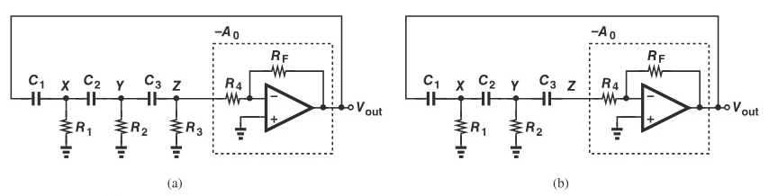

# 예제 13.9 — 연산 증폭기로 만든 위상 시프트 발진기 설계

## 원문
연산 증폭기를 이용해서 위상 시프트 발진기를 설계하라.

## 조건
- 연산 증폭기를 써서 위상 시프트 발진기를 구성
- 참고 회로 (본문 Fig 13.24(a)): 이득 $-A_0$ 증폭기(삼각형) 출력 $V_{out}$이 귀환선으로 돌아가 $C_1$–X–$C_2$–Y–$C_3$의 직렬 커패시터 사다리를 거치고, X, Y, $C_3$ 오른쪽 노드에서 각각 $R_1$, $R_2$, $R_3$가 접지로 내려간 뒤 그 마지막 노드가 증폭기 입력으로 들어가는 3단 RC 위상 시프트 루프 (원문에 없음)
- $C_1 = C_2 = C_3 = C$, $R_1 = R_2 = R_3 = R$일 때 RC 회로망의 전달 함수, 식 (13.32): $\dfrac{V_{out}}{V_{in}} = \dfrac{(RCs)^3}{(RCs)^3 + 6(RCs)^2 + 5RCs + 1}$ (본문 식, 원문에 없음)
- 식 (13.35): 발진 주파수 $\omega_1 = \dfrac{1}{\sqrt{6}RC}$ (본문 식, 원문에 없음)
- 식 (13.37): 증폭기 이득은 적어도 $A = 29$ (본문 식, 원문에 없음)

## 구할 것
- 연산 증폭기를 이용한 위상 시프트 발진기 회로 설계 (정할 것 예: 반전 증폭기 구성, 저항 배치) (원문에 없음, 원문은 "설계하라"만 적음)

## 상속·참조
- 본문 Fig 13.24 (교재 750쪽, 이 파일의 그림 목록에는 넣지 않음, 크롭은 fig13-24-a.png, fig13-24-b.png): (a) 위상 시프트 발진기 = 이득 $-A_0$ 증폭기(삼각형)와 3단 RC 회로망의 루프, (b) 루프를 끊은 위상 시프트 망. (b) 연결: `C1: Vin — X`, `R1: X — 0`, `C2: X — Y`, `R2: Y — 0`, `C3: Y — Vout`, `R3: Vout — 0`. (a)에서는 증폭기 출력 $V_{out}$이 $C_1$ 왼쪽으로 귀환되고 $R_3$ 노드가 증폭기 입력
- 식 (13.28)–(13.32): 출력에서 시작해 $R_3$ 전류를 $V_{out}/R$로 두고 거꾸로 계산 → $\dfrac{V_{out}}{V_{in}} = \dfrac{(RCs)^3}{(RCs)^3 + 6(RCs)^2 + 5RCs + 1}$
- 식 (13.33)–(13.35): 위상이 $180^\circ$가 되는 조건 $1 - 6R^2C^2\omega_1^2 = 0$ → $\omega_1 = 1/(\sqrt{6}RC)$
- 식 (13.36)–(13.37): $\omega_1$에서 회로망 이득은 $1/29$, 따라서 스타트업에 필요한 증폭기 이득 $A = 29$

## 회로 — 없음 (설계 문제, 그림은 풀이에만 있음)

## 답 (검증용)
- 연산 증폭기로 반전 증폭기($R_4$, $R_F$)를 구성한다 (Fig 13.25(a)). $R_4$가 노드 Z와 가상 접지 사이에 있어 $R_3$와 병렬로 보이므로 $R_3 \parallel R_4 = R_2 = R_1 = R$로 선택해야 앞의 유도 결과를 쓸 수 있다
- $R_3$를 무한대로, $R_4 = R$로 두면 Fig 13.25(b)의 토폴로지가 된다

### 정답 회로 — Fig 13.25(a)
```spice
C1  Vout  X     {C_1}
R1  X     0     {R_1}
C2  X     Y     {C_2}
R2  Y     0     {R_2}
C3  Y     Z     {C_3}
R3  Z     0     {R_3}
R4  Z     n1    {R_4}
RF  n1    Vout  {R_F}
XA  0     n1    Vout  opamp
```
- 단자: Vout = 출력 (개방 원)
- 표시: 노드 라벨 X, Y, Z (각 노드 위), V_out (출력 원 오른쪽) / 소자 라벨 C_1, C_2, C_3 (각 커패시터 위), R_1, R_2, R_3 (각 저항 오른쪽), R_4 (저항 위), R_F (저항 위), "−A_0" (점선 상자 왼쪽 위 바깥) / 부호 연산 증폭기 입력 − (위), + (아래) / 화살표 없음 / 수치·면적 라벨 없음
- 배치: 가로 신호선 왼쪽→오른쪽 C_1, X, C_2, Y, C_3, Z, R_4, 연산 증폭기 − 입력 / X, Y, Z에서 각각 R_1, R_2, R_3가 아래로 내려가 접지 / 점선 사각 상자("−A_0")가 R_4, R_F, 연산 증폭기를 둘러쌈 (R_3·Z는 상자 왼쪽 밖) / R_F는 − 입력 접속점에서 위로 올라가 오른쪽으로 가로질러 출력 접속점으로 내려옴 / + 입력은 짧은 가로선 끝에서 아래로 접지 / 출력선 오른쪽으로 상자 밖 접속점을 지나 V_out 원에서 끝남 / 그 접속점에서 귀환선이 위로 올라가 그림 맨 위를 왼쪽으로 가로질러 왼쪽 끝에서 내려와 C_1 왼쪽에 이어짐 / 접속점 (세 갈래 이상, 6곳): ① X = C_1 + C_2 + 아래 R_1 (점) ② Y = C_2 + C_3 + 아래 R_2 (점) ③ Z = C_3 + 오른쪽 R_4 선 + 아래 R_3 (점) ④ − 입력 = 왼쪽 R_4 + 오른쪽 − 입력 + 위 R_F (점) ⑤ 연산 증폭기 출력 = 왼쪽 출력 + 위 R_F + 오른쪽 출력선 (점, 상자 안) ⑥ 상자 밖 = 왼쪽 출력선 + 위 귀환선 + 오른쪽 V_out 원 (점) / 교차: 없음

### 정답 회로 — Fig 13.25(b)
```spice
C1  Vout  X     {C_1}
R1  X     0     {R_1}
C2  X     Y     {C_2}
R2  Y     0     {R_2}
C3  Y     Z     {C_3}
R4  Z     n1    {R_4}
RF  n1    Vout  {R_F}
XA  0     n1    Vout  opamp
```
- 단자: Vout = 출력 (개방 원)
- 표시: 노드 라벨 X, Y, Z (각 노드 위), V_out (출력 원 오른쪽) / 소자 라벨 C_1, C_2, C_3 (각 커패시터 위), R_1, R_2 (각 저항 오른쪽), R_4 (저항 위), R_F (저항 위), "−A_0" (점선 상자 왼쪽 위 바깥) / 부호 연산 증폭기 입력 − (위), + (아래) / 화살표 없음 / 수치·면적 라벨 없음
- 배치: (a)에서 R_3를 뺀 모양 / 가로 신호선 왼쪽→오른쪽 C_1, X, C_2, Y, C_3, Z(접속점 없이 라벨만), R_4, 연산 증폭기 − 입력 / X, Y에서 각각 R_1, R_2가 아래로 내려가 접지 / 점선 사각 상자("−A_0")가 R_4, R_F, 연산 증폭기를 둘러쌈 / R_F, + 입력 접지, 출력선과 귀환선은 (a)와 같음 / 접속점 (세 갈래 이상, 5곳): ① X = C_1 + C_2 + 아래 R_1 (점) ② Y = C_2 + C_3 + 아래 R_2 (점) ③ − 입력 = 왼쪽 R_4 + 오른쪽 − 입력 + 위 R_F (점) ④ 연산 증폭기 출력 = 왼쪽 출력 + 위 R_F + 오른쪽 출력선 (점, 상자 안) ⑤ 상자 밖 = 왼쪽 출력선 + 위 귀환선 + 오른쪽 V_out 원 (점) / 교차: 없음


