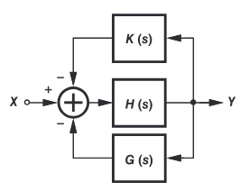

# 장말문제 13.2 — 귀환 경로가 K(s), G(s) 둘인 부귀환 시스템의 발진 조건

## 원문
A negative-feedback system is shown in Fig. 13.38. Under what conditions does the system oscillate?

## 조건
- 회로: Fig 13.38 부귀환 시스템 블록도 (순방향 $H(s)$, 출력 $Y$에서 덧셈기로 돌아가는 두 귀환 경로 $K(s)$, $G(s)$)
- 입력 $X$, 출력 $Y$, 덧셈기에서 $X$는 +, $K(s)$ 출력과 $G(s)$ 출력은 모두 −

## 구할 것
- 시스템이 발진하는 조건

## 회로 — Fig 13.38
```spice
XS  X   n2  n3  n1  sum   ; X +, n2(K(s) 출력) −, n3(G(s) 출력) −
XH  n1  Y   gain "H(s)"
XK  Y   n2  gain "K(s)"
XG  Y   n3  gain "G(s)"
```
- 단자: X = 입력 (개방 원) / Y = 출력 (선 끝, 화살촉에서 끝남)
- 표시: 노드 라벨 X (입력 원 왼쪽), Y (출력 화살촉 오른쪽) / 소자 라벨 K (s) (위 상자 안), H (s) (가운데 상자 안), G (s) (아래 상자 안), 덧셈기 ⊕ (라벨 없음) / 부호 + (덧셈기 왼쪽 입력 위), − (덧셈기 위 입력 왼쪽), − (덧셈기 아래 입력 왼쪽) / 화살표 신호 흐름 (라벨 없음, 모두 도선 위): X → 덧셈기 왼쪽 입력 (오른쪽), 덧셈기 → H(s) (오른쪽), H(s) 출력 접속점 → Y (오른쪽), 오른쪽 세로선 위 끝에서 → K(s) 오른쪽 입력 (왼쪽), 오른쪽 세로선 아래 끝에서 → G(s) 오른쪽 입력 (왼쪽), K(s) 왼쪽 출력에서 온 선 → 덧셈기 위 입력 (아래), G(s) 왼쪽 출력에서 온 선 → 덧셈기 아래 입력 (위) / 수치·면적 라벨 없음
- 배치: 세 상자가 한 세로줄로 위→아래 K(s), H(s), G(s) / 가운데 줄 왼쪽→오른쪽 X 원, 덧셈기, H(s), 접속점, Y / H(s) 출력 접속점을 지나는 오른쪽 세로선이 위로 K(s) 높이, 아래로 G(s) 높이까지 가서 각각 왼쪽으로 꺾여 상자 오른쪽에 들어감 / K(s) 왼쪽에서 선이 왼쪽으로 가다 아래로 꺾여 덧셈기 위로, G(s) 왼쪽에서 선이 왼쪽으로 가다 위로 꺾여 덧셈기 아래로 / 접속점 (세 갈래 이상, 1곳): H(s) 출력 = 왼쪽 H(s) + 오른쪽 Y 선 + 위 K(s) 귀환선 + 아래 G(s) 귀환선 (점) / 교차: 없음


