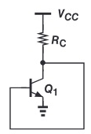

# 장말문제 13.3 — 컬렉터를 베이스에 되먹인 공통 이미터 단이 발진하지 않는 이유

## 원문
Consider the simple common-emitter stage shown in Fig. 13.39. Explain why this circuit does not oscillate.

## 조건
- 회로: Fig 13.39 간단한 공통 이미터 단 ($Q_1$, 컬렉터 저항 $R_C$), 컬렉터가 도선으로 베이스에 되먹임
- 소자 값은 주어지지 않음 (원문에 없음)

## 구할 것
- 이 회로가 발진하지 않는 이유 설명

## 회로 — Fig 13.39
```spice
RC  VCC  n1  {R_C}
Q1  n1   n1  0  npn
```
- 단자: VCC = 전원, 값 미지정 (T 전원 기호)
- 표시: 노드 라벨 V_CC (T 기호 오른쪽) / 소자 라벨 R_C (저항 오른쪽), Q_1 (트랜지스터 오른쪽, 이미터 위) / 부호 없음 / 화살표 없음 / 수치·면적 라벨 없음
- 배치: 한 세로줄 위→아래 V_CC T 기호, R_C, 컬렉터 접속점, Q1, 접지 / Q1 보통 방향(베이스 왼쪽, 컬렉터 위, 이미터 아래) / 컬렉터 접속점에서 선이 오른쪽으로 가서 아래로 내려가 그림 맨 아래(접지 기호보다 낮은 높이)에서 왼쪽으로 가로질러 왼쪽 끝에서 위로 올라가 베이스 높이에서 오른쪽으로 꺾여 베이스에 들어감 (Q1을 둘러싸는 사각 고리) / Q1 이미터 아래 접지 / 접속점 (세 갈래 이상, 1곳): 컬렉터 = 위 R_C + 아래 Q1 컬렉터 + 오른쪽 귀환선 (점) / 교차: 없음


