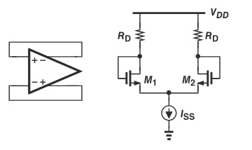

# 장말문제 13.4 — 부귀환 루프 안에 놓인 차동쌍의 발진 가능성

## 원문
A differential pair is placed in a negative-feedback loop as shown in Fig. 13.40. Can this circuit oscillate? Explain.

## 조건
- 회로: Fig 13.40 부귀환 루프 안의 차동쌍 (왼쪽 = 각 출력을 같은 쪽 입력으로 되먹인 완전 차동 증폭기 기호, 오른쪽 = 같은 구성의 트랜지스터 회로: 부하 $R_D$ 둘, $M_1$, $M_2$, 꼬리 전류원 $I_{SS}$, 각 게이트가 자기 드레인에 연결)
- 소자 값은 주어지지 않음 (원문에 없음)

## 구할 것
- 이 회로가 발진할 수 있는지와 그 이유

## 회로 — Fig 13.40
```spice
* 왼쪽: 완전 차동 증폭기 기호와 두 사각 귀환 고리
XA   n1   n2   n2   n1  fdopamp   ; 위 입력 "+" = n1, 아래 입력 "−" = n2, 위 출력 "−" = n1, 아래 출력 "+" = n2
* 오른쪽: 같은 구성을 트랜지스터로 그린 회로 (각 게이트가 자기 드레인에 연결)
RD1  VDD  n3   {R_D}   ; 인쇄 라벨 R_D (왼쪽)
RD2  VDD  n4   {R_D}   ; 인쇄 라벨 R_D (오른쪽)
M1   n3   n3   n5  nmos
M2   n4   n4   n5  nmos
ISS  n5   0              ; 인쇄 라벨 I_SS, 값 없음
```
- 단자: VDD = 전원, 값 미지정 (가로 레일) / 개방 단자 없음
- 표시: 노드 라벨 V_DD (레일 오른쪽 끝) / 소자 라벨 왼쪽 증폭기 기호 (라벨 없음), R_D (왼쪽 저항 왼쪽), R_D (오른쪽 저항 오른쪽), M_1 (M1 오른쪽, 소스 옆), M_2 (M2 왼쪽, 소스 옆), I_SS (전류원 오른쪽) / 부호 증폭기 삼각형 안 위 줄 "+ −" (왼쪽 + 는 위 입력, 오른쪽 − 는 위 출력), 아래 줄 "− +" (왼쪽 − 는 아래 입력, 오른쪽 + 는 아래 출력) / 화살표 없음 / 수치·면적 라벨 없음
- 배치: 왼쪽 그림 = 오른쪽을 향한 삼각형 기호 하나와 그 위·아래의 가는 사각 고리 둘 / 위 사각 고리는 삼각형 왼쪽 변의 위 입력에서 왼쪽으로 나가 위로 올라가 오른쪽으로 가로지른 뒤 내려와 왼쪽으로 꺾여 삼각형 위 빗변(위 출력)에 닿음, 아래 사각 고리는 같은 모양을 위아래 뒤집어 아래 입력과 아래 빗변(아래 출력)을 이음 / 삼각형 꼭짓점(오른쪽 끝)에는 선이 없음 / 오른쪽 그림 = 맨 위 V_DD 가로 레일에서 두 R_D가 좌우로 내려와 각 드레인 접속점 / M1(게이트 왼쪽, 보통 방향), M2(게이트 오른쪽, 좌우 반전) / M1 게이트에서 선이 왼쪽으로 나가 위로 올라가 오른쪽으로 꺾여 M1 드레인 접속점에, M2 게이트에서 선이 오른쪽으로 나가 위로 올라가 왼쪽으로 꺾여 M2 드레인 접속점에 / 두 소스가 아래에서 가로선으로 모여 꼬리 접속점, 그 아래 I_SS(화살표 아래), 접지 / 접속점 (세 갈래 이상, 3곳): ① M1 드레인 = 위 R_D + 아래 M1 드레인 + 왼쪽 게이트 귀환선 (점) ② M2 드레인 = 위 R_D + 아래 M2 드레인 + 오른쪽 게이트 귀환선 (점) ③ 꼬리 = 왼쪽 M1 소스 + 오른쪽 M2 소스 + 아래 I_SS (점) / 교차: 없음


