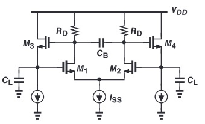

# 장말문제 13.6 — 소스 폴로어가 붙은 차동쌍 부귀환 루프의 발진 가능성

## 원문
A differential pair followed by source followers is placed in a negative-feedback loop as illustrated in Fig. 13.41. Consider only the capacitances shown in the circuit. Can this circuit oscillate? Explain.

## 조건
- 회로: Fig 13.41 차동쌍($M_1$, $M_2$, 부하 $R_D$ 둘, 꼬리 전류원 $I_{SS}$) 뒤에 소스 폴로어($M_3$, $M_4$, 각각 전류원 바이어스)를 두고, 각 폴로어 출력을 같은 쪽 차동쌍 게이트로 되먹인 부귀환 루프
- 두 드레인 사이 커패시터 $C_B$, 두 폴로어 출력에서 접지로 $C_L$
- 그림에 보인 커패시턴스($C_B$, $C_L$ 둘)만 고려 (괄호 안은 원문에 없음)
- 소자 값은 주어지지 않음 (원문에 없음)

## 구할 것
- 이 회로가 발진할 수 있는지와 그 이유

## 회로 — Fig 13.41
```spice
RD1  VDD  n1   {R_D}   ; 인쇄 라벨 R_D (왼쪽)
RD2  VDD  n2   {R_D}   ; 인쇄 라벨 R_D (오른쪽)
CB   n1   n2   {C_B}
M3   VDD  n1   n3  nmos
M4   VDD  n2   n4  nmos
M1   n1   n3   n5  nmos
M2   n2   n4   n5  nmos
CL1  n3   0    {C_L}   ; 인쇄 라벨 C_L (왼쪽)
CL2  n4   0    {C_L}   ; 인쇄 라벨 C_L (오른쪽)
I1   n3   0              ; 라벨·값 없음
I2   n4   0              ; 라벨·값 없음
ISS  n5   0              ; 인쇄 라벨 I_SS, 값 없음
```
- 단자: VDD = 전원, 값 미지정 (가로 레일) / 개방 단자 없음
- 표시: 노드 라벨 V_DD (레일 오른쪽 끝) / 소자 라벨 R_D (왼쪽 저항 왼쪽), R_D (오른쪽 저항 오른쪽), C_B (CB 아래), M_3 (M3 왼쪽, 소스 옆), M_4 (M4 오른쪽, 소스 옆), M_1 (M1 오른쪽, 소스 옆), M_2 (M2 왼쪽, 소스 옆), C_L (왼쪽 커패시터 왼쪽), C_L (오른쪽 커패시터 오른쪽), I_SS (가운데 전류원 오른쪽), I1, I2 (라벨 없음, 좌우 아래 전류원) / 부호 없음 / 화살표 없음 / 수치·면적 라벨 없음
- 배치: 맨 위 V_DD 가로 레일에서 왼쪽→오른쪽 M3 드레인, 왼쪽 R_D, 오른쪽 R_D, M4 드레인이 내려옴 / 가운데 두 R_D 아래 끝이 각 드레인 접속점(n1 왼쪽, n2 오른쪽), 두 접속점 사이 가로선 가운데에 C_B / M3는 게이트 오른쪽(좌우 반전), 게이트선이 오른쪽으로 n1에, 소스는 아래로 / M4는 게이트 왼쪽(보통 방향), 게이트선이 왼쪽으로 n2에, 소스는 아래로 / M1(게이트 왼쪽, 보통 방향) 드레인이 위로 n1, M2(게이트 오른쪽, 좌우 반전) 드레인이 위로 n2 / M3 소스 아래 접속점 n3에서 오른쪽 가로선이 M1 게이트로, 왼쪽 가로선이 왼쪽 끝에서 아래로 C_L, 접지 / n3에서 곧장 아래로 전류원(화살표 아래), 접지 / M4 쪽 n4도 좌우 대칭 (오른쪽 C_L, 전류원) / M1·M2 소스가 아래 가로선으로 모여 꼬리 접속점, 그 아래 I_SS(화살표 아래), 접지 / 접속점 (세 갈래 이상, 5곳): ① n1 = 위 R_D + 아래 M1 드레인 + 왼쪽 M3 게이트선 + 오른쪽 C_B (점) ② n2 = 위 R_D + 아래 M2 드레인 + 오른쪽 M4 게이트선 + 왼쪽 C_B (점) ③ n3 = 위 M3 소스 + 아래 전류원 + 왼쪽 C_L 선 + 오른쪽 M1 게이트선 (점) ④ n4 = 위 M4 소스 + 아래 전류원 + 오른쪽 C_L 선 + 왼쪽 M2 게이트선 (점) ⑤ 꼬리 = 왼쪽 M1 소스 + 오른쪽 M2 소스 + 아래 I_SS (점) / 교차: 없음


