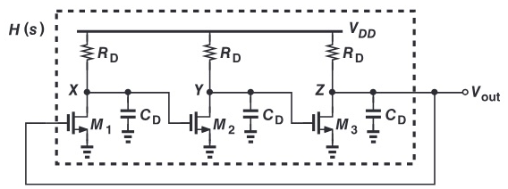

# 장말문제 13.9 — 3단 링 발진기에서 C_D를 두 배로 할 때

## 원문
Suppose in the ring oscillator of Fig. 13.8, the value of $C_D$ is doubled. How do the oscillation frequency and startup condition change?

## 조건
- 회로: Fig 13.8의 3단 링 발진기
- 참고 회로 (본문 Fig 13.8): 각 단이 저항 부하 $R_D$와 노드 커패시턴스 $C_D$를 가진 NMOS CS 단이고, 같은 단 세 개가 고리로 이어진 3단 링 발진기 (원문에 없음)
- 식 (13.3): 3단 링의 발진 주파수 $\omega_1 = \dfrac{\sqrt{3}}{R_D C_D}$ (본문 식, 원문에 없음)
- 식 (13.5)–(13.6): $g_m R_D = \sqrt{1 + R_D^2 C_D^2 \omega_1^2} = 2$, 발진이 시작하려면 각 단의 저주파 이득 $g_m R_D$가 2를 넘어야 함 (본문 식, 원문에 없음)
- 각 단의 $C_D$를 두 배로 함

## 구할 것
- 발진 주파수가 어떻게 바뀌는가
- 발진 시작 조건이 어떻게 바뀌는가

## 상속·참조
- 본문 13.2절 3단 링 발진기 해석 (교재 736–737쪽, Fig 13.8, $C_{GD}$ 무시)
  - 각 단의 전달 함수 ($\lambda = 0$): $-\dfrac{g_m R_D}{1 + R_D C_D s}$. 세 단이 같아 각 극점이 $60^\circ$씩 위상을 이동시켜야 함
  - 식 (13.2): $-\tan^{-1}(R_D C_D \omega_1) = -60^\circ$
  - 식 (13.3): $\omega_1 = \dfrac{\sqrt{3}}{R_D C_D}$
  - 식 (13.4): $\left(\dfrac{g_m R_D}{\sqrt{1 + R_D^2 C_D^2 \omega_1^2}}\right)^3 = 1$
  - 식 (13.5)–(13.6): $g_m R_D = \sqrt{1 + R_D^2 C_D^2 \omega_1^2} = 2$. 발진 시작에는 각 단의 저주파 이득이 2를 넘어야 함

## 회로 — Fig 13.8
```spice
RD1  VDD  X  {R_D}      ; 인쇄 라벨 R_D
M1   X    Z  0  nmos    ; 게이트 = 귀환선 (Z, V_out)
CD1  X    0  {C_D}      ; 인쇄 라벨 C_D
RD2  VDD  Y  {R_D}      ; 인쇄 라벨 R_D
M2   Y    X  0  nmos
CD2  Y    0  {C_D}      ; 인쇄 라벨 C_D
RD3  VDD  Z  {R_D}      ; 인쇄 라벨 R_D
M3   Z    Y  0  nmos
CD3  Z    0  {C_D}      ; 인쇄 라벨 C_D
```
- 단자: VDD = 전원, 값 미지정 (가로 레일) / Z = 출력 V_out (개방 원, Z 노드에서 오른쪽으로 이어진 선 끝) / X, Y, Z는 드레인 접속점 옆 라벨만 (원 없음)
- 표시: 노드 라벨 V_DD (레일 오른쪽 끝), X, Y, Z (각 드레인 접속점 왼쪽 위), V_out (개방 원 오른쪽) / 소자 라벨 R_D (세 저항 각각 오른쪽, 같은 라벨 세 번), M_1, M_2, M_3 (각 트랜지스터 오른쪽, 소스 옆), C_D (세 커패시터 각각 오른쪽, 같은 라벨 세 번), 점선 상자 라벨 H(s) (상자 왼쪽 위 바깥) / 부호 없음 / 화살표 없음 / 수치·면적 라벨 없음
- 배치: 점선 상자가 세 단 전체(VDD 레일, R_D, NMOS, C_D)를 둘러쌈 / 레일은 상자 안 위쪽을 가로지름 / 세 단이 왼쪽→오른쪽 M1, M2, M3 순으로 같은 모양: 위→아래 R_D, 드레인 접속점 (X/Y/Z), NMOS (게이트 왼쪽, 소스 아래 접지) / 각 드레인 접속점에서 가로선이 오른쪽으로 가다 C_D 접속점에서 C_D가 아래로 갈라지고 (C_D 아래 끝 접지), 가로선은 계속 오른쪽으로 가서 아래로 꺾이고 다음 단 게이트 높이에서 오른쪽으로 꺾여 게이트 (X → M2, Y → M3) / Z 가로선은 C_D 접속점을 지나 상자 오른쪽 변 밖으로 나가 접속점에서 오른쪽으로 V_out 개방 원, 아래로 귀환선 / 귀환선은 상자 아래 바깥을 왼쪽으로 가로질러 상자 왼쪽 바깥에서 위로 꺾이고, M1 게이트 높이에서 오른쪽으로 꺾여 상자 왼쪽 변을 지나 M1 게이트 / 접속점 (세 갈래 이상, 7곳): X, Y, Z = 위 R_D + 아래 드레인 + 오른쪽 가로선 (점), 각 C_D 위 = 왼쪽 + 오른쪽 가로선 + 아래 C_D (점, 3곳), 상자 밖 Z 선 = 왼쪽 Z + 오른쪽 V_out + 아래 귀환선 (점) / 교차: 없음 (Z 가로선과 귀환선이 점선 상자 변을 지나지만 상자는 도선이 아님)


