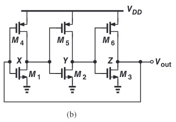

# 장말문제 13.15 — CMOS 인버터 3단 링 발진기의 발진 주파수와 시작 조건

## 원문
Derive the oscillation frequency and startup condition for the ring oscillator of Fig. 13.9(b). Consider the $C_{GS}$ of both NMOS and PMOS transistors and assume all transistors are in saturation.

## 조건
- 회로: Fig 13.9(b)의 3단 링 발진기 (CMOS 인버터 세 개)
- 커패시턴스는 NMOS와 PMOS 트랜지스터 모두의 $C_{GS}$를 고려
- 모든 트랜지스터는 포화 영역
- 참고 해석 (본문 13.2절): 두 트랜지스터가 포화 영역이면 각 단은 이득 $-(g_{mp} + g_{mn})(r_{Op} \parallel r_{On})$의 CMOS 인버터이고, Fig 13.8의 3단 해석은 각 단 전달 함수 $-\dfrac{g_m R_D}{1 + R_D C_D s}$로 $\omega_1 = \sqrt{3}/(R_D C_D)$, $g_m R_D = 2$를 얻음 (원문에 없음)

## 구할 것
- 발진 주파수
- 발진 시작 조건

## 상속·참조
- 본문 13.2절 3단 링 발진기 해석 (교재 736–737쪽, Fig 13.8, $C_{GD}$ 무시)
  - 각 단의 전달 함수 ($\lambda = 0$): $-\dfrac{g_m R_D}{1 + R_D C_D s}$. 세 단이 같아 각 극점이 $60^\circ$씩 위상을 이동시켜야 함
  - 식 (13.2): $-\tan^{-1}(R_D C_D \omega_1) = -60^\circ$
  - 식 (13.3): $\omega_1 = \dfrac{\sqrt{3}}{R_D C_D}$
  - 식 (13.4): $\left(\dfrac{g_m R_D}{\sqrt{1 + R_D^2 C_D^2 \omega_1^2}}\right)^3 = 1$
  - 식 (13.5)–(13.6): $g_m R_D = \sqrt{1 + R_D^2 C_D^2 \omega_1^2} = 2$. 발진 시작에는 각 단의 저주파 이득이 2를 넘어야 함
- 본문 설명 (교재 737–738쪽): Fig 13.8의 부하 저항을 Fig 13.9(a)처럼 PMOS 전류원으로 바꾸면 $R_D$를 $r_{Op} \parallel r_{On}$으로 바꾼 것과 같고 앞의 유도가 그대로 성립함. Fig 13.9(b)처럼 PMOS 게이트도 그 단의 입력에 이으면 두 트랜지스터가 포화 영역일 때 각 단은 이득 $-(g_{mp} + g_{mn})(r_{Op} \parallel r_{On})$의 CMOS 인버터가 됨

## 회로 — Fig 13.9(b)
```spice
M4  X  Z  VDD  pmos    ; 게이트 = M1 게이트와 공통 (귀환선)
M1  X  Z  0    nmos
M5  Y  X  VDD  pmos
M2  Y  X  0    nmos
M6  Z  Y  VDD  pmos
M3  Z  Y  0    nmos
```
- 단자: VDD = 전원, 값 미지정 (가로 레일) / Z = 출력 V_out (개방 원, Z 노드에서 오른쪽으로 이어진 선 끝) / X, Y, Z는 드레인 접속점 옆 라벨만 (원 없음)
- 표시: 노드 라벨 V_DD (레일 오른쪽 끝), X, Y, Z (각 드레인 접속점 왼쪽), V_out (개방 원 오른쪽) / 소자 라벨 M_4, M_5, M_6 (각 PMOS 아래), M_1, M_2, M_3 (각 NMOS 오른쪽, 소스 옆) / 부호 없음 / 화살표 없음 / 수치·면적 라벨 없음
- 배치: 맨 위 VDD 가로 레일 / 세 CMOS 인버터가 왼쪽→오른쪽 같은 모양: 위→아래 PMOS (M4/M5/M6, 게이트 왼쪽, 소스가 위로 레일), 드레인 접속점 (X/Y/Z), NMOS (M1/M2/M3, 게이트 왼쪽, 소스 아래 접지) / 각 인버터 왼쪽에 세로 게이트선: PMOS 게이트에서 왼쪽으로 나와 아래로 꺾이고, 드레인 접속점 높이의 입력 접속점을 지나 NMOS 게이트 높이에서 오른쪽으로 꺾여 NMOS 게이트 / X 접속점 → 오른쪽 가로선 → 둘째 인버터 입력 접속점, Y 접속점 → 셋째 인버터 입력 접속점 / Z 접속점 → 오른쪽 가로선 → 접속점 → V_out 개방 원, 그 접속점에서 귀환선이 아래로 내려가 회로 아래를 왼쪽으로 가로지르고 첫 인버터 게이트선보다 왼쪽에서 위로 꺾여, 드레인 접속점 높이에서 오른쪽으로 꺾여 첫 인버터 입력 접속점 / 접속점 (세 갈래 이상, 7곳): 세 입력 접속점 = 위 PMOS 게이트 + 아래 NMOS 게이트 + 왼쪽 가로선 (점), X, Y, Z = 위 PMOS 드레인 + 아래 NMOS 드레인 + 오른쪽 가로선 (점), Z 오른쪽 = 왼쪽 Z + 오른쪽 V_out + 아래 귀환선 (점) / 교차: 없음


