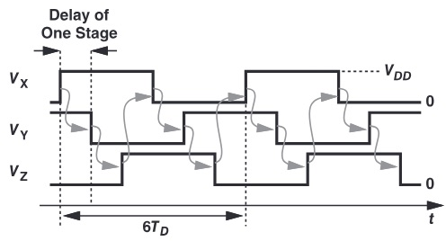
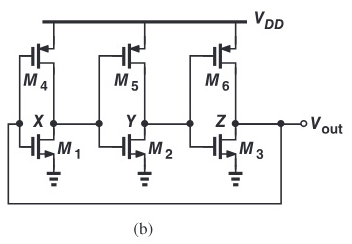

# 장말문제 13.16 — 5단 인버터 링 발진기의 대신호 파형

## 원문
Draw the large-signal waveforms of Fig. 13.10 for a five-stage ring oscillator similar to the circuit of Fig. 13.9(b).

## 조건
- 회로: Fig 13.9(b)와 비슷한 링 발진기
- 단 수는 다섯 (CMOS 인버터 다섯 개를 고리로 이음)
- Fig 13.10: 3단 인버터 링의 세 노드 전압 $V_X$, $V_Y$, $V_Z$가 $0$과 $V_{DD}$ 사이를 한 단 지연 $T_D$씩 차례로 토글하는 사각파, 한 주기 $6T_D$ (원문에 없음)

## 구할 것
- 5단 링 발진기에 대해 Fig 13.10과 같은 대신호 파형을 그림

## 상속·참조
- 본문 Fig 13.10 (교재 738쪽, PDF 5): 3단 인버터 링 발진기(Fig 13.9(b))의 대신호 파형 (회로 그림 아님)
  - 위→아래 $V_X$, $V_Y$, $V_Z$ 세 사각파, 가로축 $t$. 각 파형은 $0$과 $V_{DD}$ 사이를 오감 (오른쪽 끝에 $V_X$의 높은 레벨 점선 $V_{DD}$, $V_X$와 $V_Z$의 낮은 레벨 $0$ 표시)
  - $V_X$가 올라가면 한 단 지연 뒤 $V_Y$가 내려가고, 다시 한 단 지연 뒤 $V_Z$가 올라가고, 다시 한 단 지연 뒤 $V_X$가 내려감. 회색 곡선 화살표가 각 전이에서 다음 노드의 전이로 이어짐
  - 위쪽에 "Delay of One Stage" 라벨: $V_X$ 상승과 $V_Y$ 하강 시점의 두 세로 점선 사이를 안쪽으로 향한 두 화살표로 표시
  - 아래쪽에 $6T_D$ 양방향 화살표: $V_X$ 상승에서 다음 $V_X$ 상승까지 (한 주기)
- 본문 설명 (교재 738쪽): 각 인버터 단의 지연이 $T_D$이면 발진 주기는 $6T_D$, 출력 주파수는 $1/(6T_D)$



## 회로 — Fig 13.9(b)
```spice
M4  X  Z  VDD  pmos    ; 게이트 = M1 게이트와 공통 (귀환선)
M1  X  Z  0    nmos
M5  Y  X  VDD  pmos
M2  Y  X  0    nmos
M6  Z  Y  VDD  pmos
M3  Z  Y  0    nmos
```
- 단자: VDD = 전원, 값 미지정 (가로 레일) / Z = 출력 V_out (개방 원, Z 노드에서 오른쪽으로 이어진 선 끝) / X, Y, Z는 드레인 접속점 옆 라벨만 (원 없음)
- 표시: 노드 라벨 V_DD (레일 오른쪽 끝), X, Y, Z (각 드레인 접속점 왼쪽), V_out (개방 원 오른쪽) / 소자 라벨 M_4, M_5, M_6 (각 PMOS 아래), M_1, M_2, M_3 (각 NMOS 오른쪽, 소스 옆) / 부호 없음 / 화살표 없음 / 수치·면적 라벨 없음
- 배치: 맨 위 VDD 가로 레일 / 세 CMOS 인버터가 왼쪽→오른쪽 같은 모양: 위→아래 PMOS (M4/M5/M6, 게이트 왼쪽, 소스가 위로 레일), 드레인 접속점 (X/Y/Z), NMOS (M1/M2/M3, 게이트 왼쪽, 소스 아래 접지) / 각 인버터 왼쪽에 세로 게이트선: PMOS 게이트에서 왼쪽으로 나와 아래로 꺾이고, 드레인 접속점 높이의 입력 접속점을 지나 NMOS 게이트 높이에서 오른쪽으로 꺾여 NMOS 게이트 / X 접속점 → 오른쪽 가로선 → 둘째 인버터 입력 접속점, Y 접속점 → 셋째 인버터 입력 접속점 / Z 접속점 → 오른쪽 가로선 → 접속점 → V_out 개방 원, 그 접속점에서 귀환선이 아래로 내려가 회로 아래를 왼쪽으로 가로지르고 첫 인버터 게이트선보다 왼쪽에서 위로 꺾여, 드레인 접속점 높이에서 오른쪽으로 꺾여 첫 인버터 입력 접속점 / 접속점 (세 갈래 이상, 7곳): 세 입력 접속점 = 위 PMOS 게이트 + 아래 NMOS 게이트 + 왼쪽 가로선 (점), X, Y, Z = 위 PMOS 드레인 + 아래 NMOS 드레인 + 오른쪽 가로선 (점), Z 오른쪽 = 왼쪽 Z + 오른쪽 V_out + 아래 귀환선 (점) / 교차: 없음


> 참고: 그림은 원문의 3단 회로. 문제는 같은 인버터를 다섯 개로 늘린 링
