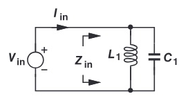

# 장말문제 13.20 — 공진 주파수 근처 코사인 입력에서 병렬 LC 탱크의 입력 전류

## 원문
In the circuit of Fig. 13.13, assume $V_{in}(t) = V_0 \cos \omega_{in} t$. Plot $I_{in}(t)$ if $\omega_{in}$ is slightly below $\omega_1$ or above $\omega_1$. (Hint: consider the magnitude and phase response in Fig. 13.14.)

## 조건
- 회로: Fig 13.13의 이상적 병렬 LC 탱크
- 입력 $V_{in}(t) = V_0 \cos \omega_{in} t$
- 두 경우: $\omega_{in}$이 $\omega_1$보다 조금 낮을 때, $\omega_1$보다 조금 높을 때
- Fig 13.14의 크기·위상 응답을 생각할 것 (원문의 힌트)
- 식 (13.9): $Z_1(j\omega) = \dfrac{jL_1\omega}{1 - L_1 C_1 \omega^2}$, 공진 주파수 $\omega_1 = 1/\sqrt{L_1 C_1}$ (본문 식, 원문에 없음)
- Fig 13.14 (예제 13.4): $|Z_{in}|$은 $\omega_1$에서 무한대로 발산하고, $\angle Z_{in}$은 $\omega < \omega_1$에서 $+90^\circ$, $\omega > \omega_1$에서 $-90^\circ$ (원문에 없음)

## 구할 것
- 두 경우 각각 $I_{in}(t)$의 그래프

## 상속·참조
- 예제 13.4 (교재 741–742쪽, Fig 13.13): $Z_1(j\omega)$의 크기와 위상을 주파수 함수로 스케치. Fig 13.13의 $Z_{in}$을 본문 식에서는 $Z_1$로 씀
  - 식 (13.7)–(13.8): $Z_1(s) = (L_1 s) \parallel \dfrac{1}{C_1 s} = \dfrac{L_1 s}{L_1 C_1 s^2 + 1}$
  - 식 (13.9): $Z_1(j\omega) = \dfrac{jL_1\omega}{1 - L_1 C_1 \omega^2}$, 공진 주파수 $\omega_1 = 1/\sqrt{L_1 C_1}$에서 임피던스가 무한대
  - 식 (13.10): $|Z_1(j\omega)| = \dfrac{L_1\omega}{|1 - L_1 C_1 \omega^2|}$
  - 위상: $\omega < \omega_1$이면 $\angle Z_1 = +90^\circ$ (인덕터처럼), $\omega > \omega_1$이면 $\angle Z_1 = -90^\circ$ (커패시터처럼)
- 본문 Fig 13.14 (교재 742쪽, PDF 7, 예제 13.4의 풀이 그림, 이 파일의 그림 목록에는 넣지 않음, 크롭은 fig13-14.png): 병렬 LC 탱크 임피던스의 주파수 특성 (회로 그림 아님)
  - (a) 세로축 $|Z_{in}|$, 가로축 $\omega$. 곡선이 원점에서 시작해 $\omega_1$에 다가갈수록 가파르게 올라 무한대로 발산하고 ($\omega_1$에 세로 점선), $\omega_1$ 위에서는 위에서 내려와 $\omega$가 커질수록 0에 다가감
  - (b) 세로축 $\angle Z_{in}$, 가로축 $\omega$. $\omega < \omega_1$에서 $+90^\circ$, $\omega_1$에서 수직으로 떨어져 $\omega > \omega_1$에서 $-90^\circ$ ($-90^\circ$ 높이에 가로 점선 보조선)

## 회로 — Fig 13.13
```spice
Vin  n1  n2          ; + 단자가 위 (n1)
L1   n1  n2  {L_1}
C1   n1  n2  {C_1}
```
- 단자: 개방 단자 없음 (입력은 전압원 V_in이 탱크를 직접 구동)
- 표시: 노드 라벨 없음 / 소자 라벨 V_in (전압원 왼쪽), L_1 (인덕터 왼쪽), C_1 (커패시터 오른쪽) / 부호 + (전압원 오른쪽 위), − (전압원 오른쪽 아래) / 화살표 "I_in": 위 도선의 전류, 오른쪽 방향, 도선 위 (글자는 화살촉 위) / "Z_in": 전압원 쪽에서 오른쪽 탱크를 들여다봄, 오른쪽 방향, 도선 옆 별도 화살표 두 개 (위는 ┌ 꺾임, 아래는 L자, 둘 다 화살촉은 오른쪽 끝, 글자 Z_in은 두 화살표 사이) / 수치·면적 라벨 없음
- 배치: 왼쪽 세로 변에 전압원 V_in (+ 위), 위 도선과 아래 도선이 오른쪽으로 뻗음 / 가운데 세로 L_1, 그 오른쪽 세로 C_1 / 위 도선은 L_1 위 접속점을 지나 오른쪽 모서리에서 아래로 꺾여 C_1 위 끝, 아래 도선도 L_1 아래 접속점을 지나 C_1 아래 끝 / Z_in 화살표 쌍은 전압원과 L_1 사이 / 접속점 (세 갈래 이상, 2곳): L_1 위 = 왼쪽 위 도선 + 아래 L_1 + 오른쪽 C_1 가지 (점), L_1 아래 = 왼쪽 아래 도선 + 위 L_1 + 오른쪽 C_1 가지 (점) / 교차: 없음


