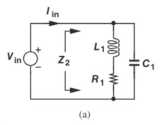

# 장말문제 13.21 — 손실 탱크 Z_2(s)와 극점 주파수

## 원문
Compute $Z_2(s)$ in the tank of Fig. 13.15(a). Compute the pole frequencies.

## 조건
- 회로: Fig 13.15(a)의 손실 탱크 ($L_1$과 그 선 저항 $R_1$의 직렬 가지에 $C_1$이 병렬)
- 소자 값은 주어지지 않음. 답은 $L_1$, $R_1$, $C_1$ 기호로 나타냄 (원문에 없음)

## 구할 것
- 탱크의 임피던스 $Z_2(s)$
- 극점 주파수

## 회로 — Fig 13.15(a)
```spice
Vin  n1  n2          ; + 단자가 위 (n1)
L1   n1  n3  {L_1}
R1   n3  n2  {R_1}
C1   n1  n2  {C_1}
```
- 단자: 개방 단자 없음 (입력은 전압원 V_in이 탱크를 직접 구동)
- 표시: 노드 라벨 없음 / 소자 라벨 V_in (전압원 왼쪽), L_1 (인덕터 왼쪽), R_1 (저항 왼쪽), C_1 (커패시터 오른쪽) / 부호 + (전압원 오른쪽 위), − (전압원 오른쪽 아래) / 화살표 "I_in": 위 도선의 전류, 오른쪽 방향, 도선 위 (글자는 화살촉 위) / "Z_2": 전압원 쪽에서 오른쪽 탱크를 들여다봄, 오른쪽 방향, 도선 옆 별도 화살표 두 개 (위는 ┌ 꺾임, 아래는 L자, 둘 다 화살촉은 오른쪽 끝, 글자 Z_2는 두 화살표 사이) / 수치·면적 라벨 없음
- 배치: 왼쪽 세로 변에 전압원 V_in (+ 위), 위 도선과 아래 도선이 오른쪽으로 뻗음 / 가운데 세로 가지에 위→아래 L_1, R_1 직렬 (사이 노드 n3, 라벨 없음) / 그 오른쪽 세로 C_1 / 위 도선은 L_1 위 접속점을 지나 오른쪽 모서리에서 아래로 꺾여 C_1 위 끝, 아래 도선도 R_1 아래 접속점을 지나 C_1 아래 끝 / Z_2 화살표 쌍은 전압원과 L_1·R_1 가지 사이 / 접속점 (세 갈래 이상, 2곳): L_1 위 = 왼쪽 위 도선 + 아래 L_1 + 오른쪽 C_1 가지 (점), R_1 아래 = 왼쪽 아래 도선 + 위 R_1 + 오른쪽 C_1 가지 (점) / 교차: 없음


