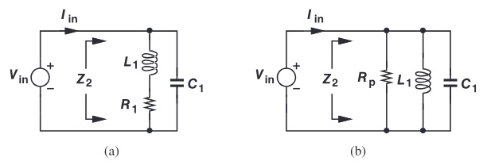

# 장말문제 13.23 — 직렬 손실 탱크를 병렬 R_p 탱크로 바꾸는 등가 변환

## 원문
In this problem, we wish to determine how the tank in Fig. 13.15(a) can be transformed to that in Fig. 13.15(b). Compute the impedance of each tank at a frequency $s = j\omega$ and equate the two impedances. Now, equate their real parts and do the same with their imaginary parts. Also, assume $L_1\omega/R_1 \gg 1$. (We say the inductor has a high quality factor, $Q$.) Determine the value of $R_p$.

## 조건
- 회로: Fig 13.15(a)의 탱크 ($L_1$과 $R_1$ 직렬 가지에 $C_1$ 병렬)를 Fig 13.15(b)의 탱크 ($R_p$, $L_1$, $C_1$ 병렬)로 변환
- 각 탱크의 임피던스를 주파수 $s = j\omega$에서 계산해 두 임피던스를 같게 놓음
- 두 임피던스의 실수부끼리, 허수부끼리 각각 같게 놓음
- $L_1\omega/R_1 \gg 1$로 가정 (인덕터의 품질 계수 $Q$가 높다고 말함)

## 구할 것
- 두 탱크가 등가가 되는 $R_p$의 값

## 회로 — Fig 13.15(a)
```spice
VIN  n1  n2  {V_in}    ; + 위(n1), − 아래(n2)
L1   n1  n3  {L_1}
R1   n3  n2  {R_1}
C1   n1  n2  {C_1}
* n2는 아래 귀선 (접지 기호 없음)
```
- 단자: 개방 단자·전원 단자 없음 (V_in은 원형 독립 전압원 소자)
- 표시: 노드 라벨 없음 / 소자 라벨 V_in (전압원 왼쪽), L_1 (인덕터 왼쪽), R_1 (저항 왼쪽), C_1 (커패시터 오른쪽) / 부호 + (전압원 오른쪽 위), − (전압원 오른쪽 아래) / 화살표 "I_in": 위 도선의 전류, 오른쪽 방향, 도선 위; "Z_2": 전압원 오른쪽에서 탱크 쪽을 들여다봄, 오른쪽 방향, 도선 옆 별도 화살표 (세로선의 위·아래 끝에서 오른쪽으로 가로 화살표 두 개, ㄷ자 꺾쇠 모양(오른쪽이 열림), Z_2 글자는 세로선 가운데 끊긴 자리) / 수치·면적 라벨 없음
- 배치: 왼쪽 세로 변에 V_in 원 (+ 위) / 위 도선이 오른쪽으로 가서 접속점에서 L_1(위)–R_1(아래) 직렬 세로 가지가 아래 도선으로 내려가고, 위 도선은 계속 오른쪽 모서리에서 아래로 꺾여 C_1을 지나 아래 도선으로 / 아래 도선은 V_in 아래 끝으로 돌아오는 귀선 (접지 기호 없음) / Z_2 꺾쇠는 V_in과 L_1–R_1 가지 사이 / 접속점 (세 갈래 이상, 2곳): 위 도선의 L_1 가지 (점), 아래 도선의 R_1 가지 (점) / 교차: 없음

## 회로 — Fig 13.15(b)
```spice
VIN  n1  n2  {V_in}    ; + 위(n1), − 아래(n2)
RP   n1  n2  {R_p}
L1   n1  n2  {L_1}
C1   n1  n2  {C_1}
* n2는 아래 귀선 (접지 기호 없음)
```
- 단자: 개방 단자·전원 단자 없음 (V_in은 원형 독립 전압원 소자)
- 표시: 노드 라벨 없음 / 소자 라벨 V_in (전압원 왼쪽), R_p (저항 왼쪽), L_1 (인덕터 왼쪽), C_1 (커패시터 오른쪽) / 부호 + (전압원 오른쪽 위), − (전압원 오른쪽 아래) / 화살표 "I_in": 위 도선의 전류, 오른쪽 방향, 도선 위; "Z_2": 전압원 오른쪽에서 탱크 쪽을 들여다봄, 오른쪽 방향, 도선 옆 별도 화살표 (세로선의 위·아래 끝에서 오른쪽으로 가로 화살표 두 개, ㄷ자 꺾쇠 모양(오른쪽이 열림), Z_2 글자는 세로선 가운데 끊긴 자리) / 수치·면적 라벨 없음
- 배치: 왼쪽 세로 변에 V_in 원 (+ 위) / 위·아래 도선 사이에 왼쪽→오른쪽 R_p, L_1, C_1 세 세로 가지가 병렬, C_1은 오른쪽 모서리 / 아래 도선은 귀선 (접지 기호 없음) / 접속점 (세 갈래 이상, 4곳): 위 도선의 R_p 가지, L_1 가지 (각각 점), 아래 도선의 R_p 가지, L_1 가지 (각각 점) / 교차: 없음


> 참고: Fig 13.15는 본문 그림(교재 742쪽, PDF 7)
