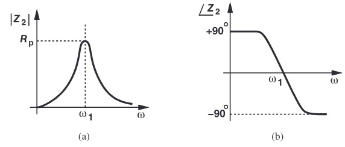

# 장말문제 13.24 — R_p가 두 배일 때 손실 탱크 크기·위상 그래프의 변화

## 원문
Explain qualitatively what happens to the plots in Fig. 13.16 if $R_p$ is doubled.

## 조건
- Fig 13.16의 그래프: 예제 13.5에서 그린 손실 탱크(Fig 13.15(b))의 (a) $|Z_2|$, (b) $\angle Z_2$ 대 $\omega$
- 참고 회로 (본문 Fig 13.15(b)): $R_p$, $L_1$, $C_1$ 병렬 탱크, $Z_2$는 이 탱크의 임피던스 (원문에 없음)
- 식 (13.13): $Z_2(s) = \dfrac{R_pL_1s}{R_pL_1C_1s^2 + L_1s + R_p}$ (본문 식, 원문에 없음)
- 식 (13.14): $Z_2(j\omega) = \dfrac{jR_pL_1\omega}{R_p(1 - L_1C_1\omega^2) + jL_1\omega}$ (본문 식, 원문에 없음)
- $\omega_1 = 1/\sqrt{L_1C_1}$에서 $Z_2(j\omega_1) = R_p$, $\angle Z_2(j\omega_1) = 0$ (예제 13.5 풀이, 원문에 없음)
- $R_p$를 두 배로 함

## 구할 것
- $R_p$가 두 배가 될 때 Fig 13.16의 그래프가 어떻게 되는지 정성적으로 설명

## 상속·참조
- 예제 13.5 (교재 743쪽, PDF 7): "그림 13.15(b)에서 $Z_2(s)$의 크기와 위상을 주파수 함수로 그려라." 풀이는 식 (13.12)–(13.14)를 얻고 그 결과를 Fig 13.16으로 그림
- 식 (13.12): $Z_2(s) = R_p \parallel (L_1s) \parallel \dfrac{1}{C_1s}$
- 식 (13.13): $Z_2(s) = \dfrac{R_pL_1s}{R_pL_1C_1s^2 + L_1s + R_p}$
- 식 (13.14): $Z_2(j\omega) = \dfrac{jR_pL_1\omega}{R_p(1 - L_1C_1\omega^2) + jL_1\omega}$
- 예제 13.5 풀이: $\omega_1 = 1/\sqrt{L_1C_1}$에서 인덕터와 커패시터의 임피던스가 상쇄되어 $Z_2(j\omega_1) = R_p$, $\angle Z_2(j\omega_1) = 0$. 매우 낮은 주파수에서는 $Z_2 \approx jL_1\omega$, 매우 높은 주파수에서는 $Z_2 \approx 1/(jC_1\omega)$
- 본문 Fig 13.15(b) (교재 742쪽, PDF 7, 크롭 안 함, 이 파일의 그림 목록에는 넣지 않음, 크롭은 fig13-15-b.png): 원형 전압원 $V_{in}$에 $R_p$, $L_1$, $C_1$ 세 가지가 병렬로 걸린 탱크. 연결: $R_p$, $L_1$, $C_1$: 모두 위 도선 ↔ 아래 도선, $V_{in}$: + = 위 도선, − = 아래 도선
- 본문 Fig 13.16 (교재 743쪽, PDF 7): 특성 그래프 (회로 그림 아님)
  - (a) 세로축 $|Z_2|$, 가로축 $\omega$. 곡선은 원점 0에서 시작해 올라가 $\omega_1$에서 뾰족한 봉우리(높이 $R_p$, 점선으로 세로축 $R_p$ 레벨과 가로축 $\omega_1$에 이어짐)를 이루고 높은 주파수에서 다시 0 쪽으로 내려감
  - (b) 세로축 $\angle Z_2$, 가로축 $\omega$. 낮은 주파수에서 $+90°$로 평평하다가 내려가 $\omega_1$에서 0을 지나 높은 주파수에서 $-90°$(점선 레벨)로 평평해짐

## 회로 — 없음 (특성 그래프 문제, 그림 13.16은 회로가 아닌 그래프로 상속·참조에 적음)
