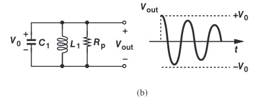

# 장말문제 13.25 — 손실 탱크에서 R_p의 순시 소비 전력

## 원문
Sketch the instantaneous power dissipated by $R_p$ in Fig. 13.17(b) as a function of time. Can you predict what we will obtain if we integrate the area under this plot?

## 조건
- 회로: Fig 13.17(b)의 손실 탱크 ($C_1$, $L_1$, $R_p$ 병렬, 출력 $V_{out}$은 탱크 양단 전압)
- 예제 13.6에서 이어받는 조건: 분리된 탱크의 커패시터 $C_1$ 양단에 초기 전압 $V_0$를 걸어 둔 뒤 놓아 두는 시간 영역 동작 (원문에 없음)
- Fig 13.17(b)의 파형 (예제 13.6 풀이): $V_{out}$은 $t = 0$에서 $+V_0$로 시작해 진동하며 진폭이 점점 줄어듦 (감쇠 진동, 점선 $\pm V_0$ 레벨 안쪽) (원문에 없음)

## 구할 것
- $R_p$가 소비하는 순시 전력을 시간의 함수로 스케치
- 이 그래프 아래 면적을 적분하면 무엇을 얻을지 예측

## 상속·참조
- 예제 13.6 (교재 743–744쪽, PDF 7–8): "분리된 병렬 탱크 내의 커패시터 양단의 $V_0$의 초기 전압을 인가했다고 가정하자. 만약 탱크가 이상적이거나 손실이 있을 경우, 시간 영역에서의 회로의 동작을 분석하라."
- 예제 13.6 풀이: 이상적인 탱크(Fig 13.17(a))에서는 $C_1$과 $L_1$ 사이 에너지 전송이 반복되어 탱크가 무기한 발진함. 손실 탱크(Fig 13.17(b))에서는 영이 아닌 출력 전압이 $R_p$를 통한 전류의 흐름과 에너지 손실을 유발하여, 탱크가 매 사이클마다 얼마의 에너지를 잃고 감쇠된 발진 출력을 만듦

## 회로 — Fig 13.17(b)
```spice
C1  out1  out2  {C_1}   ; 초기 전압 V0 (+ 위)
L1  out1  out2  {L_1}
RP  out1  out2  {R_p}
* out1/out2 = V_out 단자 (+ 위, − 아래)
```
- 단자: out1, out2 = 출력 V_out (+ 위, − 아래) 측정 단자 (개방 원)
- 표시: 노드 라벨 V_out (두 개방 원 사이 오른쪽), V_0 (C_1 왼쪽, 초기 전압) / 소자 라벨 C_1 (커패시터 오른쪽), L_1 (인덕터 오른쪽), R_p (저항 오른쪽) / 부호 + (C_1 왼쪽 위), − (C_1 왼쪽 아래) (V_0 극성), + (V_out 위 원 아래), − (V_out 아래 원 위) / 화살표 없음 / 수치·면적 라벨 없음
- 배치: 위·아래 가로 도선 사이에 왼쪽→오른쪽 C_1, L_1, R_p 세로 가지가 병렬, C_1은 왼쪽 모서리 / 위·아래 도선이 오른쪽 끝에서 각각 개방 원 / 접지 없음 / 접속점 (세 갈래 이상, 4곳): 위 도선의 L_1 가지, R_p 가지 (각각 점), 아래 도선의 L_1 가지, R_p 가지 (각각 점) / 교차: 없음


> 참고: Fig 13.17은 본문 예제 13.6 풀이 그림(교재 744쪽, PDF 8). 크롭 오른쪽은 (b)의 V_out 파형 그래프 (가로축 t, 세로축 V_out. t = 0에서 점선이 +V_0 레벨까지 올라가고 곡선은 +V_0에서 시작해 내려가며 진폭이 줄어드는 진동 세 번 남짓, 점선 −V_0 레벨 아래쪽 표시)
