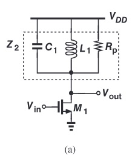

# 장말문제 13.26 — 탱크 부하 CS 단에 바이어스 + 공진 주파수 정현파 입력

## 원문
In the CS stage of Fig. 13.18(a), $V_{in} = V_0\cos\omega_1 t + V_1$, where $\omega_1 = 1/\sqrt{L_1C_1}$ and $V_1$ is a bias value. Plot $V_{out}$ as a function of time. (Hint: what is the dc value of the output when the input is just equal to $V_1$?)

## 조건
- 회로: Fig 13.18(a)의 CS 단 (드레인에 $C_1$, $L_1$, $R_p$ 병렬 탱크 부하)
- 입력: $V_{in} = V_0\cos\omega_1 t + V_1$
- $\omega_1 = 1/\sqrt{L_1C_1}$
- $V_1$은 바이어스 값
- 힌트: 입력이 정확히 $V_1$일 때 출력의 dc 값은 얼마인가? (원문의 힌트)

## 구할 것
- $V_{out}$을 시간의 함수로 그리기

## 회로 — Fig 13.18(a)
```spice
C1  VDD   Vout  {C_1}
L1  VDD   Vout  {L_1}
RP  VDD   Vout  {R_p}
M1  Vout  Vin   0   nmos
```
- 단자: VDD = 전원, 값 미지정 (가로 레일) / Vin = 게이트 입력 (개방 원) / Vout = 출력 (개방 원)
- 표시: 노드 라벨 V_DD (레일 오른쪽 끝 위), V_in (입력 원 왼쪽), V_out (출력 원 오른쪽) / 소자 라벨 C_1, L_1, R_p (각 소자 오른쪽), M1 (트랜지스터 오른쪽), Z_2 (점선 상자 왼쪽 바깥, 탱크 전체 임피던스) / 부호 없음 / 화살표 없음 / 수치·면적 라벨 없음
- 배치: 위에 V_DD 가로 레일, 그 아래 왼쪽→오른쪽 C_1, L_1, R_p 세로 가지가 아래 가로선으로 묶임 / 탱크(세 소자와 아래 가로선)를 점선 상자가 둘러싸고 왼쪽 바깥에 Z_2 라벨 / 탱크 아래 가로선 가운데(L_1 아래) 접속점에서 세로선이 내려가 접속점, 여기서 가로선이 오른쪽 V_out 원으로, 세로선은 계속 M1 드레인으로 / M1 nmos 보통 방향(게이트 왼쪽, 소스 아래·화살표 바깥), 게이트는 가로선으로 왼쪽 V_in 원, 소스 아래 접지 / 접속점 (세 갈래 이상, 2곳): 탱크 아래 L_1 자리 (점), V_out 가지 (점) / 교차: 없음


> 참고: Fig 13.18은 본문 그림(교재 745쪽, PDF 8)
