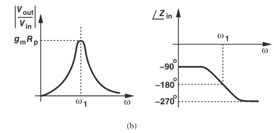

# 장말문제 13.27 — R_p가 두 배일 때 탱크 부하 CS 단 크기·위상 그래프의 변화

## 원문
Explain qualitatively what happens to the plots in Fig. 13.18(b) if $R_p$ is doubled.

## 조건
- Fig 13.18(b)의 그래프: 탱크 부하 CS 단(본문 Fig 13.18(a))의 크기 $|V_{out}/V_{in}|$와 위상 대 $\omega$
- 참고 회로 (본문 Fig 13.18(a)): NMOS $M_1$의 게이트가 입력 $V_{in}$, 소스가 접지, 드레인이 출력 $V_{out}$이고, 드레인과 $V_{DD}$ 사이에 $C_1$, $L_1$, $R_p$ 병렬 탱크(임피던스 $Z_2$)가 부하로 연결됨 (원문에 없음)
- 식 (13.15): $\dfrac{V_{out}}{V_{in}} = -g_mZ_2(s)$ (본문 식, 채널 길이 변조 무시, 원문에 없음)
- 식 (13.13): $Z_2(s) = \dfrac{R_pL_1s}{R_pL_1C_1s^2 + L_1s + R_p}$ (본문 식, 원문에 없음)
- 그래프의 위상 축 라벨은 "∠Z_in"으로 인쇄됨. 본문(교재 744쪽)은 이 그래프를 $\angle(V_{out}/V_{in})$으로 설명하므로 문맥과 맞지 않음(오식으로 보임) (원문에 없음)
- $R_p$를 두 배로 함

## 구할 것
- $R_p$가 두 배가 될 때 Fig 13.18(b)의 그래프가 어떻게 되는지 정성적으로 설명

## 상속·참조
- 본문 13.3.2 (교재 744쪽, PDF 8): 탱크 임피던스를 $Z_2$라 하고 채널 길이 변조를 무시하면 식 (13.15) $V_{out}/V_{in} = -g_mZ_2(s)$. $|Z_2|$와 $\angle Z_2$(Fig 13.16)로부터 $|V_{out}/V_{in}|$와 $\angle(V_{out}/V_{in})$을 그리며, 위상은 음의 부호 때문에 $\angle Z_2$를 $180°$ 옮긴 것. CS 단은 공진 주파수에서 $g_mR_p$의 최댓값, 저주파·고주파에서 0에 가까운 이득을 보임
- 식 (13.13): $Z_2(s) = \dfrac{R_pL_1s}{R_pL_1C_1s^2 + L_1s + R_p}$, $\omega_1 = 1/\sqrt{L_1C_1}$에서 $Z_2 = R_p$
- 본문 Fig 13.18(a) (교재 745쪽, PDF 8, 크롭 안 함, 이 파일의 그림 목록에는 넣지 않음, 크롭은 fig13-18-a.png): 연결 $M_1$: D = $V_{out}$, G = $V_{in}$, S = 접지 / $C_1$, $L_1$, $R_p$: 모두 $V_{DD}$ ↔ $V_{out}$ (점선 상자로 묶이고 라벨 $Z_2$)
- 본문 Fig 13.18(b) (교재 745쪽, PDF 8): 특성 그래프 두 개 (회로 그림 아님)
  - 왼쪽: 세로축 $|V_{out}/V_{in}|$, 가로축 $\omega$. 곡선은 0 근처에서 올라가 $\omega_1$에서 뾰족한 봉우리(높이 $g_mR_p$, 점선으로 세로축 $g_mR_p$ 레벨과 가로축 $\omega_1$에 이어짐)를 이루고 높은 주파수에서 다시 0 쪽으로 내려감
  - 오른쪽: 세로축 "∠Z_in"(인쇄 라벨), 가로축 $\omega$ (가로축은 0° 높이, 곡선은 그 아래). 낮은 주파수에서 $-90°$로 평평하다가 내려가 $\omega_1$(점선)에서 $-180°$ 레벨(점선)을 지나 높은 주파수에서 $-270°$(점선 레벨)로 평평해짐

## 회로 — 없음 (특성 그래프 문제, 그림 13.18(b)는 회로가 아닌 그래프로 상속·참조에 적음)
