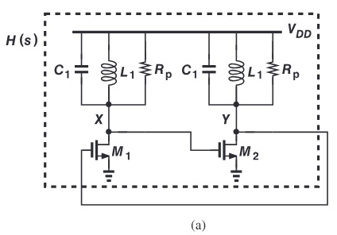
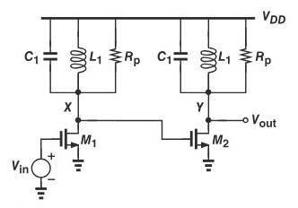

# 장말문제 13.28 — 두 LC 부하 CS 단 루프를 M1 게이트에서 끊었을 때 X, Y 파형

## 원문
In the circuit of Fig. 13.19(a), we break the loop at the gate of $M_1$ and apply an input as shown in Fig. 13.42. Suppose $V_{in} = V_0\cos\omega_1 t + V_1$, where $\omega_1$ is the resonance frequency of each tank and $V_1$ is a bias voltage. Plot the waveforms at nodes $X$ and $Y$.

## 조건
- 회로: Fig 13.19(a)의 발진기 (LC 탱크 부하 CS 단 $M_1$, $M_2$ 두 개를 루프로 연결)
- $M_1$의 게이트에서 루프를 끊고 Fig 13.42처럼 $M_1$ 게이트에 입력 $V_{in}$을 인가
- 입력: $V_{in} = V_0\cos\omega_1 t + V_1$
- $\omega_1$: 각 탱크의 공진 주파수
- $V_1$: 바이어스 전압

## 구할 것
- 노드 $X$와 $Y$의 파형 그리기

## 회로 — Fig 13.19(a)
```spice
C1X  VDD  X  {C_1}    ; 인쇄 라벨 C_1 (왼쪽 탱크)
L1X  VDD  X  {L_1}    ; 인쇄 라벨 L_1 (왼쪽 탱크)
RPX  VDD  X  {R_p}    ; 인쇄 라벨 R_p (왼쪽 탱크)
C1Y  VDD  Y  {C_1}    ; 인쇄 라벨 C_1 (오른쪽 탱크)
L1Y  VDD  Y  {L_1}    ; 인쇄 라벨 L_1 (오른쪽 탱크)
RPY  VDD  Y  {R_p}    ; 인쇄 라벨 R_p (오른쪽 탱크)
M1   X    Y  0   nmos
M2   Y    X  0   nmos
```
- 단자: VDD = 전원, 값 미지정 (가로 레일) / 개방 단자 없음
- 표시: 노드 라벨 V_DD (레일 오른쪽 끝), X (X 세로선 왼쪽), Y (Y 세로선 왼쪽) / 소자 라벨 C_1 (커패시터 왼쪽), L_1, R_p (각 소자 오른쪽) — 왼쪽 탱크와 오른쪽 탱크에 같은 라벨이 두 번씩, M1, M2 (각 트랜지스터 오른쪽), H(s) (점선 상자 왼쪽 위 바깥) / 부호 없음 / 화살표 없음 / 수치·면적 라벨 없음
- 배치: 위에 긴 V_DD 가로 레일, 그 아래 탱크 둘 (각각 왼쪽→오른쪽 C_1, L_1, R_p 세로 가지가 아래 가로선으로 묶임) / 왼쪽 탱크 아래 가로선 가운데(L_1 아래) 접속점에서 세로선이 X 라벨 옆을 지나 아래 접속점, 이어서 M1 드레인 / 오른쪽 탱크도 같은 모양으로 Y, M2 드레인 / X 아래 접속점에서 가로선이 오른쪽으로 가서 아래로 한 번 꺾인 뒤 오른쪽으로 M2 게이트(왼쪽) / Y 아래 접속점에서 가로선이 오른쪽으로 점선 상자 밖까지 가서 아래로 꺾이고, 점선 상자 아래쪽 밖에서 왼쪽으로 돌아 M1 왼쪽에서 위로 꺾여 M1 게이트(왼쪽) / M1, M2 nmos 보통 방향(게이트 왼쪽, 소스 아래·화살표 바깥), 소스 아래 각각 접지 / 굵은 점선 상자가 레일, 두 탱크, M1, M2를 둘러싸고 왼쪽 위 바깥에 "H(s)" 라벨 (루프 안 회로 묶음 표시), 귀환선만 상자 밖으로 나감 / 접속점 (세 갈래 이상, 4곳): 왼쪽 탱크 아래 L_1 자리 (점), X 아래 (점), 오른쪽 탱크 아래 L_1 자리 (점), Y 아래 (점) / 교차: 없음 (귀환선이 점선 상자 테두리를 지나가는 것은 도선 교차 아님)


> 참고: Fig 13.19는 본문 그림(교재 745쪽, PDF 8)

## 회로 — Fig 13.42
```spice
C1X  VDD  X   {C_1}    ; 인쇄 라벨 C_1 (왼쪽 탱크)
L1X  VDD  X   {L_1}    ; 인쇄 라벨 L_1 (왼쪽 탱크)
RPX  VDD  X   {R_p}    ; 인쇄 라벨 R_p (왼쪽 탱크)
C1Y  VDD  Y   {C_1}    ; 인쇄 라벨 C_1 (오른쪽 탱크)
L1Y  VDD  Y   {L_1}    ; 인쇄 라벨 L_1 (오른쪽 탱크)
RPY  VDD  Y   {R_p}    ; 인쇄 라벨 R_p (오른쪽 탱크)
M1   X    n1  0   nmos
M2   Y    X   0   nmos
VIN  n1   0   {V_in}   ; + 위(M1 게이트 쪽), − 아래(접지)
```
- 단자: VDD = 전원, 값 미지정 (가로 레일) / Y = 출력 V_out (개방 원, Y 아래 접속점에서 오른쪽 가로선 끝)
- 표시: 노드 라벨 V_DD (레일 오른쪽 끝), X (X 세로선 왼쪽), Y (Y 세로선 왼쪽), V_out (출력 원 오른쪽) / 소자 라벨 C_1 (커패시터 왼쪽), L_1, R_p (각 소자 오른쪽) — 왼쪽 탱크와 오른쪽 탱크에 같은 라벨이 두 번씩, M1, M2 (각 트랜지스터 오른쪽), V_in (전압원 왼쪽) / 부호 + (전압원 오른쪽 위), − (전압원 오른쪽 아래) / 화살표 없음 / 수치·면적 라벨 없음
- 배치: 위에 긴 V_DD 가로 레일, 그 아래 탱크 둘 (각각 왼쪽→오른쪽 C_1, L_1, R_p 세로 가지가 아래 가로선으로 묶임) / 왼쪽 탱크 아래 가운데(L_1 아래) 접속점에서 세로선이 X 라벨 옆을 지나 아래 접속점, 이어서 M1 드레인 / 오른쪽 탱크도 같은 모양으로 Y, M2 드레인 / X 아래 접속점에서 가로선이 오른쪽으로 가서 아래로 한 번 꺾인 뒤 오른쪽으로 M2 게이트(왼쪽) / Y 아래 접속점에서 가로선이 오른쪽 V_out 원으로 / M1 게이트에서 가로선이 왼쪽으로 가서 아래로 꺾여 원형 전압원 V_in의 + 단자, V_in − 단자 아래 접지 / M1, M2 nmos 보통 방향(게이트 왼쪽, 소스 아래·화살표 바깥), 소스 아래 각각 접지 / 점선 상자·귀환선 없음 / 접속점 (세 갈래 이상, 4곳): 왼쪽 탱크 아래 L_1 자리 (점), X 아래 (점), 오른쪽 탱크 아래 L_1 자리 (점), Y 아래 (점) / 교차: 없음


> 참고: 문제 문장은 교재 765쪽(PDF 18)에, Fig 13.42는 다음 쪽 교재 766쪽(PDF 19) 단1 위에 인쇄됨
