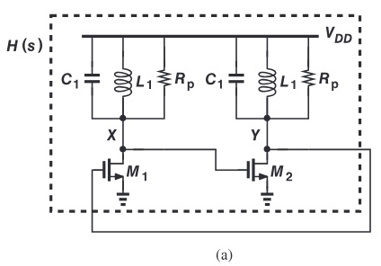

# 장말문제 13.30 — 두 탱크의 공진 주파수가 조금 다를 때의 발진 주파수

## 원문
Suppose the two tanks in the oscillator of Fig. 13.19(a) have slightly different resonance frequencies. Can you roughly predict the oscillation frequency? (Hint: consider the open-loop frequency response.)

## 조건
- 회로: Fig 13.19(a)의 발진기
- 두 탱크의 공진 주파수가 조금 다름
- 힌트: 개루프 주파수 응답을 고려하라 (원문의 힌트)

## 구할 것
- 발진 주파수를 대략 예측할 수 있는가?

## 회로 — Fig 13.19(a)
```spice
C1X  VDD  X  {C_1}    ; 인쇄 라벨 C_1 (왼쪽 탱크)
L1X  VDD  X  {L_1}    ; 인쇄 라벨 L_1 (왼쪽 탱크)
RPX  VDD  X  {R_p}    ; 인쇄 라벨 R_p (왼쪽 탱크)
C1Y  VDD  Y  {C_1}    ; 인쇄 라벨 C_1 (오른쪽 탱크)
L1Y  VDD  Y  {L_1}    ; 인쇄 라벨 L_1 (오른쪽 탱크)
RPY  VDD  Y  {R_p}    ; 인쇄 라벨 R_p (오른쪽 탱크)
M1   X    Y  0   nmos
M2   Y    X  0   nmos
```
- 단자: VDD = 전원, 값 미지정 (가로 레일) / 개방 단자 없음
- 표시: 노드 라벨 V_DD (레일 오른쪽 끝), X (X 세로선 왼쪽), Y (Y 세로선 왼쪽) / 소자 라벨 C_1 (커패시터 왼쪽), L_1, R_p (각 소자 오른쪽) — 왼쪽 탱크와 오른쪽 탱크에 같은 라벨이 두 번씩, M1, M2 (각 트랜지스터 오른쪽), H(s) (점선 상자 왼쪽 위 바깥) / 부호 없음 / 화살표 없음 / 수치·면적 라벨 없음
- 배치: 위에 긴 V_DD 가로 레일, 그 아래 탱크 둘 (각각 왼쪽→오른쪽 C_1, L_1, R_p 세로 가지가 아래 가로선으로 묶임) / 왼쪽 탱크 아래 가로선 가운데(L_1 아래) 접속점에서 세로선이 X 라벨 옆을 지나 아래 접속점, 이어서 M1 드레인 / 오른쪽 탱크도 같은 모양으로 Y, M2 드레인 / X 아래 접속점에서 가로선이 오른쪽으로 가서 아래로 한 번 꺾인 뒤 오른쪽으로 M2 게이트(왼쪽) / Y 아래 접속점에서 가로선이 오른쪽으로 점선 상자 밖까지 가서 아래로 꺾이고, 점선 상자 아래쪽 밖에서 왼쪽으로 돌아 M1 왼쪽에서 위로 꺾여 M1 게이트(왼쪽) / M1, M2 nmos 보통 방향(게이트 왼쪽, 소스 아래·화살표 바깥), 소스 아래 각각 접지 / 굵은 점선 상자가 레일, 두 탱크, M1, M2를 둘러싸고 왼쪽 위 바깥에 "H(s)" 라벨 (루프 안 회로 묶음 표시), 귀환선만 상자 밖으로 나감 / 접속점 (세 갈래 이상, 4곳): 왼쪽 탱크 아래 L_1 자리 (점), X 아래 (점), 오른쪽 탱크 아래 L_1 자리 (점), Y 아래 (점) / 교차: 없음 (귀환선이 점선 상자 테두리를 지나가는 것은 도선 교차 아님)


> 참고: Fig 13.19는 본문 그림(교재 745쪽, PDF 8). 그림의 두 탱크는 같은 라벨(C_1, L_1, R_p)로 인쇄되어 있고, 문제는 두 공진 주파수가 조금 다르다고 둠
