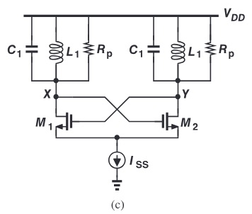

# 장말문제 13.31 — 교차 결합 발진기에서 탱크를 저항으로 바꾸면 발진하지 않는 이유

## 원문
Explain why the circuit of Fig. 13.20(c) does not oscillate if the tanks are replaced with resistors.

## 조건
- 회로: Fig 13.20(c)의 교차 결합 발진기
- 두 탱크($C_1$, $L_1$, $R_p$ 병렬)를 저항으로 바꿈

## 구할 것
- 이때 회로가 발진하지 않는 이유 설명

## 회로 — Fig 13.20(c)
```spice
C1X  VDD  X   {C_1}    ; 인쇄 라벨 C_1 (왼쪽 탱크)
L1X  VDD  X   {L_1}    ; 인쇄 라벨 L_1 (왼쪽 탱크)
RPX  VDD  X   {R_p}    ; 인쇄 라벨 R_p (왼쪽 탱크)
C1Y  VDD  Y   {C_1}    ; 인쇄 라벨 C_1 (오른쪽 탱크)
L1Y  VDD  Y   {L_1}    ; 인쇄 라벨 L_1 (오른쪽 탱크)
RPY  VDD  Y   {R_p}    ; 인쇄 라벨 R_p (오른쪽 탱크)
M1   X    Y   n1  nmos
M2   Y    X   n1  nmos
ISS  n1   0   {I_SS}
```
- 단자: VDD = 전원, 값 미지정 (가로 레일) / 개방 단자 없음
- 표시: 노드 라벨 V_DD (레일 오른쪽 끝), X (X 접속점 왼쪽), Y (Y 접속점 오른쪽) / 소자 라벨 C_1 (커패시터 왼쪽), L_1, R_p (각 소자 오른쪽) — 왼쪽 탱크와 오른쪽 탱크에 같은 라벨이 두 번씩, M1 (M1 왼쪽 아래), M2 (M2 오른쪽 아래), I_SS (전류원 오른쪽) / 부호 없음 / 화살표 없음 / 수치·면적 라벨 없음
- 배치: 위에 긴 V_DD 가로 레일, 그 아래 탱크 둘 (각각 왼쪽→오른쪽 C_1, L_1, R_p 세로 가지가 아래 가로선으로 묶임) / 왼쪽 탱크 아래 가운데(L_1 아래) 접속점에서 세로선이 X 접속점을 지나 M1 드레인으로, 오른쪽도 같은 모양으로 Y 접속점을 지나 M2 드레인으로 / M1은 좌우 반전(게이트가 오른쪽, 드레인 위, 소스 아래·화살표가 왼쪽 바깥), M2는 보통 방향(게이트 왼쪽, 소스 화살표 오른쪽 바깥) / X 접속점에서 가로선이 오른쪽으로 가다가 대각선으로 내려가 M2 게이트로, Y 접속점에서 가로선이 왼쪽으로 가다가 대각선으로 내려가 M1 게이트로 (두 대각선이 가운데서 X자로 교차) / M1, M2 소스에서 아래로 내려와 가로선으로 이어지고, 가운데 접속점 n1에서 아래로 전류원 I_SS(화살표 아래), 그 아래 접지 / 접속점 (세 갈래 이상, 5곳): 왼쪽 탱크 아래 L_1 자리 (점), X (점), 오른쪽 탱크 아래 L_1 자리 (점), Y (점), 소스 공통선 가운데 n1 (점) / 교차: X → M2 게이트 선과 Y → M1 게이트 선이 두 트랜지스터 사이 가운데에서 점 없이 교차


> 참고: Fig 13.20은 본문 그림(교재 746쪽, PDF 9)
