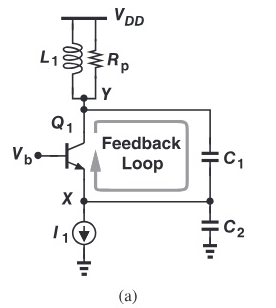

# 장말문제 13.33 — 콜피츠 발진기에서 C2 = 0일 때

## 원문
What happens if $C_2 = 0$ in the Colpitts oscillator of Fig. 13.22(a)?

## 조건
- 회로: Fig 13.22(a)의 콜피츠 발진기
- $C_2 = 0$
- 식 (13.24): $\omega_1^2 = \dfrac{C_1 + C_2}{L_1C_1C_2} + \dfrac{g_m}{R_pC_1C_2}$ (본문 식, 발진 주파수, 원문에 없음)
- 식 (13.26): $g_mR_p = \dfrac{(C_1 + C_2)^2}{C_1C_2}$ (본문 식, 스타트업 조건, 원문에 없음)

## 구할 것
- $C_2 = 0$이면 어떻게 되는가?

## 상속·참조
- 본문 13.3.3 (교재 748–749쪽, PDF 10): 컬렉터에서 루프를 끊은 개루프 등가 회로(Fig 13.22(b))로 구한 전달 함수를 1과 같게 놓고 실수부·허수부를 0으로 두어 식 (13.22) $-L_1(C_1 + C_2)\omega_1^2 + g_mR_p = 0$, 식 (13.23) $-L_1C_1C_2R_p\omega_1^3 + [g_mL_1 + R_p(C_1 + C_2)]\omega_1 = 0$을 얻음
- 식 (13.24): $\omega_1^2 = \dfrac{C_1 + C_2}{L_1C_1C_2} + \dfrac{g_m}{R_pC_1C_2}$, 두 번째 항을 무시하면 식 (13.25) $\omega_1^2 \approx \dfrac{1}{L_1\dfrac{C_1C_2}{C_1 + C_2}}$ (발진은 $L_1$과 $C_1$, $C_2$의 직렬 조합의 공진)
- 식 (13.26): $g_mR_p = \dfrac{(C_1 + C_2)^2}{C_1C_2}$

## 회로 — Fig 13.22(a)
```spice
L1  VDD  Y   {L_1}
RP  VDD  Y   {R_p}
Q1  Y    Vb  X   npn
C1  Y    X   {C_1}
C2  X    0   {C_2}
I1  X    0   {I_1}
```
- 단자: VDD = 전원, 값 미지정 (T 전원 기호, 짧은 굵은 막대에 가지 둘) / Vb = Q1 베이스 바이어스, 값 미지정 (점 단자)
- 표시: 노드 라벨 V_DD (막대 오른쪽 위), Y (Y 접속점 오른쪽), X (X 접속점 왼쪽), V_b (점 단자 왼쪽) / 소자 라벨 L_1 (인덕터 왼쪽), R_p (저항 오른쪽), Q1 (트랜지스터 왼쪽 위), C_1, C_2 (각 커패시터 오른쪽), I_1 (전류원 왼쪽), "Feedback Loop" (트랜지스터 오른쪽 회색 둥근 사각형 안 글자) / 부호 없음 / 화살표 "Feedback Loop": 루프 방향 표시, 회색 둥근 사각형 왼쪽 변 안쪽의 위쪽 방향 화살표, 도선 옆 별도 화살표 (직선, 회색) / 수치·면적 라벨 없음
- 배치: 위에 짧은 V_DD 굵은 막대, 그 아래 L_1(왼쪽)과 R_p(오른쪽) 병렬 세로 가지가 아래 짧은 가로선으로 묶이고 그 가운데 Y 접속점 / Y 접속점에서 세로선이 조금 내려가 아래 접속점, 여기서 가로선이 오른쪽으로 가서 아래로 꺾여 C_1, 세로선은 계속 Q1 컬렉터로 / Q1 npn 보통 방향(베이스 왼쪽, 컬렉터 위, 이미터 아래·화살표 바깥), V_b 점 단자 → 가로선 → 베이스 / Q1 이미터 아래 X 접속점에서 가로선이 오른쪽 C_1 아래 끝의 접속점으로, 그 아래 C_2, 그 아래 접지 / X 접속점 아래 전류원 I_1(화살표 아래), 그 아래 접지 / 회색 둥근 사각형("Feedback Loop")이 Q1 오른쪽, C_1 왼쪽, Y–X 사이 공간에 놓임 (루프 묶음 표시, 소자 아님) / 접속점 (세 갈래 이상, 4곳): Y (L_1·R_p 아래 가운데, 점), Y 아래 C_1 가지 (점), X (점), C_1·C_2 사이 (점) / 교차: 없음


> 참고: Fig 13.22는 본문 그림(교재 748쪽, PDF 10)
