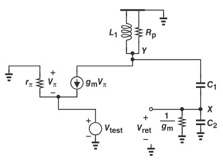

# 장말문제 13.34 — 콜피츠 발진기 해석을 Q1 이미터에서 루프를 끊어 반복

## 원문
Repeat the analysis of the Colpitts oscillator but by breaking the loop at the emitter of $Q_1$. The equivalent circuit is shown in Fig. 13.43. Note that the loading seen at the emitter, $1/g_m$, is included in parallel with $C_2$.

## 조건
- 회로: Fig 13.43 (콜피츠 발진기를 $Q_1$의 이미터에서 끊은 등가 회로, $V_{test}$를 넣고 $X$에서 $V_{ret}$를 봄)
- 본문의 콜피츠 발진기 해석을 반복하되, 루프를 $Q_1$의 이미터에서 끊음
- 이미터에서 보이는 부하 $1/g_m$을 $C_2$와 병렬로 포함함 (원문의 메모)
- 참고 회로 (본문 Fig 13.22(a)): npn $Q_1$의 컬렉터 $Y$와 $V_{DD}$ 사이에 $L_1 \parallel R_p$, 베이스는 바이어스 $V_b$, 이미터 $X$와 접지 사이에 전류원 $I_1$, $Y$–$X$ 사이에 $C_1$, $X$–접지 사이에 $C_2$ (원문에 없음)
- 식 (13.20): $\dfrac{I_{ret}}{I_{test}}(s) = \dfrac{g_mR_pL_1C_1s^2}{L_1C_1C_2R_ps^3 + [g_mR_pL_1C_1 + L_1(C_1 + C_2)]s^2 + [g_mL_1 + R_p(C_1 + C_2)]s + g_mR_p}$ (본문 식, 컬렉터에서 루프를 끊은 개루프 전달 함수, 얼리 효과 무시, 원문에 없음)
- 식 (13.24): $\omega_1^2 = \dfrac{C_1 + C_2}{L_1C_1C_2} + \dfrac{g_m}{R_pC_1C_2}$ (본문 식, 발진 주파수, 원문에 없음)
- 식 (13.26): $g_mR_p = \dfrac{(C_1 + C_2)^2}{C_1C_2}$ (본문 식, 스타트업 조건, 원문에 없음)

## 구할 것
- $Q_1$ 이미터에서 루프를 끊어 콜피츠 발진기 해석 반복
- 구할 값 예: 개루프 전달 함수 $V_{ret}/V_{test}$, 발진 주파수 $\omega_1$, 스타트업 조건 (원문에 없음, 원문은 "Repeat the analysis"만 적음)

## 상속·참조
- 본문 13.3.3 콜피츠 발진기 해석 (교재 747–749쪽, PDF 9–10): 얼리 효과를 무시하면 Fig 13.22(a)의 $Q_1$은 $Y$ 노드에 소신호 전류를 인가하는 이상적인 전압종속 전류원으로 동작한다. 컬렉터에서 루프를 끊고(Fig 13.22(b)) 양의 비종속 전류원 $I_{test}$를 넣어 $I_{ret}$를 측정한다. 전달 함수 $I_{ret}/I_{test}$는 발진 주파수에서 $360°$의 위상과 적어도 1 이상의 크기를 가져야 한다
- $I_{test}$는 $(L_1s) \parallel R_p = \dfrac{L_1sR_p}{L_1s + R_p}$와 $Z_1$ 사이에서 나뉜다. 식 (13.17)–(13.18): $Z_1 = \dfrac{1}{C_1s} + \dfrac{1}{g_m} \parallel \dfrac{1}{C_2s} = \dfrac{1}{C_1s} + \dfrac{1}{C_2s + g_m}$
- 식 (13.19): $I_{Z1} = -I_{test}\dfrac{\dfrac{L_1sR_p}{L_1s + R_p}}{\dfrac{L_1sR_p}{L_1s + R_p} + \dfrac{1}{C_1s} + \dfrac{1}{C_2s + g_m}}$. 이 전류가 $1/(C_2s)$와 $1/g_m$의 병렬 조합에 곱해져 $V_X$가 되고, $I_{ret} = g_mV_\pi = -g_mV_X$
- 식 (13.20): $\dfrac{I_{ret}}{I_{test}}(s) = \dfrac{g_mR_pL_1C_1s^2}{L_1C_1C_2R_ps^3 + [g_mR_pL_1C_1 + L_1(C_1 + C_2)]s^2 + [g_mL_1 + R_p(C_1 + C_2)]s + g_mR_p}$
- 이 전달 함수를 1과 같게 두면 식 (13.21): $L_1C_1C_2R_ps^3 + L_1(C_1 + C_2)s^2 + [g_mL_1 + R_p(C_1 + C_2)]s + g_mR_p = 0$. $s = j\omega_1$에서 실수부와 허수부가 0이 되어 식 (13.22) $-L_1(C_1 + C_2)\omega_1^2 + g_mR_p = 0$, 식 (13.23) $-L_1C_1C_2R_p\omega_1^3 + [g_mL_1 + R_p(C_1 + C_2)]\omega_1 = 0$
- 식 (13.24): $\omega_1^2 = \dfrac{C_1 + C_2}{L_1C_1C_2} + \dfrac{g_m}{R_pC_1C_2}$, 두 번째 항을 무시하면 식 (13.25) $\omega_1^2 \approx \dfrac{1}{L_1\dfrac{C_1C_2}{C_1 + C_2}}$
- 식 (13.26) (스타트업 조건): $g_mR_p = \dfrac{(C_1 + C_2)^2}{C_1C_2}$. $C_1 = C_2$일 때 우변이 최소이므로 $g_mR_p$는 최소한 4 이상이어야 함
- 본문 Fig 13.22(a) 콜피츠 발진기 (교재 748쪽, PDF 10, 크롭 안 함, 이 파일의 그림 목록에는 넣지 않음, 크롭은 fig13-22-a.png): 연결 $Q_1$(npn): C = $Y$, B = $V_b$(이상적 바이어스, 점 단자), E = $X$ / $L_1$, $R_p$: 둘 다 $V_{DD}$ ↔ $Y$ (병렬) / $C_1$: $Y$ ↔ $X$ / $C_2$: $X$ ↔ 접지 / 전류원 $I_1$: $X$ → 접지. 그림 안 회색 둥근 사각형 "Feedback Loop"가 $Q_1$, $C_1$ 사이 루프를 표시
- 본문 Fig 13.22(b) (a)의 개루프 등가 회로 (교재 748쪽, PDF 10, 크롭 안 함, 이 파일의 그림 목록에는 넣지 않음, 크롭은 fig13-22-b.png): 연결 $L_1$, $R_p$: 둘 다 교류 접지 막대 ↔ $Y$ (병렬) / 전류원 $I_{test}$: $Y$ → 접지 / $C_1$: $Y$ ↔ $X$ / $C_2$: $X$ ↔ 접지 / $r_\pi$: 접지 ↔ $X$ ($V_\pi$의 + 는 접지 쪽, − 는 $X$ 쪽) / 종속 전류원 $g_mV_\pi$: 위 단자 → 아래 단자($X$), 위 단자는 접지에 이어지고 그 선을 흐르는 전류(접지 → 전류원 쪽)가 $I_{ret}$. $Z_1$은 $Y$에서 $C_1$ 쪽(아래)을 들여다본 임피던스, $I_{Z1}$은 $C_1$의 아래 방향 전류, $I_2$는 $C_2$의 아래 방향 전류, $1/g_m$은 $X$에서 이미터 쪽(왼쪽)을 들여다본 임피던스

## 회로 — Fig 13.43
```spice
L1     0   Y   {L_1}       ; 위 굵은 막대는 오른쪽 가로선으로 접지 기호에 이어짐
RP     0   Y   {R_p}
G1     Y   n1  0   n1  {g_m}   ; g_mV_π, 원 안 화살표 아래(Y → n1), V_π: + = r_π 위(접지), − = n1
RPI    0   n1  {r_pi}      ; r_π, 위 끝은 선으로 왼쪽 접지 기호
VTEST  n1  0   {V_test}    ; + 위(n1), − 아래(접지)
C1     Y   X   {C_1}
RGM    X   0   {1/g_m}     ; 라벨 1/g_m
C2     X   0   {C_2}
```
- 단자: X = 귀환 전압 V_ret 측정 단자 (개방 원, X에서 왼쪽으로 뻗은 선 끝. V_ret의 + 는 원 아래, − 는 그 아래, 그 밑에 따로 접지 기호)
- 표시: 노드 라벨 Y (Y 접속점 오른쪽), X (X 접속점 오른쪽), V_ret (개방 원 아래) / 소자 라벨 L_1 (인덕터 왼쪽), R_p (저항 오른쪽), r_π (저항 왼쪽), g_mV_π (종속 전류원 오른쪽), V_test (전압원 오른쪽), C_1, C_2 (각 커패시터 오른쪽), 1/g_m (저항 왼쪽, 분수 꼴) / 부호 + (r_π 오른쪽 위), − (r_π 오른쪽 아래) (V_π 극성, V_π 글자는 그 사이), + (V_test 왼쪽 위), − (V_test 왼쪽 아래), + (개방 원 아래), − (V_ret 아래) / 화살표 없음 / 수치·면적 라벨 없음
- 배치: 맨 위 짧은 굵은 막대(오른쪽 끝에서 가로선이 나가 아래로 접지 기호) 아래에 L_1(왼쪽)과 R_p(오른쪽) 병렬 세로 가지, 아래 짧은 가로선 가운데 Y 접속점 / Y 접속점에서 세로선이 내려가 아래 접속점, 여기서 가로선이 왼쪽으로 가서 아래로 꺾여 g_mV_π 전류원 위 단자, 다른 가로선은 오른쪽으로 길게 가서 아래로 꺾여 C_1 / g_mV_π 아래 단자 → 가로선 왼쪽 → 접속점 n1 → 왼쪽으로 r_π 아래 끝 / r_π 위 끝에서 세로선이 올라가 왼쪽으로 꺾여 왼쪽 끝 접지 기호 / n1 접속점에서 아래로 내려가 오른쪽으로 꺾여 원형 전압원 V_test(+ 위), V_test 아래 접지 / C_1 아래 끝 X 접속점 → 아래 C_2 → 접지 / X 접속점에서 가로선이 왼쪽으로 가서 접속점(1/g_m 저항이 아래로 걸려 접지), 계속 왼쪽 끝 개방 원 / 접속점 (세 갈래 이상, 5곳): Y (L_1·R_p 아래 가운데, 점), Y 아래 g_mV_π·C_1 가지 (점), n1 (점), 1/g_m 가지 (점), X (점) / 교차: 없음


