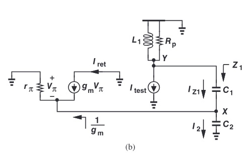

# 장말문제 13.37 — 이미터에 R_in을 단 콜피츠 발진기의 스타트업 조건 g_mR_in = 1 유도

## 원문
Derive Eq. (13.27) if $R_p = \infty$. You can use the equivalent circuit of Fig. 13.22(b) and tie $R_{in}$ from $X$ to ground.

## 조건
- 식 (13.27): $g_mR_{in} = 1$ (본문 식, 이미터에서 다음 단을 구동하는 콜피츠 발진기의 스타트업 조건, 원문에 없음)
- 참고 회로 (본문 Fig 13.23): Fig 13.22(a)의 콜피츠 발진기에서 이미터 노드 $X$가 출력 $V_{out}$이 되어 입력 저항 $R_{in}$(입력 단자와 접지 사이)을 가진 다음 단 증폭기를 구동함 (원문에 없음)
- $R_p = \infty$
- 회로: Fig 13.22(b)의 개루프 등가 회로를 쓰고, $X$와 접지 사이에 $R_{in}$을 연결함
- 식 (13.20): $\dfrac{I_{ret}}{I_{test}}(s) = \dfrac{g_mR_pL_1C_1s^2}{L_1C_1C_2R_ps^3 + [g_mR_pL_1C_1 + L_1(C_1 + C_2)]s^2 + [g_mL_1 + R_p(C_1 + C_2)]s + g_mR_p}$ (본문 식, $R_{in}$이 없을 때의 개루프 전달 함수, 원문에 없음)

## 구할 것
- $R_p = \infty$일 때 식 (13.27) $g_mR_{in} = 1$ 유도

## 상속·참조
- 본문 13.3.3 (교재 749–750쪽, PDF 10–11): 출력은 이미터에서 감지할 수 있다(Fig 13.23). 개별 인덕터는 손실이 적어(높은 등가 $R_p$) 부하 저항에 민감한데, $R_{in}$만이 이미터에 부하를 가하는($R_p \to \infty$) 상태에서 스타트업 조건은 식 (13.27) $g_mR_{in} = 1$로 바뀐다. 본문은 이 식을 "문제 13.37에서 유도된" 조건으로 언급
- 본문 Fig 13.23 (교재 750쪽, PDF 11, 크롭 안 함, figures.yaml에 등록되지 않음): Fig 13.22(a)와 같은 콜피츠 발진기($V_{DD}$ ↔ $Y$: $L_1 \parallel R_p$, $Q_1$: C = $Y$, B = $V_b$, E = $X$, $C_1$: $Y$ ↔ $X$, $C_2$: $X$ ↔ 접지, 전류원 $I_1$: $X$ → 접지)에서 $X$가 $V_{out}$ 라벨로 오른쪽 삼각형 증폭기의 입력에 이어지고, 증폭기 안에 입력 ↔ 접지 저항 $R_{in}$이 그려짐
- 본문 콜피츠 해석 (교재 748쪽, PDF 10): $I_{test}$는 $(L_1s) \parallel R_p$와 $Z_1$ 사이에서 나뉘고, 식 (13.17)–(13.18) $Z_1 = \dfrac{1}{C_1s} + \dfrac{1}{g_m} \parallel \dfrac{1}{C_2s} = \dfrac{1}{C_1s} + \dfrac{1}{C_2s + g_m}$, 식 (13.19) $I_{Z1} = -I_{test}\dfrac{\dfrac{L_1sR_p}{L_1s + R_p}}{\dfrac{L_1sR_p}{L_1s + R_p} + \dfrac{1}{C_1s} + \dfrac{1}{C_2s + g_m}}$. 이 전류가 $1/(C_2s)$와 $1/g_m$의 병렬 조합에 곱해져 $V_X$가 되고 $I_{ret} = g_mV_\pi = -g_mV_X$ → 식 (13.20). 전달 함수를 1과 같게 두어 식 (13.21) $L_1C_1C_2R_ps^3 + L_1(C_1 + C_2)s^2 + [g_mL_1 + R_p(C_1 + C_2)]s + g_mR_p = 0$을 얻고, $s = j\omega_1$에서 실수부·허수부를 0으로 둠

## 회로 — Fig 13.22(b)
```spice
L1     0   Y   {L_1}       ; 위 굵은 막대는 오른쪽 가로선으로 접지 기호에 이어짐
RP     0   Y   {R_p}
ITEST  Y   0   {I_test}
C1     Y   X   {C_1}
C2     X   0   {C_2}
RPI    0   X   {r_pi}      ; r_π, 위 끝은 선으로 왼쪽 접지 기호, 아래 끝은 긴 아래 도선으로 X
G1     n1  X   0   X  {g_m}   ; g_mV_π, 원 안 화살표 아래(n1 → X), V_π: + = r_π 위(접지), − = X
VAC    0   n1  0           ; 그림에 없는 소자 (I_ret 화살표가 붙은 접지 단락선)
* VAC는 소신호 단락만 의미 (그림에 없는 소자)
```
- 단자: 개방 단자 없음 (I_test는 원형 독립 전류원 소자)
- 표시: 노드 라벨 Y (Y 접속점 오른쪽), X (X 접속점 오른쪽) / 소자 라벨 L_1 (인덕터 왼쪽), R_p (저항 오른쪽), I_test (전류원 왼쪽), C_1, C_2 (각 커패시터 오른쪽), r_π (저항 왼쪽), g_mV_π (종속 전류원 오른쪽) / 부호 + (r_π 오른쪽 위), − (r_π 오른쪽 아래) (V_π 극성, V_π 글자는 그 사이) / 화살표 "I_ret": g_mV_π 위 단자에서 오른쪽 접지로 가는 가로선의 전류, 왼쪽 방향(접지 → 전류원), 도선 위; "Z_1": Y에서 C_1 쪽을 아래로 들여다봄, 아래 방향, 도선 옆 별도 화살표 (┌ 꺾임: 위 끝에서 짧은 가로선이 오른쪽 Z_1 글자 쪽으로, 화살촉은 아래 끝, C_1 오른쪽 위); "I_Z1": C_1 전류, 아래 방향, 도선 옆 별도 화살표 (직선, C_1 왼쪽); "I_2": C_2 전류, 아래 방향, 도선 옆 별도 화살표 (직선, C_2 왼쪽); "1/g_m": X 쪽에서 이미터 쪽(왼쪽)을 들여다본 임피던스, 왼쪽 방향, 도선 옆 별도 화살표 (┐ 꺾임: 가로선 오른쪽 끝에서 짧은 세로선이 아래로, 화살촉은 가로선 왼쪽 끝, 긴 아래 도선 바로 아래, 1/g_m 글자는 오른쪽) / 수치·면적 라벨 없음
- 배치: 오른쪽 위 짧은 굵은 막대(오른쪽 끝에서 가로선이 나가 아래로 접지 기호) 아래에 L_1(왼쪽)과 R_p(오른쪽) 병렬 세로 가지, 아래 짧은 가로선 가운데 Y 접속점 / Y 접속점에서 세로선이 내려가 아래 접속점, 여기서 가로선이 오른쪽으로 길게 가서 아래로 꺾여 C_1, 세로선은 계속 아래로 I_test 전류원(화살표 아래), 그 아래 접지 / C_1 아래 끝 X 접속점 → 아래 C_2 → 접지 / 왼쪽에 r_π와 g_mV_π가 나란히: r_π 위 끝에서 세로선이 올라가 왼쪽으로 꺾여 왼쪽 끝 접지 기호, g_mV_π 위 단자에서 세로선이 올라가 오른쪽으로 꺾여 가로선(I_ret) 끝 접지 기호 / r_π 아래 끝과 g_mV_π 아래 단자는 아래 가로선으로 이어지고 그 접속점에서 아래로 내려가 오른쪽으로 꺾여 긴 아래 도선이 X 접속점까지 / 접속점 (세 갈래 이상, 4곳): Y (L_1·R_p 아래 가운데, 점), Y 아래 C_1·I_test 가지 (점), r_π·g_mV_π 아래 (점), X (점) / 교차: 없음


> 참고: Fig 13.22는 본문 그림(교재 748쪽, PDF 10). 그림에는 R_in이 없고 문제는 X와 접지 사이에 R_in을 달아 쓰라고 함
