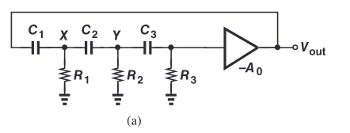

# 장말문제 13.38 — 위상 시프트 발진기의 노드 X, Y 파형

## 원문
In the oscillator of Fig. 13.24(a), we have $R_1 = R_2 = R_3 = R$, $C_1 = C_2 = C_3 = C$, and $V_{out} = V_0 \cos \omega_0 t$, where $\omega_0 = 1/(RC)$. Plot the waveforms at $X$ and $Y$. Assume $A_0 = 2$.

## 조건
- 회로: Fig 13.24(a)의 위상 시프트 발진기 (세 개의 CR 고역 통과 단 + 이득 $-A_0$ 증폭기)
- $R_1 = R_2 = R_3 = R$, $C_1 = C_2 = C_3 = C$
- $V_{out} = V_0 \cos \omega_0 t$, $\omega_0 = 1/(RC)$
- $A_0 = 2$로 가정
- 식 (13.28): $V_Y = \dfrac{V_{out}}{R} \dfrac{1}{Cs} + V_{out}$ (본문 식, 원문에 없음)
- 식 (13.29): $V_X = \left( \dfrac{V_Y}{R_2} + \dfrac{V_{out}}{R_3} \right) \dfrac{1}{Cs} + V_Y$ (본문 식, 원문에 없음)
- 위 두 식에서 $V_{out}$은 증폭기 입력 노드(그림에서 라벨 없는 $R_3$ 위 노드)의 전압을 뜻함 — 본문은 Fig 13.24(b) 수동 망의 출력을 $V_{out}$이라 부름 (원문에 없음)

## 구할 것
- 노드 $X$와 $Y$의 파형 (시간 함수로 그리기)

## 상속·참조
- 본문 Fig 13.24(b) (교재 750쪽, 크롭 안 함): Fig 13.24(a)에서 증폭기를 떼어 낸 수동 위상 시프트 망. $V_{in}$ → $C_1$ → $X$ → $C_2$ → $Y$ → $C_3$ → $V_{out}$, 각 노드 $X$, $Y$, $V_{out}$에서 $R_1$, $R_2$, $R_3$가 접지로
- 식 (13.28)–(13.29) (13.4절, $R_3$ 전류를 $V_{out}/R$로 놓고 출력에서 거꾸로 계산): $V_Y = \dfrac{V_{out}}{R} \dfrac{1}{Cs} + V_{out}$, $\quad V_X = \left( \dfrac{V_Y}{R_2} + \dfrac{V_{out}}{R_3} \right) \dfrac{1}{Cs} + V_Y$

## 회로 — Fig 13.24(a)
```spice
C1  Vout  X     {C_1}
R1  X     0     {R_1}
C2  X     Y     {C_2}
R2  Y     0     {R_2}
C3  Y     n1    {C_3}
R3  n1    0     {R_3}
XA  n1    Vout  gain "-A0" tri    ; 증폭기 입력 = n1(라벨 없음), 출력 = Vout
```
- 단자: Vout = 증폭기 출력, 발진기 출력 (개방 원)
- 표시: 노드 라벨 X (X 접속점 위, C_1과 C_2 사이), Y (Y 접속점 위, C_2와 C_3 사이), V_out (개방 원 오른쪽) / 소자 라벨 C_1, C_2, C_3 (각 직렬 커패시터 위), R_1, R_2, R_3 (각 세로 저항 오른쪽), −A_0 (삼각형 아래 오른쪽) / 부호 없음 (−A_0의 − 는 이득 라벨의 일부) / 화살표 없음 / 수치·면적 라벨 없음
- 배치: 왼쪽→오른쪽 한 가로선 위에 C_1, X 접속점, C_2, Y 접속점, C_3, n1 접속점, 오른쪽을 향한 삼각형 증폭기, Vout 접속점, V_out 개방 원 / X, Y, n1에서 각각 세로 저항 R_1, R_2, R_3가 아래로 내려가 접지 / 귀환 선: Vout 접속점에서 위로 올라가 그림 맨 위 높이에서 왼쪽으로 꺾여 회로 전체 위를 지나 왼쪽 끝에서 아래로 꺾여 C_1 왼쪽 단자 / 접속점 (세 갈래 이상, 4곳): X = 왼쪽 C_1 + 오른쪽 C_2 + 아래 R_1 (점), Y = 왼쪽 C_2 + 오른쪽 C_3 + 아래 R_2 (점), n1 = 왼쪽 C_3 + 오른쪽 증폭기 입력 + 아래 R_3 (점), Vout = 왼쪽 증폭기 출력 + 위 귀환 선 + 오른쪽 V_out 원 (점) / 교차: 없음


