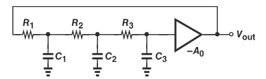

# 장말문제 13.39 — 저역 통과 RC 세 단을 쓴 위상 시프트 발진기

## 원문
A student decides to employ three low-pass sections to create the phase shift necessary in a phase shift oscillator (Fig. 13.44). If $R_1 = R_2 = R_3 = R$ and $C_1 = C_2 = C_3 = C$, repeat the analysis for this circuit.

## 조건
- 회로: Fig 13.44 — 위상 시프트 발진기에 필요한 위상 시프트를 세 개의 저역 통과 RC 단(직렬 $R$, 병렬 $C$)으로 만듦
- $R_1 = R_2 = R_3 = R$, $C_1 = C_2 = C_3 = C$
- 증폭기 이득은 $-A_0$ (그림 라벨)
- 증폭기 자체의 위상 기여는 무시 (원문에 없음, 본문 13.4절 가정)
- 본문 13.4절의 해석: Fig 13.24(b)의 고역 통과 세 단 망에서 전달 함수를 구하고, 위상이 $180°$가 되는 주파수 $\omega_1$과 그때 루프 이득이 1이 되는 증폭기 이득을 구함 (원문에 없음)
- 식 (13.32): $\dfrac{V_{out}}{V_{in}} = \dfrac{(RCs)^3}{(RCs)^3 + 6(RCs)^2 + 5RCs + 1}$ (본문 식, 고역 통과 세 단, 원문에 없음)
- 식 (13.35): $\omega_1 = \dfrac{1}{\sqrt{6}RC}$ (본문 식, 원문에 없음)
- 식 (13.37): $A = 29$ (본문 식, 원문에 없음)

## 구할 것
- 이 회로에 대해 본문 13.4절의 해석을 반복
- 반복할 내용: 수동 망의 전달 함수, 발진 주파수, 스타트업 조건(필요한 증폭기 이득) (원문에 없음)

## 상속·참조
- 본문 Fig 13.24(b) (교재 750쪽, 크롭 안 함): 고역 통과 위상 시프트 망. $V_{in}$ → $C_1$ → $X$ → $C_2$ → $Y$ → $C_3$ → $V_{out}$, 노드 $X$, $Y$, $V_{out}$에서 각각 $R_1$, $R_2$, $R_3$가 접지로
- 본문 해석 (13.4절, 식 13.28–13.37): $R_3$ 전류를 $V_{out}/R$로 두고 출력에서 입력 쪽으로 노드 전압을 차례로 구함
  - 식 (13.28)–(13.29): $V_Y = \dfrac{V_{out}}{R} \dfrac{1}{Cs} + V_{out}$, $\quad V_X = \left( \dfrac{V_Y}{R_2} + \dfrac{V_{out}}{R_3} \right) \dfrac{1}{Cs} + V_Y$
  - 식 (13.31): $V_{in} = \dfrac{V_{out}}{R^3C^3s^3} + \dfrac{5V_{out}}{R^2C^2s^2} + \dfrac{6V_{out}}{RCs} + V_{out}$
  - 식 (13.32): $\dfrac{V_{out}}{V_{in}} = \dfrac{(RCs)^3}{(RCs)^3 + 6(RCs)^2 + 5RCs + 1}$
  - 식 (13.33): $\angle \dfrac{V_{out}}{V_{in}} = 3 \times 90° - \tan^{-1} \dfrac{5RC\omega - (RC\omega)^3}{1 - 6R^2C^2\omega^2}$
  - 식 (13.34)–(13.35): 위상이 $180°$가 되려면 $1 - 6R^2C^2\omega_1^2 = 0$, $\omega_1 = \dfrac{1}{\sqrt{6}RC}$
  - 식 (13.36)–(13.37): 식 (13.32)의 크기에 증폭기 이득 $A$를 곱해 1로 두면 $\dfrac{(\sqrt{6})^{-3}A}{5/\sqrt{6} - (\sqrt{6})^{-3}} = 1$, 곧 $A = 29$

## 회로 — Fig 13.44
```spice
R1  Vout  n1    {R_1}
C1  n1    0     {C_1}
R2  n1    n2    {R_2}
C2  n2    0     {C_2}
R3  n2    n3    {R_3}
C3  n3    0     {C_3}
XA  n3    Vout  gain "-A0" tri    ; 증폭기 입력 = n3(라벨 없음), 출력 = Vout
```
- 단자: Vout = 증폭기 출력, 발진기 출력 (개방 원)
- 표시: 노드 라벨 V_out (개방 원 오른쪽) / 소자 라벨 R_1, R_2, R_3 (각 직렬 저항 위), C_1, C_2, C_3 (각 세로 커패시터 오른쪽), −A_0 (삼각형 아래 오른쪽) / 부호 없음 (−A_0의 − 는 이득 라벨의 일부) / 화살표 없음 / 수치·면적 라벨 없음
- 배치: 왼쪽→오른쪽 한 가로선 위에 R_1, n1 접속점, R_2, n2 접속점, R_3, n3 접속점, 오른쪽을 향한 삼각형 증폭기, Vout 접속점, V_out 개방 원 / n1, n2, n3에서 각각 세로 커패시터 C_1, C_2, C_3가 아래로 내려가 접지 / 귀환 선: Vout 접속점에서 위로 올라가 그림 맨 위 높이에서 왼쪽으로 꺾여 회로 전체 위를 지나 왼쪽 끝에서 아래로 꺾여 R_1 왼쪽 단자 / 노드 라벨(X, Y)은 인쇄되지 않음 / 접속점 (세 갈래 이상, 4곳): n1 = 왼쪽 R_1 + 오른쪽 R_2 + 아래 C_1 (점), n2 = 왼쪽 R_2 + 오른쪽 R_3 + 아래 C_2 (점), n3 = 왼쪽 R_3 + 오른쪽 증폭기 입력 + 아래 C_3 (점), Vout = 왼쪽 증폭기 출력 + 위 귀환 선 + 오른쪽 V_out 원 (점) / 교차: 없음


