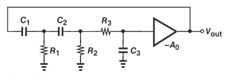

# 장말문제 13.42 — 고역 통과 두 단과 저역 통과 한 단을 섞은 위상 시프트 회로의 발진 가능성

## 원문
Can the circuit shown in Fig. 13.45 oscillate? Explain. Assume $R_1 = R_2 = R_3 = R$ and $C_1 = C_2 = C_3 = C$.

## 조건
- 회로: Fig 13.45 — 고역 통과 단 두 개($C_1$–$R_1$, $C_2$–$R_2$) 뒤에 저역 통과 단 하나($R_3$–$C_3$)가 오고, 이득 $-A_0$ 증폭기 출력이 첫 단으로 되돌아가는 고리 (괄호 안은 원문에 없음)
- $R_1 = R_2 = R_3 = R$, $C_1 = C_2 = C_3 = C$

## 구할 것
- 이 회로가 발진할 수 있는가? 이유를 설명

## 회로 — Fig 13.45
```spice
C1  Vout  n1    {C_1}
R1  n1    0     {R_1}
C2  n1    n2    {C_2}
R2  n2    0     {R_2}
R3  n2    n3    {R_3}
C3  n3    0     {C_3}
XA  n3    Vout  gain "-A0" tri    ; 증폭기 입력 = n3(라벨 없음), 출력 = Vout
```
- 단자: Vout = 증폭기 출력, 발진기 출력 (개방 원)
- 표시: 노드 라벨 V_out (개방 원 오른쪽) / 소자 라벨 C_1, C_2 (각 직렬 커패시터 위), R_3 (직렬 저항 위), R_1, R_2 (각 세로 저항 오른쪽), C_3 (세로 커패시터 오른쪽), −A_0 (삼각형 아래 오른쪽) / 부호 없음 (−A_0의 − 는 이득 라벨의 일부) / 화살표 없음 / 수치·면적 라벨 없음
- 배치: 왼쪽→오른쪽 한 가로선 위에 C_1, n1 접속점, C_2, n2 접속점, R_3, n3 접속점, 오른쪽을 향한 삼각형 증폭기, Vout 접속점, V_out 개방 원 / n1, n2에서 각각 세로 저항 R_1, R_2가, n3에서 세로 커패시터 C_3가 아래로 내려가 접지 / 귀환 선: Vout 접속점에서 위로 올라가 그림 맨 위 높이에서 왼쪽으로 꺾여 회로 전체 위를 지나 왼쪽 끝에서 아래로 꺾여 C_1 왼쪽 단자 / 노드 라벨(X, Y)은 인쇄되지 않음 / 접속점 (세 갈래 이상, 4곳): n1 = 왼쪽 C_1 + 오른쪽 C_2 + 아래 R_1 (점), n2 = 왼쪽 C_2 + 오른쪽 R_3 + 아래 R_2 (점), n3 = 왼쪽 R_3 + 오른쪽 증폭기 입력 + 아래 C_3 (점), Vout = 왼쪽 증폭기 출력 + 위 귀환 선 + 오른쪽 V_out 원 (점) / 교차: 없음


> 참고: Fig 13.45는 교재 767쪽(PDF 19 오른쪽) 단1 위에 인쇄됨. 문제 문장은 766쪽
