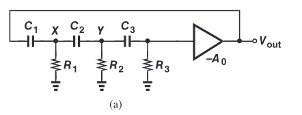

# 장말문제 13.43 — 증폭기 극점과 고역 통과 두 단만으로 위상 시프트 발진기가 되는가

## 원문
Consider the oscillator of Fig. 13.24(a) and assume the amplifier contains a pole, i.e., $A(s) = A_0/(1 + s/\omega_0)$. Also, assume the phase shift network contains only two high-pass sections with $R_1 = R_2 = R$ and $C_1 = C_2 = C$. Can $\omega_0$ be chosen such that this circuit oscillates?

## 조건
- 회로: Fig 13.24(a)의 위상 시프트 발진기를 바탕으로 함
- 증폭기에 극점 하나가 있음: $A(s) = A_0/(1 + s/\omega_0)$
- 위상 시프트 망은 고역 통과 단 두 개($C_1$–$R_1$, $C_2$–$R_2$)만으로 이루어짐 (괄호 안은 원문에 없음)
- 그림의 세 번째 단($C_3$, $R_3$)은 없는 것으로 보고, 노드 $Y$가 증폭기 입력에 바로 이어진다고 봄 (원문에 없음, 원문은 "두 고역 통과 단만"이라고만 적음)
- $R_1 = R_2 = R$, $C_1 = C_2 = C$
- 증폭기는 반전 증폭기로 봄: 그림의 이득 라벨 $-A_0$ (원문에 없음, 원문의 $A(s)$ 식에는 부호가 없음)

## 구할 것
- 이 회로가 발진하도록 $\omega_0$를 고를 수 있는가?

## 회로 — Fig 13.24(a)
```spice
C1  Vout  X     {C_1}
R1  X     0     {R_1}
C2  X     Y     {C_2}
R2  Y     0     {R_2}
C3  Y     n1    {C_3}
R3  n1    0     {R_3}
XA  n1    Vout  gain "-A0" tri    ; 증폭기 입력 = n1(라벨 없음), 출력 = Vout
```
- 단자: Vout = 증폭기 출력, 발진기 출력 (개방 원)
- 표시: 노드 라벨 X (X 접속점 위, C_1과 C_2 사이), Y (Y 접속점 위, C_2와 C_3 사이), V_out (개방 원 오른쪽) / 소자 라벨 C_1, C_2, C_3 (각 직렬 커패시터 위), R_1, R_2, R_3 (각 세로 저항 오른쪽), −A_0 (삼각형 아래 오른쪽) / 부호 없음 (−A_0의 − 는 이득 라벨의 일부) / 화살표 없음 / 수치·면적 라벨 없음
- 배치: 왼쪽→오른쪽 한 가로선 위에 C_1, X 접속점, C_2, Y 접속점, C_3, n1 접속점, 오른쪽을 향한 삼각형 증폭기, Vout 접속점, V_out 개방 원 / X, Y, n1에서 각각 세로 저항 R_1, R_2, R_3가 아래로 내려가 접지 / 귀환 선: Vout 접속점에서 위로 올라가 그림 맨 위 높이에서 왼쪽으로 꺾여 회로 전체 위를 지나 왼쪽 끝에서 아래로 꺾여 C_1 왼쪽 단자 / 접속점 (세 갈래 이상, 4곳): X = 왼쪽 C_1 + 오른쪽 C_2 + 아래 R_1 (점), Y = 왼쪽 C_2 + 오른쪽 C_3 + 아래 R_2 (점), n1 = 왼쪽 C_3 + 오른쪽 증폭기 입력 + 아래 R_3 (점), Vout = 왼쪽 증폭기 출력 + 위 귀환 선 + 오른쪽 V_out 원 (점) / 교차: 없음


> 참고: 그림은 세 단으로 인쇄돼 있음. 문제는 이 가운데 고역 통과 두 단만 남긴 회로를 다룸. 문제 문장은 766쪽 단2 아래에서 시작해 767쪽 단1 맨 위로 이어짐
