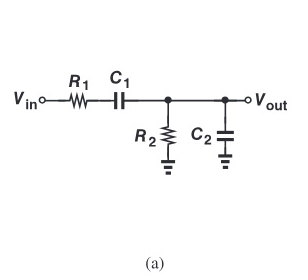

# 장말문제 13.44 — 빈 브리지 위상 시프트 망의 출력 파형

## 원문
In the circuit of Fig. 13.27(a), $R_1 = R_2 = R$ and $C_1 = C_2 = C$. If $V_{in} = V_0 \cos \omega_0 t$, where $\omega_0 = 1/(RC)$, plot $V_{out}$ as a function of time.

## 조건
- 회로: Fig 13.27(a)의 수동 위상 시프트 망 (직렬 $R_1$–$C_1$, 출력 노드에서 접지로 $R_2 \parallel C_2$)
- $R_1 = R_2 = R$, $C_1 = C_2 = C$
- $V_{in} = V_0 \cos \omega_0 t$, $\omega_0 = 1/(RC)$
- 식 (13.41): $\dfrac{V_{out}}{V_{in}}(s) = \dfrac{RCs}{R^2C^2s^2 + 3RCs + 1}$ (본문 식, 원문에 없음)

## 구할 것
- $V_{out}$을 시간의 함수로 그리기

## 상속·참조
- 식 (13.40)–(13.41) (13.5절, $R_1 = R_2 = R$, $C_1 = C_2 = C$): $\dfrac{V_{out}}{V_{in}}(s) = \dfrac{\dfrac{R}{RCs + 1}}{\dfrac{R}{RCs + 1} + \dfrac{1}{Cs} + R} = \dfrac{RCs}{R^2C^2s^2 + 3RCs + 1}$
- 식 (13.42)–(13.43): $\angle \dfrac{V_{out}}{V_{in}}(s = j\omega) = \dfrac{\pi}{2} - \tan^{-1} \dfrac{3RC\omega}{1 - R^2C^2\omega^2}$, 위상은 $\omega_1 = \dfrac{1}{RC}$에서 0

## 회로 — Fig 13.27(a)
```spice
R1  Vin   n1    {R_1}
C1  n1    Vout  {C_1}
R2  Vout  0     {R_2}
C2  Vout  0     {C_2}
```
- 단자: Vin = 입력 (개방 원) / Vout = 출력 (개방 원)
- 표시: 노드 라벨 V_in (입력 원 왼쪽), V_out (출력 원 오른쪽) / 소자 라벨 R_1 (직렬 저항 위), C_1 (직렬 커패시터 위), R_2 (세로 저항 왼쪽), C_2 (세로 커패시터 왼쪽) / 부호 없음 / 화살표 없음 / 수치·면적 라벨 없음
- 배치: 왼쪽→오른쪽 한 가로선 위에 V_in 원, R_1, C_1, R_2 접속점, C_2 접속점, V_out 원 / R_2 접속점에서 세로 저항 R_2가, C_2 접속점에서 세로 커패시터 C_2가 아래로 내려가 각각 접지 / R_2 접속점과 C_2 접속점은 같은 노드(Vout)를 가로선으로 이은 것 / 접속점 (세 갈래 이상, 2곳): R_2 접속점 = 왼쪽 C_1 + 오른쪽 가로선 + 아래 R_2 (점), C_2 접속점 = 왼쪽 가로선 + 오른쪽 V_out 원 + 아래 C_2 (점) / 교차: 없음


> 참고: Fig 13.27은 본문 그림(교재 754쪽, PDF 13 왼쪽)
