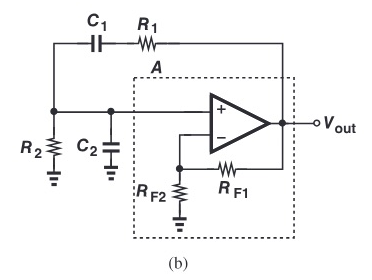
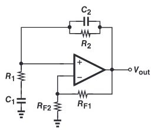

# 장말문제 13.45 — R과 C 가지를 맞바꾼 빈 브리지 발진기의 발진 가능성

## 원문
A student decides to modify the Wien oscillator of Fig. 13.27(b) as shown in Fig. 13.46. Can this circuit oscillate? Explain.

## 조건
- 회로: Fig 13.27(b)의 빈 브리지 발진기를 Fig 13.46처럼 바꾼 회로
- Fig 13.27(b): 출력에서 비반전 입력으로 직렬 $C_1$–$R_1$ 가지, 비반전 입력에서 접지로 $R_2 \parallel C_2$, 비반전 증폭기 이득은 $R_{F1}$, $R_{F2}$로 정함
- Fig 13.46: 출력에서 비반전 입력으로 $C_2 \parallel R_2$ 가지, 비반전 입력에서 접지로 직렬 $R_1$–$C_1$, 증폭기 부분($R_{F1}$, $R_{F2}$)은 그대로
- 소자 값은 주어지지 않음 (원문에 없음)
- 본문 13.5절의 결과: Fig 13.27(b)는 $R_1 = R_2 = R$, $C_1 = C_2 = C$일 때 $\omega_1 = 1/(RC)$에서 귀환 망 위상이 0이 되고, 비반전 증폭기 이득 $A = 3$이면 발진 (식 13.43, 13.45, 본문 식, 원문에 없음)

## 구할 것
- Fig 13.46의 회로가 발진할 수 있는가? 이유를 설명

## 상속·참조
- 식 (13.41) (Fig 13.27(a) 망, $R_1 = R_2 = R$, $C_1 = C_2 = C$): $\dfrac{V_{out}}{V_{in}}(s) = \dfrac{RCs}{R^2C^2s^2 + 3RCs + 1}$
- 식 (13.42)–(13.43): $\angle \dfrac{V_{out}}{V_{in}}(s = j\omega) = \dfrac{\pi}{2} - \tan^{-1} \dfrac{3RC\omega}{1 - R^2C^2\omega^2}$, 위상은 $\omega_1 = \dfrac{1}{RC}$에서 0
- 식 (13.44)–(13.45): $\left| \dfrac{ARCj\omega}{1 - R^2C^2\omega^2 + 3jRC\omega} \right| = 1$, $\omega_1$에서 $A = 3$, 곧 $R_{F1} \geq 2R_{F2}$

## 회로 — Fig 13.27(b)
```spice
C1   n1    n2    {C_1}
R1   n2    Vout  {R_1}
R2   n1    0     {R_2}
C2   n1    0     {C_2}
X1   n1    n3    Vout  opamp    ; in+ = n1, in- = n3
RF1  Vout  n3    {R_F1}
RF2  n3    0     {R_F2}
```
- 단자: Vout = 출력 (개방 원)
- 표시: 노드 라벨 V_out (개방 원 오른쪽) / 소자 라벨 C_1, R_1 (위 가로 가지, 각 소자 위), R_2 (세로 저항 왼쪽), C_2 (세로 커패시터 왼쪽 위), R_F1 (가로 저항 아래), R_F2 (세로 저항 왼쪽), 연산증폭기 (라벨 없음), 점선 상자 라벨 A (상자 위쪽 왼편, R_1 아래) / 부호 연산증폭기 입력 "+" (위 입력, 삼각형 안), "−" (아래 입력, 삼각형 안) / 화살표 없음 / 수치·면적 라벨 없음
- 배치: 점선 사각형(라벨 A)이 연산증폭기, R_F1, R_F2와 그 접지를 둘러쌈 (비반전 증폭기 블록 A); 귀환 망 소자 C_1, R_1, R_2, C_2는 상자 밖 / 왼쪽에 n1 접속점, 그 아래로 세로 저항 R_2 → 접지 / n1에서 가로선이 오른쪽으로 가 C_2 접속점(아래로 세로 커패시터 C_2 → 접지)을 지나 상자 안 연산증폭기 + 입력 / n1에서 위로 올라가 그림 맨 위 높이에서 오른쪽으로 꺾여 가로 C_1, R_1을 지나 오른쪽 끝에서 아래로 꺾여 Vout 접속점 / 연산증폭기 출력 → Vout 접속점 → 오른쪽 V_out 원 / Vout 접속점에서 아래로 내려가 R_F1 높이에서 왼쪽으로 꺾여 가로 R_F1 → RF 접속점 / − 입력에서 왼쪽으로 짧게 나가 아래로 꺾여 RF 접속점 / RF 접속점 아래 세로 R_F2 → 접지 / 접속점 (세 갈래 이상, 4곳): n1 = 위 귀환 선 + 아래 R_2 + 오른쪽 가로선 (점), C_2 접속점 = 왼쪽 가로선 + 오른쪽 + 입력 선 + 아래 C_2 (점), Vout = 왼쪽 연산증폭기 출력 + 위 R_1 가지 + 아래 R_F1 가지 + 오른쪽 V_out 원 (점), RF 접속점 = 위 − 입력 선 + 오른쪽 R_F1 + 아래 R_F2 (점) / 교차: 없음 (점선 상자 경계와 도선이 겹치는 곳은 교차로 보지 않음)

## 회로 — Fig 13.46
```spice
C2   n1    Vout  {C_2}
R2   n1    Vout  {R_2}      ; C2와 병렬
R1   n1    n2    {R_1}
C1   n2    0     {C_1}
X1   n1    n3    Vout  opamp    ; in+ = n1, in- = n3
RF1  Vout  n3    {R_F1}
RF2  n3    0     {R_F2}
```
- 단자: Vout = 출력 (개방 원)
- 표시: 노드 라벨 V_out (개방 원 오른쪽) / 소자 라벨 C_2 (병렬 쌍 위 커패시터 위), R_2 (병렬 쌍 아래 저항 아래), R_1 (세로 저항 왼쪽), C_1 (세로 커패시터 왼쪽), R_F1 (가로 저항 아래), R_F2 (세로 저항 왼쪽), 연산증폭기 (라벨 없음) / 부호 연산증폭기 입력 "+" (위 입력, 삼각형 안), "−" (아래 입력, 삼각형 안) / 화살표 없음 / 수치·면적 라벨 없음
- 배치: 점선 상자 없음 / 왼쪽에 n1 접속점, 그 아래로 세로 저항 R_1, 이어서 세로 커패시터 C_1 → 접지 (R_1이 위, C_1이 아래) / n1에서 가로선이 오른쪽으로 가 연산증폭기 + 입력 / n1에서 위로 올라가 그림 맨 위 높이에서 오른쪽으로 꺾여 병렬 쌍 C_2(위)·R_2(아래)의 왼쪽 접속점, 병렬 쌍 오른쪽 접속점에서 오른쪽으로 가 아래로 꺾여 Vout 접속점 / 연산증폭기 출력 → Vout 접속점 → 오른쪽 V_out 원 / Vout 접속점에서 아래로 내려가 R_F1 높이에서 왼쪽으로 꺾여 가로 R_F1 → RF 접속점 / − 입력에서 왼쪽으로 짧게 나가 아래로 꺾여 RF 접속점 / RF 접속점 아래 세로 R_F2 → 접지 / R_F2는 R_1·C_1 줄보다 오른쪽, 연산증폭기 왼쪽 아래 / 접속점 (세 갈래 이상, 5곳): n1 = 위 귀환 선 + 아래 R_1 + 오른쪽 + 입력 선 (점), 병렬 쌍 왼쪽 = 왼쪽 귀환 선 + C_2 + R_2 (점), 병렬 쌍 오른쪽 = C_2 + R_2 + 오른쪽 선 (점), Vout = 왼쪽 연산증폭기 출력 + 위 병렬 쌍 가지 + 아래 R_F1 가지 + 오른쪽 V_out 원 (점), RF 접속점 = 위 − 입력 선 + 오른쪽 R_F1 + 아래 R_F2 (점) / 교차: 없음



> 참고: Fig 13.27은 본문 그림(교재 754쪽, PDF 13 왼쪽). Fig 13.46은 교재 767쪽(PDF 19 오른쪽) 단1
