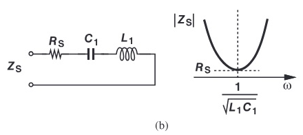

# 장말문제 13.46 — 크리스털 직렬 공진 모델 Z_S의 식

## 원문
Derive an expression for $Z_S$ in Fig. 13.30(b) if $s = j\omega$.

## 조건
- 회로: Fig 13.30(b)의 크리스털 직렬 공진 모델 — 두 단자 사이에 $R_S$, $C_1$, $L_1$이 직렬
- $s = j\omega$ (사인파 정상 상태)
- Fig 13.30(b) 오른쪽 그래프: $|Z_S|$는 $\omega = 1/\sqrt{L_1 C_1}$에서 최솟값 $R_S$를 갖고 양쪽으로 커지는 U자 곡선 (그림의 그래프)

## 구할 것
- $s = j\omega$일 때 $Z_S$의 식

## 회로 — Fig 13.30(b)
```spice
RS  out1  n1    {R_S}
C1  n1    n2    {C_1}
L1  n2    out2  {L_1}
```
- 단자: out1, out2 = Z_S를 보는 두 단자 (개방 원, 위·아래)
- 표시: 노드 라벨 없음 / 소자 라벨 R_S, C_1, L_1 (각 소자 위), Z_S (두 개방 원 사이 왼쪽, 단자 이름) / 부호 없음 / 화살표 없음 / 수치·면적 라벨 없음
- 배치: 위 개방 원(out1)에서 오른쪽으로 가로선 위에 R_S, C_1, L_1 차례로 직렬 / L_1 오른쪽 끝에서 아래로 꺾여 아래 높이에서 왼쪽으로 꺾인 가로선이 아래 개방 원(out2)으로 / 접지 없음 / 접속점: 없음 / 교차: 없음


> 참고: (b) 패널 오른쪽은 |Z_S| 그래프 — 세로 라벨 |Z_S|, 가로축 ω(화살표), 곡선 바닥에 R_S 높이의 가로 점선, 바닥을 지나는 세로 점선 아래 눈금 1/√(L_1C_1). Fig 13.30은 본문 그림(교재 757쪽, PDF 14 오른쪽)
