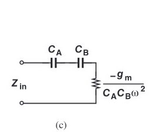

# 장말문제 13.47 — 음저항 회로 등가 임피던스 Z_in의 실수부와 허수부

## 원문
Sketch the real and imaginary parts of $Z_{in}$ in Fig. 13.31(c) as a function of frequency.

## 조건
- 회로: Fig 13.31(c)의 등가 임피던스 — $C_A$, $C_B$, 저항 $-g_m/(C_A C_B \omega^2)$가 직렬
- 식 (13.57): $Z_{in}(j\omega) = \dfrac{1}{jC_A\omega} + \dfrac{1}{jC_B\omega} - \dfrac{g_m}{C_A C_B \omega^2}$ (본문 식, 원문에 없음)

## 구할 것
- $Z_{in}$의 실수부를 주파수의 함수로 스케치
- $Z_{in}$의 허수부를 주파수의 함수로 스케치

## 상속·참조
- 본문 13.6.2절: Fig 13.31(a)의 음저항 회로($M_1$ 게이트–소스에 $C_A$, 드레인–소스에 $C_B$, $Z_{in}$은 게이트와 드레인 사이)에서 채널 길이 변조와 다른 커패시턴스를 무시하고 구한 결과
- 식 (13.56): $Z_{in}(s) = \dfrac{1}{C_A s} + \dfrac{1}{C_B s} + \dfrac{g_m}{C_A C_B s^2}$
- 식 (13.57) ($s = j\omega$): $Z_{in}(j\omega) = \dfrac{1}{jC_A\omega} + \dfrac{1}{jC_B\omega} - \dfrac{g_m}{C_A C_B \omega^2}$ — 앞 두 항은 직렬 커패시터, 셋째 항은 실수이고 음인 저항

## 회로 — Fig 13.31(c)
```spice
CA  out1  n1    {C_A}
CB  n1    n2    {C_B}
RN  n2    out2  {-g_m/(C_A*C_B*ω^2)}    ; 저항 값 라벨이 식으로 인쇄됨
```
- 단자: out1, out2 = Z_in을 보는 두 단자 (개방 원, 위·아래)
- 표시: 노드 라벨 없음 / 소자 라벨 C_A, C_B (각 커패시터 위), 저항 이름 없음 (값 라벨 −g_m / (C_A C_B ω²) 분수가 저항 오른쪽), Z_in (두 개방 원 사이 왼쪽, 단자 이름) / 부호 없음 (−g_m의 − 는 값 라벨의 일부) / 화살표 없음 / 수치·면적 라벨 없음
- 배치: 위 개방 원(out1)에서 오른쪽으로 가로선 위에 C_A, C_B 직렬 / C_B 오른쪽에서 아래로 꺾여 세로 저항 / 저항 아래에서 아래 높이로 내려가 왼쪽으로 꺾인 가로선이 아래 개방 원(out2)으로 / 접지 없음 / 접속점: 없음 / 교차: 없음


> 참고: Fig 13.31은 본문 그림(교재 759쪽, PDF 15 오른쪽)
