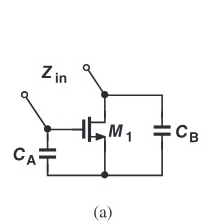

# 장말문제 13.48 — 바이폴라 트랜지스터로 만든 음저항 회로의 Z_in과 등가 회로

## 원문
Suppose the negative-resistance circuit of Fig. 13.31(a) employs a bipolar transistor rather than a MOSFET. Determine $Z_{in}$ and the equivalent circuit.

## 조건
- 회로: Fig 13.31(a)의 음저항 회로에서 MOSFET $M_1$ 대신 바이폴라 트랜지스터를 씀
- 게이트 → 베이스, 드레인 → 컬렉터, 소스 → 이미터로 바꿔 놓음 (원문에 없음)
- $C_A$는 베이스–이미터 사이, $C_B$는 컬렉터–이미터 사이, $Z_{in}$은 베이스와 컬렉터 사이에서 봄 (원문에 없음, 그림에서 읽음)
- 바이어스 회로는 생략 (원문에 없음, 본문 13.6.2절 가정)
- 본문 MOSFET 해석의 가정: 채널 길이 변조와 다른 커패시턴스는 무시 (원문에 없음)
- 식 (13.57): MOSFET일 때 $Z_{in}(j\omega) = \dfrac{1}{jC_A\omega} + \dfrac{1}{jC_B\omega} - \dfrac{g_m}{C_A C_B \omega^2}$ (본문 식, 원문에 없음)

## 구할 것
- 바이폴라 트랜지스터를 쓸 때의 $Z_{in}$
- 그 $Z_{in}$의 등가 회로

## 상속·참조
- 본문 Fig 13.31(b) (교재 759쪽, 크롭 안 함): $Z_{in}$ 측정 구성. 게이트 노드와 드레인 노드 사이에 시험 전압원 $V_X$ (+ 단자가 드레인 쪽), 전류 $I_X$가 드레인 노드로 들어가 게이트 노드에서 나옴, $M_1$ 드레인 전류 $I_1$ (아래 방향)
- 본문 해석 (13.6.2절, MOSFET): $I_X$가 $C_A$를 지나며 게이트–소스 전압을 만듦
  - 식 (13.54): $I_1 = -\dfrac{I_X}{C_A s} g_m$
  - 식 (13.55): $C_B$에 $I_X - I_1$이 흘러 $V_X = \dfrac{I_X}{C_A s} + \dfrac{I_X}{C_B s} + \dfrac{g_m I_X}{C_A C_B s^2}$
  - 식 (13.56)–(13.57): $Z_{in}(s) = \dfrac{1}{C_A s} + \dfrac{1}{C_B s} + \dfrac{g_m}{C_A C_B s^2}$, $s = j\omega$이면 $Z_{in}(j\omega) = \dfrac{1}{jC_A\omega} + \dfrac{1}{jC_B\omega} - \dfrac{g_m}{C_A C_B \omega^2}$
- 본문 Fig 13.31(c) (교재 759쪽, 이 파일의 그림 목록에는 넣지 않음, 크롭은 fig13-31-c.png): MOSFET일 때의 등가 회로 — $C_A$, $C_B$, 저항 $-g_m/(C_A C_B \omega^2)$ 직렬

## 회로 — Fig 13.31(a)
```spice
M1  out2  out1  n1    nmos
CA  out1  n1    {C_A}
CB  out2  n1    {C_B}
```
- 단자: out1, out2 = Z_in을 보는 두 단자 (개방 원 2개: out1은 M1 게이트 노드에서, out2는 M1 드레인 노드에서 비스듬한 선 끝)
- 표시: 노드 라벨 없음 / 소자 라벨 M_1 (M1 오른쪽), C_A (세로 커패시터 왼쪽), C_B (세로 커패시터 오른쪽), Z_in (두 비스듬한 단자 선 사이 위쪽, 단자 이름) / 부호 없음 / 화살표 없음 / 수치·면적 라벨 없음
- 배치: 가운데 M1 (nmos, 게이트 왼쪽, 드레인 위, 소스 아래·소스 화살표는 바깥) / M1 게이트에서 왼쪽으로 짧은 가로선 → out1 접속점, 거기서 왼쪽 위로 비스듬한 선이 개방 원(out1) / out1 접속점 아래로 세로 커패시터 C_A → 아래 가로선 / M1 드레인 위 out2 접속점, 거기서 왼쪽 위로 비스듬한 선이 개방 원(out2), 오른쪽으로 가로선이 가 모서리에서 아래로 꺾여 세로 커패시터 C_B → 아래 가로선 / M1 소스에서 아래로 내려가 아래 가로선의 n1 접속점 / 아래 가로선이 C_A 아래 끝, n1, C_B 아래 끝을 이음 (접지 기호 없음) / 두 개방 원은 위쪽에 나란히, out1 원이 out2 원보다 왼쪽·조금 아래 / 접속점 (세 갈래 이상, 3곳): out1 = 오른쪽 M1 게이트 + 아래 C_A + 왼쪽 위 비스듬한 단자 선 (점), out2 = 아래 M1 드레인 + 오른쪽 C_B 가지 + 왼쪽 위 비스듬한 단자 선 (점), n1 = 위 M1 소스 + 왼쪽 C_A 쪽 가로선 + 오른쪽 C_B 쪽 가로선 (점) / 교차: 없음


> 참고: 그림은 MOSFET으로 인쇄돼 있음. 문제는 M1 자리에 바이폴라 트랜지스터를 넣은 회로를 다룸. Fig 13.31은 본문 그림(교재 759쪽, PDF 15 오른쪽)
