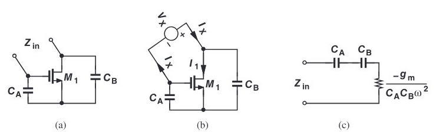

# 장말문제 13.49 — 채널 길이 변조를 고려한 음의 저항 회로의 Z_in

## 원문
Determine $Z_{in}$ in Fig. 13.31(a) if channel-length modulation is not neglected. Can you construct a simple equivalent circuit for $Z_{in}$ such as that in Fig. 13.31(c)?

## 조건
- 회로: Fig 13.31(a)의 음의 저항 회로 ($M_1$, $C_A$, $C_B$, 단자 사이 임피던스 $Z_{in}$)
- 채널 길이 변조를 무시하지 않음 ($M_1$의 출력 저항 $r_O$를 고려)
- 본문 결과 (채널 길이 변조와 다른 커패시턴스를 무시했을 때), 식 (13.56): $Z_{in}(s) = \dfrac{1}{C_A s} + \dfrac{1}{C_B s} + \dfrac{g_m}{C_A C_B s^2}$ (본문 식, 원문에 없음)
- 식 (13.57): $Z_{in}(j\omega) = \dfrac{1}{jC_A\omega} + \dfrac{1}{jC_B\omega} - \dfrac{g_m}{C_A C_B \omega^2}$ (본문 식, 원문에 없음)
- 참고 등가회로 (본문 Fig 13.31(c)): $C_A$, $C_B$, 저항 $-g_m/(C_A C_B \omega^2)$의 직렬 연결 (원문에 없음)

## 구할 것
- 채널 길이 변조를 고려한 Fig 13.31(a)의 $Z_{in}$
- Fig 13.31(c)와 같은 간단한 $Z_{in}$ 등가회로를 만들 수 있는지

## 상속·참조
- 본문 13.6.2절 해석 (Fig 13.31(b)로 $Z_{in}$을 구함, 채널 길이 변조와 다른 커패시턴스 무시): 단자 사이에 시험 전압 $V_X$를 걸고 전류 $I_X$를 흘리면 $I_X$가 $C_A$를 지나 $M_1$의 게이트-소스 전압을 만듦
  - 식 (13.54): $I_1 = -\dfrac{I_X}{C_A s} g_m$ ($I_1$은 $M_1$ 드레인 전류, 아래로)
  - $C_B$에 흐르는 전류는 $I_X - I_1$
  - 식 (13.55): $V_X = \dfrac{I_X}{C_A s} + \dfrac{I_X}{C_B s} + \dfrac{g_m I_X}{C_A C_B s^2}$
  - 식 (13.56), (13.57)은 조건에 적은 대로
- 본문 Fig 13.31(b) (크롭 안 함, 이 파일 이미지의 가운데 패널): (a)의 두 단자 사이에 전압원 $V_X$(+ 단자가 드레인 쪽)를 넣고, $I_X$가 드레인 쪽 선에서 드레인 노드로, 게이트 노드에서 전압원 쪽으로 흐르며, $M_1$ 드레인으로 내려가는 전류가 $I_1$

## 회로 — Fig 13.31(a)
```spice
M1  out2  out1  n1  nmos      ; out1 = 게이트 노드, out2 = 드레인 노드, n1 = 소스 노드
CA  out1  n1    {C_A}
CB  out2  n1    {C_B}
```
- 단자: out1, out2 = Z_in 측정 단자 (개방 원)
- 표시: 노드 라벨 없음 / 소자 라벨 M1 (트랜지스터 오른쪽), C_A (왼쪽 커패시터 왼쪽), C_B (오른쪽 커패시터 오른쪽) / 부호 없음 / 화살표 없음 / 수치·면적 라벨 Z_in (두 개방 원 사이 위쪽)
- 배치: M1은 바디 단자 없는 3단자 NMOS, 보통 방향(게이트 왼쪽, 드레인 위, 소스 아래) / 게이트 노드에서 왼쪽 위로 비스듬한 선이 왼쪽 개방 원 out1, 아래로 C_A / 드레인 노드에서 왼쪽 위로 비스듬한 선이 오른쪽 개방 원 out2, 오른쪽 가로선이 C_B 위쪽으로 / 맨 아래 가로선이 C_A 아래, M1 소스, C_B 아래를 이음, 접지 기호 없음 / 접속점 (세 갈래 이상, 3곳): ① out1 = 비스듬한 단자선 + 아래 C_A + 오른쪽 M1 게이트선 (점) ② out2 = 비스듬한 단자선 + 아래 M1 드레인 + 오른쪽 C_B로 가는 선 (점) ③ n1 = 왼쪽 C_A 아랫선 + 위 M1 소스 + 오른쪽 C_B 아랫선 (점) / 교차: 없음

## 회로 — Fig 13.31(c)
```spice
CA  out1  n1    {C_A}
CB  n1    n2    {C_B}
RN  n2    out2  {-g_m/(C_AC_Bω^2)}   ; 음의 저항
```
- 단자: out1, out2 = Z_in 측정 단자 (개방 원, out1 위, out2 아래)
- 표시: 노드 라벨 없음 / 소자 라벨 C_A, C_B (각 커패시터 위), 저항 라벨은 분수 "−g_m / C_A C_B ω²" (저항 오른쪽) / 부호 없음 / 화살표 없음 / 수치·면적 라벨 Z_in (두 개방 원 사이 왼쪽)
- 배치: 위 개방 원에서 가로선이 오른쪽으로 C_A, C_B를 차례로 지나 오른쪽 끝에서 아래로 꺾여 세로 저항, 저항 아래에서 가로선이 왼쪽 아래 개방 원으로 / 교차: 없음


> 참고: 가운데 (b)는 본문의 임피던스 측정 구성 (크롭 안 함, 상속·참조에 글로 적음). (a)와 (c)를 한 직사각형으로 자를 수 없고 답 패널이 없어 전체 이미지를 둠
