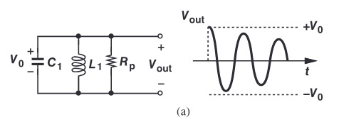

# 장말문제 13.50 — 손실 있는 LC 탱크의 시간 응답

## 원문
Suppose capacitor $C_1$ in Fig. 13.32(a) begins with an initial condition of $V_0$. Derive an equation for $V_{out}$ assuming that $R_p$ is large. (A large $R_p$ means the tank has a high quality factor, $Q$.)

## 조건
- 회로: Fig 13.32(a)의 손실 있는 병렬 LC 탱크 ($C_1$, $L_1$, $R_p$ 병렬)
- 커패시터 $C_1$의 초기 전압은 $V_0$ (그림의 극성: 위 +, 아래 −)
- $R_p$가 크다고 가정. $R_p$가 크다는 것은 탱크의 품질 계수 $Q$가 높다는 뜻 (원문의 메모)
- Fig 13.32(a) 오른쪽 파형: $V_{out}$이 $t = 0$에서 $+V_0$로 시작해 $+V_0$, $-V_0$ 점선 사이에서 진폭이 점점 줄어드는 사인파

## 구할 것
- $V_{out}(t)$의 식

## 회로 — Fig 13.32(a)
```spice
C1  out1  out2  {C_1}   ; 초기 전압 V_0 (위 +, 아래 −)
L1  out1  out2  {L_1}
RP  out1  out2  {R_p}
* out1, out2: 두 개방 원 사이에 V_out 라벨 하나 (차동 출력)
```
- 단자: out1, out2 = 출력 V_out (개방 원, out1 위, out2 아래)
- 표시: 노드 라벨 V_out (두 개방 원 사이, 위 원 아래 "+", 아래 원 위 "−"), V_0 (C1 왼쪽) / 소자 라벨 C_1, L_1, R_p (각 소자 오른쪽) / 부호 C1 왼쪽 위 "+", 왼쪽 아래 "−" (V_0 극성), 출력 쪽 위 "+", 아래 "−" (V_out 극성) / 화살표 없음 / 수치·면적 라벨 없음
- 배치: 위 가로선과 아래 가로선 사이에 왼쪽부터 C1, L1, R_p가 세로로 나란히 매달림, 두 가로선은 오른쪽 끝에서 각각 개방 원 / C1은 맨 왼쪽 끝(선의 꺾임) / 접속점 (세 갈래 이상, 4곳): ① 위 가로선의 L1 위 (점) ② 위 가로선의 R_p 위 (점) ③ 아래 가로선의 L1 아래 (점) ④ 아래 가로선의 R_p 아래 (점) / 접지 없음 / 교차: 없음


> 참고: 크롭 오른쪽은 같은 패널 (a)의 파형 그래프. 세로축 라벨 V_out, 가로축 t(화살표). 위 점선 "+V_0", 아래 점선 "−V_0". 곡선은 시작점에서 세로 점선으로 +V_0까지 올라간 곳에서 출발해 감쇠하는 사인파(봉우리 셋, 골 둘)
