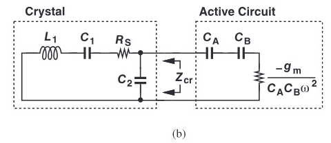

# 장말문제 13.51 — 크리스털 발진기의 스타트업 조건 유도

## 원문
We wish to determine the startup condition for the crystal oscillator of Fig. 13.33(b).

(a) Prove that $Z_{cr}$ is given by the following equation at the parallel resonance frequency:

$$Z_{cr}(j\omega_2) = \frac{L_1 C_1 \omega_2^2 - 1}{R_S C_1 C_2 \omega_2^2} + \frac{1}{jC_2\omega_2}. \qquad (13.59)$$

(b) Now, cancel the real part of $Z_{cr}(j\omega_2)$ by the negative resistance and prove Eq. (13.58).

## 조건
- 회로: Fig 13.33(b), 크리스털 모델($L_1$, $C_1$, $R_S$ 직렬 가지와 병렬 $C_2$)에 능동 회로의 등가 임피던스($C_A$, $C_B$, 음의 저항 $-g_m/(C_A C_B \omega^2)$ 직렬)를 붙인 등가회로
- $Z_{cr}$: 능동 회로 쪽에서 크리스털을 들여다본 임피던스
- $\omega_2$: 크리스털의 병렬 공진 주파수
- 식 (13.59): $Z_{cr}(j\omega_2) = \dfrac{L_1 C_1 \omega_2^2 - 1}{R_S C_1 C_2 \omega_2^2} + \dfrac{1}{jC_2\omega_2}$
- 식 (13.58): $L_1 C_1 \omega^2 - 1 \le g_m R_S \dfrac{C_1 C_2}{C_A C_B}$ (본문 식, 원문에 없음)

## 구할 것
- (a) 병렬 공진 주파수에서 $Z_{cr}$이 식 (13.59)로 주어짐을 증명
- (b) $Z_{cr}(j\omega_2)$의 실수부를 음의 저항으로 상쇄해 식 (13.58)을 증명

## 상속·참조
- 본문 13.6.3절: 식 (13.58)이 성립하면 회로는 크리스털의 병렬 공진 주파수에서 발진. 본문은 이 분석의 개요를 이 문제(문제 13.51)로 넘김
- 본문 Fig 13.33(a) (크롭 안 함, 크롭은 fig13-33-a.png): 실제 회로. NMOS $M_1$ 소스 접지, 게이트와 드레인 사이에 크리스털, 게이트-접지 사이 $C_A$, 드레인-접지 사이 $C_B$
- 음의 저항 회로의 등가 임피던스 (본문 식 13.57, Fig 13.31(c), 채널 길이 변조 무시): $Z_{in}(j\omega) = \dfrac{1}{jC_A\omega} + \dfrac{1}{jC_B\omega} - \dfrac{g_m}{C_A C_B \omega^2}$
- 크리스털 모델 (본문 Fig 13.30(c), 식 13.46–13.48): 병렬 공진 주파수 $\omega_2 = 1\Big/\sqrt{L_1 \dfrac{C_1 C_2}{C_1 + C_2}}$ ($R_S$ 무시)

## 회로 — Fig 13.33(b)
```spice
* Crystal 점선 상자
L1  n1  n2  {L_1}
C1  n2  n3  {C_1}
RS  n3  n4  {R_S}
C2  n4  n1  {C_2}
* Active Circuit 점선 상자
CA  n4  n5  {C_A}
CB  n5  n6  {C_B}
RN  n6  n1  {-g_m/(C_AC_Bω^2)}   ; 음의 저항
```
- 단자: 없음 (개방 단자 없는 닫힌 회로)
- 표시: 노드 라벨 없음 / 소자 라벨 L_1, C_1, R_S (각 소자 위), C_2 (커패시터 왼쪽), C_A, C_B (각 커패시터 위), 음의 저항 라벨은 분수 "−g_m / C_A C_B ω²" (저항 오른쪽), 점선 상자 제목 "Crystal" (왼쪽 상자 위), "Active Circuit" (오른쪽 상자 위) / 부호 없음 / 화살표 "Z_cr": 두 상자 사이 틈의 두 화살표, 왼쪽(크리스털 쪽)을 향함, 도선 옆 별도 화살표 (위 화살표는 ┐ 꺾임, 아래 화살표는 ┘ 꺾임, 두 꺾인 끝이 Z_cr 라벨 쪽으로 마주봄) / 수치·면적 라벨 없음
- 배치: 왼쪽 점선 상자 "Crystal" 안 위 가로선에 왼쪽부터 L1, C1, R_S 직렬, R_S 오른쪽 끝 n4에서 C2가 아래 가로선으로 내려감, L1 왼쪽 끝은 아래로 꺾여 아래 가로선 / 오른쪽 점선 상자 "Active Circuit" 안 위 가로선에 C_A, C_B 직렬, 오른쪽 끝에서 아래로 꺾여 세로 음의 저항, 아래로 아래 가로선 / 위·아래 가로선이 두 상자를 잇고 상자 경계(점선)를 지나감 / 접속점 (세 갈래 이상, 2곳): ① n4 = 왼쪽 R_S + 아래 C2 + 오른쪽 C_A로 가는 선 (점) ② n1 = 위 C2 + 왼쪽 L1 쪽 아래 가로선 + 오른쪽 저항 쪽 아래 가로선 (점) / 교차: 없음 (도선이 점선 상자 경계를 지나는 것 말고)


