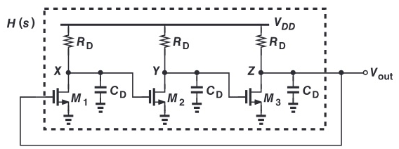

# 장말문제 13.53 — 3단 링 발진기 설계 (1 GHz, 3 mW)

## 원문
In Fig. 13.8, $R_D = 1\ \text{k}\Omega$. Design the circuit for a power budget of $3\ \text{mW}$ and a frequency of $1\ \text{GHz}$. Assume $V_{DD} = 1.5\ \text{V}$ and $\lambda = 0$.

## 조건
- 설계 대상: Fig 13.8의 3단 링 발진기 (같은 CS 단 세 개, 각 단 $R_D$, $C_D$, NMOS)
- $R_D = 1\ \text{k}\Omega$
- 전력 예산 $3\ \text{mW}$, 발진 주파수 $1\ \text{GHz}$
- $V_{DD} = 1.5\ \text{V}$, $\lambda = 0$
- 공통 가정: $\mu_n C_{ox} = 100\ \mu\text{A/V}^2$, $\mu_p C_{ox} = 50\ \mu\text{A/V}^2$, $V_{THN} = 0.3\ \text{V}$, $V_{THP} = -0.35\ \text{V}$ (원문의 Design Problems 머리말)
- 머리말의 "$\lambda_n = 0.5\ \lambda_p = 0.1\ \text{V}^{-1}$"은 쉼표 없이 인쇄됨. "$\mu_n C_{ox} = 2\mu_p C_{ox}$"와 같은 꼴로 $\lambda_n = 0.5\lambda_p = 0.1\ \text{V}^{-1}$로 읽어 $\lambda_n = 0.1\ \text{V}^{-1}$, $\lambda_p = 0.2\ \text{V}^{-1}$로 봄 (원문에 없음)
- 식 (13.3): 발진 주파수 $\omega_1 = \dfrac{\sqrt{3}}{R_D C_D}$ (본문 식, 원문에 없음)
- 식 (13.6): 스타트업 조건, 각 단의 저주파 이득 $g_m R_D = 2$ (발진 시작을 보장하려면 2를 넘어야 함) (본문 식, 원문에 없음)

## 구할 것
- 회로 설계 (정할 값 예: 각 단의 바이어스 전류, $C_D$, 트랜지스터 $W/L$) (원문에 없음, 원문은 "Design the circuit"만 적음)

## 상속·참조
- Design Problems 공통 가정 (원문 머리말을 그대로 옮김, 문제에 따로 적힌 값이 우선): In the following problems, unless otherwise stated, assume $\mu_n C_{ox} = 2\mu_p C_{ox} = 100\ \mu\text{A/V}^2$, $\lambda_n = 0.5\ \lambda_p = 0.1\ \text{V}^{-1}$, $V_{THN} = 0.3\ \text{V}$, and $V_{THP} = -0.35\ \text{V}$.
  - 해석: $\mu_n C_{ox} = 100\ \mu\text{A/V}^2$, $\mu_p C_{ox} = 50\ \mu\text{A/V}^2$. "$\lambda_n = 0.5\ \lambda_p = 0.1$"은 쉼표 없이 인쇄돼 있어 같은 머리말의 "$\mu_n C_{ox} = 2\mu_p C_{ox} = 100$"과 같은 꼴, 곧 $\lambda_n = 0.5\lambda_p = 0.1\ \text{V}^{-1}$로 읽어 $\lambda_n = 0.1\ \text{V}^{-1}$, $\lambda_p = 0.2\ \text{V}^{-1}$로 봄 ("$\lambda_n = 0.5$, $\lambda_p = 0.1$"로 읽을 수도 있음)
- 본문 13.2절 3단 링 해석 ($C_{GD}$ 무시, $\lambda = 0$): 각 단의 전달 함수 $-g_m R_D/(1 + R_D C_D s)$
  - 식 (13.2): 각 극점이 $60^\circ$씩 위상을 줌, $-\tan^{-1}(R_D C_D \omega_1) = -60^\circ$
  - 식 (13.3): $\omega_1 = \sqrt{3}/(R_D C_D)$
  - 식 (13.4)–(13.6): $\left(\dfrac{g_m R_D}{\sqrt{1 + R_D^2 C_D^2 \omega_1^2}}\right)^3 = 1$ → $g_m R_D = \sqrt{1 + R_D^2 C_D^2 \omega_1^2} = 2$

## 회로 — Fig 13.8
```spice
RD1  VDD  X  {R_D}   ; 세 저항 모두 R_D로 인쇄
RD2  VDD  Y  {R_D}
RD3  VDD  Z  {R_D}
M1   X    Z  0  nmos
M2   Y    X  0  nmos
M3   Z    Y  0  nmos
CD1  X    0  {C_D}   ; 세 커패시터 모두 C_D로 인쇄
CD2  Y    0  {C_D}
CD3  Z    0  {C_D}
* Z 노드가 오른쪽으로 이어져 V_out 개방 원 (Z = Vout)
```
- 단자: VDD = 전원, 값 미지정 (가로 레일) / Vout = 출력, 노드 Z와 같은 노드 (개방 원)
- 표시: 노드 라벨 V_DD (레일 오른쪽 끝), X, Y, Z (각 드레인 접속점 왼쪽 위), V_out (개방 원 오른쪽), H(s) (점선 상자 왼쪽 위 바깥) / 소자 라벨 R_D (세 저항 각각 오른쪽), M1, M2, M3 (각 트랜지스터 오른쪽), C_D (세 커패시터 각각 오른쪽) / 부호 없음 / 화살표 없음 / 수치·면적 라벨 없음
- 배치: 굵은 점선 상자가 세 단 전체(레일, 저항, 트랜지스터, 커패시터)를 둘러싸고 왼쪽 위 바깥에 "H(s)" / 맨 위 굵은 가로 레일 V_DD, 세 R_D가 레일에서 아래로 / 각 단은 위→아래 R_D, 드레인 접속점(X, Y, Z), NMOS(바디 없는 3단자, 게이트 왼쪽), 소스 접지 / 각 드레인 접속점에서 가로선이 오른쪽으로 가서 C_D(아래로 접지)를 지나고, X, Y 선은 아래로 꺾여 다음 단 게이트로 들어감 / Z 선은 C_D를 지나 상자 오른쪽 경계를 넘어 접속점, 오른쪽 개방 원 V_out / 그 접속점에서 귀환선이 아래로 내려가 상자 아래 바깥을 왼쪽으로 지나 위로 꺾여 상자 왼쪽 경계를 넘어 M1 게이트로 / 접속점 (세 갈래 이상, 7곳): ① X = 위 R_D + 아래 M1 드레인 + 오른쪽 가로선 (점) ② X선의 C_D 위 (점) ③ Y = 위 R_D + 아래 M2 드레인 + 오른쪽 가로선 (점) ④ Y선의 C_D 위 (점) ⑤ Z = 위 R_D + 아래 M3 드레인 + 오른쪽 가로선 (점) ⑥ Z선의 C_D 위 (점) ⑦ 상자 바깥 귀환선 갈림 = 왼쪽 Z선 + 오른쪽 V_out + 아래 귀환선 (점) / 교차: 없음 (도선이 점선 상자 경계를 지나는 것 말고)


