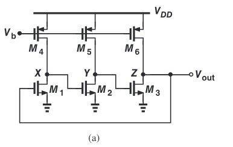

# 장말문제 13.54 — PMOS 부하 링 발진기의 W/L 선택

## 원문
In the circuit of Fig. 13.9(a), $V_{DD} - V_b = 0.6\ \text{V}$.

(a) Choose $W/L$ of the PMOS devices for a bias current of $1\ \text{mA}$.

(b) Choose $W/L$ of the NMOS devices to meet the startup condition, $g_{mN}(r_{ON} \| r_{OP}) = 2$.

## 조건
- 회로: Fig 13.9(a), PMOS 전류원 부하($M_4$–$M_6$)를 가진 CS 단 세 개($M_1$–$M_3$)로 만든 3단 링 발진기
- $V_{DD} - V_b = 0.6\ \text{V}$
- 바이어스 전류 $1\ \text{mA}$ (각 단)
- 스타트업 조건: $g_{mN}(r_{ON} \| r_{OP}) = 2$
- 공통 가정: $\mu_n C_{ox} = 100\ \mu\text{A/V}^2$, $\mu_p C_{ox} = 50\ \mu\text{A/V}^2$, $\lambda_n = 0.1\ \text{V}^{-1}$, $\lambda_p = 0.2\ \text{V}^{-1}$, $V_{THN} = 0.3\ \text{V}$, $V_{THP} = -0.35\ \text{V}$ (원문의 Design Problems 머리말)
- 머리말의 "$\lambda_n = 0.5\ \lambda_p = 0.1\ \text{V}^{-1}$"은 쉼표 없이 인쇄됨. "$\mu_n C_{ox} = 2\mu_p C_{ox}$"와 같은 꼴로 $\lambda_n = 0.5\lambda_p = 0.1\ \text{V}^{-1}$로 읽음 (원문에 없음)

## 구할 것
- (a) 바이어스 전류 $1\ \text{mA}$를 위한 PMOS 소자($M_4$–$M_6$)의 $W/L$
- (b) 스타트업 조건 $g_{mN}(r_{ON} \| r_{OP}) = 2$를 만족하는 NMOS 소자($M_1$–$M_3$)의 $W/L$

## 상속·참조
- Design Problems 공통 가정 (원문 머리말을 그대로 옮김, 문제에 따로 적힌 값이 우선): In the following problems, unless otherwise stated, assume $\mu_n C_{ox} = 2\mu_p C_{ox} = 100\ \mu\text{A/V}^2$, $\lambda_n = 0.5\ \lambda_p = 0.1\ \text{V}^{-1}$, $V_{THN} = 0.3\ \text{V}$, and $V_{THP} = -0.35\ \text{V}$.
  - 해석: $\mu_n C_{ox} = 100\ \mu\text{A/V}^2$, $\mu_p C_{ox} = 50\ \mu\text{A/V}^2$. "$\lambda_n = 0.5\ \lambda_p = 0.1$"은 쉼표 없이 인쇄돼 있어 같은 머리말의 "$\mu_n C_{ox} = 2\mu_p C_{ox} = 100$"과 같은 꼴, 곧 $\lambda_n = 0.5\lambda_p = 0.1\ \text{V}^{-1}$로 읽어 $\lambda_n = 0.1\ \text{V}^{-1}$, $\lambda_p = 0.2\ \text{V}^{-1}$로 봄 ("$\lambda_n = 0.5$, $\lambda_p = 0.1$"로 읽을 수도 있음)
- 본문 13.2절: Fig 13.8의 부하 저항 $R_D$를 PMOS 전류원으로 바꾼 것이 Fig 13.9(a). $R_D$를 $r_{OP} \| r_{ON}$으로 바꾸면 3단 링의 유도(식 13.3, 13.6)가 그대로 성립 (스타트업에는 각 단 저주파 이득 2)

## 회로 — Fig 13.9(a)
```spice
M4  X  Vb  VDD  pmos
M5  Y  Vb  VDD  pmos
M6  Z  Vb  VDD  pmos
M1  X  Z   0    nmos
M2  Y  X   0    nmos
M3  Z  Y   0    nmos
* Z 노드가 오른쪽으로 이어져 V_out 개방 원 (Z = Vout)
```
- 단자: VDD = 전원, 값 미지정 (가로 레일) / Vb = PMOS 게이트 바이어스 (점 단자) / Vout = 출력, 노드 Z와 같은 노드 (개방 원)
- 표시: 노드 라벨 V_DD (레일 오른쪽 끝), V_b (점 단자 왼쪽), X, Y, Z (각 드레인 접속점 왼쪽 위), V_out (개방 원 오른쪽) / 소자 라벨 M4, M5, M6 (각 PMOS 아래 왼쪽), M1, M2, M3 (각 NMOS 오른쪽) / 부호 없음 / 화살표 없음 / 수치·면적 라벨 없음
- 배치: 맨 위 굵은 가로 레일 V_DD / 세 단 각각 위→아래 PMOS(소스 위로 레일, 게이트 왼쪽), 드레인 접속점(X, Y, Z), NMOS(게이트 왼쪽, 소스 아래 접지) / 모두 바디 없는 3단자 기호 / V_b 점 단자에서 가로선이 M4 게이트로 들어가 M4, M5 기호를 가로질러 M6 게이트까지 이어짐 (세 게이트 공통선, M4·M5 기호를 지나는 곳에 점 없음) / X에서 가로선이 오른쪽으로 가서 아래로 꺾여 M2 게이트, Y에서 같은 모양으로 M3 게이트 / Z에서 가로선이 오른쪽 접속점을 지나 개방 원 V_out, 그 접속점에서 귀환선이 아래로 내려가 회로 아래를 왼쪽으로 지나 위로 꺾여 M1 게이트 / 접속점 (세 갈래 이상, 4곳): ① X = 위 M4 드레인 + 아래 M1 드레인 + 오른쪽 가로선 (점) ② Y = 위 M5 드레인 + 아래 M2 드레인 + 오른쪽 가로선 (점) ③ Z = 위 M6 드레인 + 아래 M3 드레인 + 오른쪽 가로선 (점) ④ 귀환선 갈림 = 왼쪽 Z선 + 오른쪽 V_out + 아래 귀환선 (점) / 교차: 없음


