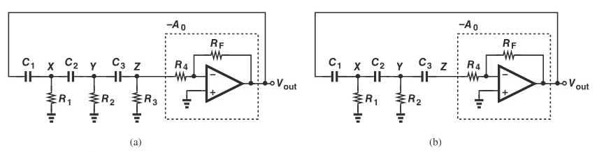

# 장말문제 13.57 — 10 MHz 위상 시프트 발진기 설계

## 원문
Design the phase shift oscillator of Fig. 13.25 for a frequency of $10\ \text{MHz}$, assuming an ideal op amp and $C_1 = C_2 = C_3 = 1\ \text{nF}$.

## 조건
- 설계 대상: Fig 13.25의 위상 시프트 발진기 (원문은 패널을 정하지 않음)
- 발진 주파수 $10\ \text{MHz}$
- 이상적인 연산 증폭기
- $C_1 = C_2 = C_3 = 1\ \text{nF}$
- 공통 가정: $\mu_n C_{ox} = 100\ \mu\text{A/V}^2$, $\mu_p C_{ox} = 50\ \mu\text{A/V}^2$, $V_{THN} = 0.3\ \text{V}$, $V_{THP} = -0.35\ \text{V}$ (원문의 Design Problems 머리말)
- 머리말의 "$\lambda_n = 0.5\ \lambda_p = 0.1\ \text{V}^{-1}$"은 쉼표 없이 인쇄됨. "$\mu_n C_{ox} = 2\mu_p C_{ox}$"와 같은 꼴로 $\lambda_n = 0.5\lambda_p = 0.1\ \text{V}^{-1}$로 읽어 $\lambda_n = 0.1\ \text{V}^{-1}$, $\lambda_p = 0.2\ \text{V}^{-1}$로 봄 (원문에 없음)
- 예제 13.9에서 이어받는 내용: 연산 증폭기 반전 증폭기로 이득 $-A_0$를 만들면 $R_4$가 노드 $Z$와 가상 접지 사이에 놓여 $R_3$과 병렬로 보이므로, 본문 유도를 쓰려면 $R_3 \| R_4 = R_2 = R_1 = R$로 정함. $R_3 = \infty$, $R_4 = R$로 두면 Fig 13.25(b) 꼴이 됨 (원문에 없음)
- 식 (13.35): 같은 $RC$ 세 단($C_1 = C_2 = C_3 = C$, 각 단 저항 $R$)의 발진 주파수 $\omega_1 = \dfrac{1}{\sqrt{6}RC}$ (본문 식, 원문에 없음)
- 식 (13.37): 스타트업에 필요한 증폭기 이득 $A = 29$ (적어도 이 값) (본문 식, 원문에 없음)

## 구할 것
- 회로 설계 (정할 값 예: $R_1$, $R_2$, ($R_3$,) $R_4$, $R_F$) (원문에 없음, 원문은 "Design"만 적음)

## 상속·참조
- Design Problems 공통 가정 (원문 머리말을 그대로 옮김, 문제에 따로 적힌 값이 우선): In the following problems, unless otherwise stated, assume $\mu_n C_{ox} = 2\mu_p C_{ox} = 100\ \mu\text{A/V}^2$, $\lambda_n = 0.5\ \lambda_p = 0.1\ \text{V}^{-1}$, $V_{THN} = 0.3\ \text{V}$, and $V_{THP} = -0.35\ \text{V}$.
  - 해석: $\mu_n C_{ox} = 100\ \mu\text{A/V}^2$, $\mu_p C_{ox} = 50\ \mu\text{A/V}^2$. "$\lambda_n = 0.5\ \lambda_p = 0.1$"은 쉼표 없이 인쇄돼 있어 같은 머리말의 "$\mu_n C_{ox} = 2\mu_p C_{ox} = 100$"과 같은 꼴, 곧 $\lambda_n = 0.5\lambda_p = 0.1\ \text{V}^{-1}$로 읽어 $\lambda_n = 0.1\ \text{V}^{-1}$, $\lambda_p = 0.2\ \text{V}^{-1}$로 봄 ("$\lambda_n = 0.5$, $\lambda_p = 0.1$"로 읽을 수도 있음)
- 공통 가정은 MOS 값뿐이고, 이 문제는 이상적인 연산 증폭기와 RC 소자만 씀
- 예제 13.9 (연산 증폭기로 위상 시프트 발진기를 설계): 반전 증폭기를 Fig 13.25(a)처럼 구성. $R_4$가 노드 $Z$와 가상 접지 사이에 보여 $R_3$과 병렬이므로 앞의 유도를 그대로 쓰려면 $R_3 \| R_4 = R_2 = R_1 = R$. $R_3$을 무한대로, $R_4$를 $R$과 같게 두면 Fig 13.25(b)의 토폴로지. 연습문제 13.9는 발진 주파수에서 루프 이득이 1이 되는 $R_F/R_4$를 물음
- 본문 13.4절 위상 시프트 해석 ($C_1 = C_2 = C_3 = C$, $R_1 = R_2 = R_3 = R$, 수동 네트워크 Fig 13.24(b)):
  - 식 (13.32): $\dfrac{V_{out}}{V_{in}} = \dfrac{(RCs)^3}{(RCs)^3 + 6(RCs)^2 + 5RCs + 1}$
  - 식 (13.34)–(13.35): 위상이 $180^\circ$가 되는 조건 $1 - 6R^2C^2\omega_1^2 = 0$ → $\omega_1 = 1/(\sqrt{6}RC)$
  - 식 (13.36)–(13.37): 스타트업 $A \ge 29$

## 회로 — Fig 13.25(a)
```spice
C1   Vout  X     {C_1}   ; 귀환선이 Vout에서 C1 왼쪽 끝으로
R1   X     0     {R_1}
C2   X     Y     {C_2}
R2   Y     0     {R_2}
C3   Y     Z     {C_3}
R3   Z     0     {R_3}
R4   Z     n1    {R_4}
RF   n1    Vout  {R_F}
XA1  0     n1    Vout  opamp   ; + 입력 접지
```
- 단자: Vout = 출력 (개방 원)
- 표시: 노드 라벨 X, Y, Z (각 노드 위), V_out (개방 원 오른쪽) / 소자 라벨 C1, C2, C3 (각 커패시터 위), R1, R2, R3 (각 저항 오른쪽), R4 (저항 위), R_F (저항 위), 점선 상자 라벨 "−A_0" (상자 왼쪽 위 바깥) / 부호 연산 증폭기 입력 "−" 위, "+" 아래 / 화살표 없음 / 수치·면적 라벨 없음
- 배치: 왼쪽에서 오른쪽으로 가로 신호선에 C1, X, C2, Y, C3, Z, R4가 차례로 놓임, X, Y, Z에서 각각 R1, R2, R3이 아래로 내려가 접지 / 점선 상자("−A_0")가 R4, R_F, 연산 증폭기, + 입력 접지를 둘러쌈 / R4 오른쪽 끝 n1이 연산 증폭기 − 입력, n1에서 위로 올라가 R_F가 오른쪽으로, R_F 오른쪽 끝이 아래로 꺾여 연산 증폭기 출력 접속점 / + 입력은 왼쪽으로 짧게 나가 접지 기호 / 출력선이 상자 오른쪽 경계를 넘어 접속점, 오른쪽 개방 원 V_out / 그 접속점에서 귀환선이 위로 올라가 회로 위를 왼쪽으로 지나 아래로 꺾여 C1 왼쪽 끝으로 / 접속점 (세 갈래 이상, 6곳): ① X = C1 + C2 + 아래 R1 (점) ② Y = C2 + C3 + 아래 R2 (점) ③ Z = C3 + R4 + 아래 R3 (점) ④ n1 = R4 + − 입력 + 위 R_F (점) ⑤ 연산 증폭기 출력 = 출력 + 위 R_F + 오른쪽 출력선 (점) ⑥ 귀환선 갈림 = 왼쪽 출력선 + 오른쪽 V_out + 위 귀환선 (점) / 교차: 없음 (도선이 점선 상자 경계를 지나는 것 말고)

## 회로 — Fig 13.25(b)
```spice
C1   Vout  X     {C_1}   ; 귀환선이 Vout에서 C1 왼쪽 끝으로
R1   X     0     {R_1}
C2   X     Y     {C_2}
R2   Y     0     {R_2}
C3   Y     Z     {C_3}
R4   Z     n1    {R_4}
RF   n1    Vout  {R_F}
XA1  0     n1    Vout  opamp   ; + 입력 접지
```
- 단자: Vout = 출력 (개방 원)
- 표시: 노드 라벨 X, Y, Z (각 노드 위), V_out (개방 원 오른쪽) / 소자 라벨 C1, C2, C3 (각 커패시터 위), R1, R2 (각 저항 오른쪽), R4 (저항 위), R_F (저항 위), 점선 상자 라벨 "−A_0" (상자 왼쪽 위 바깥) / 부호 연산 증폭기 입력 "−" 위, "+" 아래 / 화살표 없음 / 수치·면적 라벨 없음
- 배치: (a)에서 R3을 뺀 모양. Z는 C3과 R4 사이 가로선 위의 라벨뿐이고 접속점이 아님 (점 없음) / 나머지는 (a)와 같음 / 접속점 (세 갈래 이상, 5곳): ① X = C1 + C2 + 아래 R1 (점) ② Y = C2 + C3 + 아래 R2 (점) ③ n1 = R4 + − 입력 + 위 R_F (점) ④ 연산 증폭기 출력 = 출력 + 위 R_F + 오른쪽 출력선 (점) ⑤ 귀환선 갈림 = 왼쪽 출력선 + 오른쪽 V_out + 위 귀환선 (점) / 교차: 없음 (도선이 점선 상자 경계를 지나는 것 말고)


> 참고: Fig 13.25는 본문에서 예제 13.9의 풀이 그림이며 캡션은 "그림 13.25"뿐
