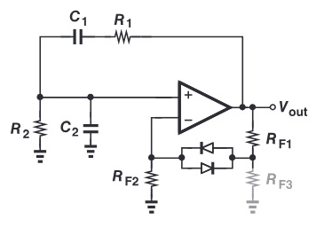

# 장말문제 13.58 — 10 MHz 빈 브리지 발진기 설계

## 원문
Design the Wien bridge oscillator of Fig. 13.28(b) for a frequency of $10\ \text{MHz}$, assume an ideal op amp and $C_1 = C_2 = 1\ \text{nF}$.

## 조건
- 설계 대상: Fig 13.28의 빈 브리지 발진기 (출력 스윙을 제한하는 다이오드가 붙은 형태)
- 원문의 "Fig. 13.28(b)"는 그림과 맞지 않음(오식으로 보임). Fig 13.28에는 패널 글자가 없으므로 Fig 13.28 전체로 봄. 다이오드 없는 빈 브리지 발진기는 본문 Fig 13.27(b)에 있음 (원문에 없음)
- 발진 주파수 $10\ \text{MHz}$
- 이상적인 연산 증폭기
- $C_1 = C_2 = 1\ \text{nF}$
- 공통 가정: $\mu_n C_{ox} = 100\ \mu\text{A/V}^2$, $\mu_p C_{ox} = 50\ \mu\text{A/V}^2$, $\lambda_n = 0.1\ \text{V}^{-1}$, $\lambda_p = 0.2\ \text{V}^{-1}$, $V_{THN} = 0.3\ \text{V}$, $V_{THP} = -0.35\ \text{V}$ (원문의 Design Problems 머리말)
- 머리말의 "$\lambda_n = 0.5\ \lambda_p = 0.1\ \text{V}^{-1}$"은 쉼표 없이 인쇄됨. "$\mu_n C_{ox} = 2\mu_p C_{ox}$"와 같은 꼴로 $\lambda_n = 0.5\lambda_p = 0.1\ \text{V}^{-1}$로 읽음 (원문에 없음)
- 식 (13.43): $R_1 = R_2 = R$, $C_1 = C_2 = C$일 때 RC 네트워크의 위상이 0이 되는 주파수 $\omega_1 = \dfrac{1}{RC}$ (본문 식, 원문에 없음)
- 식 (13.45): $\omega_1$에서 스타트업에 필요한 비반전 증폭기 이득 $A = 3$, 곧 $R_{F1} \ge 2R_{F2}$ (본문 식, 원문에 없음)

## 구할 것
- 회로 설계 (정할 값 예: $R_1 = R_2$, $R_{F1}$, $R_{F2}$) (원문에 없음, 원문은 "Design"만 적음)

## 상속·참조
- Design Problems 공통 가정 (원문 머리말을 그대로 옮김, 문제에 따로 적힌 값이 우선): In the following problems, unless otherwise stated, assume $\mu_n C_{ox} = 2\mu_p C_{ox} = 100\ \mu\text{A/V}^2$, $\lambda_n = 0.5\ \lambda_p = 0.1\ \text{V}^{-1}$, $V_{THN} = 0.3\ \text{V}$, and $V_{THP} = -0.35\ \text{V}$.
  - 해석: $\mu_n C_{ox} = 100\ \mu\text{A/V}^2$, $\mu_p C_{ox} = 50\ \mu\text{A/V}^2$. "$\lambda_n = 0.5\ \lambda_p = 0.1$"은 쉼표 없이 인쇄돼 있어 같은 머리말의 "$\mu_n C_{ox} = 2\mu_p C_{ox} = 100$"과 같은 꼴, 곧 $\lambda_n = 0.5\lambda_p = 0.1\ \text{V}^{-1}$로 읽어 $\lambda_n = 0.1\ \text{V}^{-1}$, $\lambda_p = 0.2\ \text{V}^{-1}$로 봄 ("$\lambda_n = 0.5$, $\lambda_p = 0.1$"로 읽을 수도 있음)
- 공통 가정은 MOS 값뿐이고, 이 문제는 이상적인 연산 증폭기와 RC 소자, 다이오드만 씀
- 본문 13.5절 빈 브리지 해석 ($R_1 = R_2 = R$, $C_1 = C_2 = C$, Fig 13.27(a) 네트워크):
  - 식 (13.41): $\dfrac{V_{out}}{V_{in}}(s) = \dfrac{RCs}{R^2C^2s^2 + 3RCs + 1}$
  - 식 (13.43): 위상이 0이 되는 주파수 $\omega_1 = 1/(RC)$
  - 식 (13.44)–(13.45): 비반전 증폭기 이득을 $A$라 하면 $\omega_1$에서 $A = 3$, 곧 $R_{F1} \ge 2R_{F2}$
- 본문 Fig 13.28 설명: $|V_{out}|$이 $V_{D,on}$을 넘으면 강한 피드백을 만들도록 $R_{F1}$과 직렬로 서로 반대 방향인 다이오드 두 개를 병렬로 넣음. 더 큰 진폭이 필요하면 $V_{out}$을 분배해 다이오드에 걸도록 저항 $R_{F3}$을 추가할 수 있음(그림에서 회색)

## 회로 — Fig 13.28
```spice
C1   n1    n2    {C_1}
R1   n2    Vout  {R_1}
R2   n1    0     {R_2}
C2   n1    0     {C_2}
XA1  n1    n3    Vout  opamp
RF1  Vout  n4    {R_F1}
D1   n4    n3    ; 위 다이오드 (애노드 오른쪽, 캐소드 왼쪽)
D2   n3    n4    ; 아래 다이오드 (애노드 왼쪽, 캐소드 오른쪽)
RF2  n3    0     {R_F2}
RF3  n4    0     {R_F3}   ; 회색으로 그려짐 (선택 소자)
```
- 단자: Vout = 출력 (개방 원)
- 표시: 노드 라벨 V_out (개방 원 오른쪽) / 소자 라벨 C1, R1 (각 소자 위), R2 (저항 왼쪽), C2 (커패시터 왼쪽), R_F1 (저항 오른쪽), R_F2 (저항 왼쪽), R_F3 (저항 오른쪽, 회색), 다이오드 두 개 (라벨 없음) / 부호 연산 증폭기 입력 "+" 위, "−" 아래 / 화살표 없음 / 수치·면적 라벨 없음
- 배치: 연산 증폭기는 가운데 오른쪽, 출력이 오른쪽 / 위쪽 귀환 경로: 왼쪽 세로선 위 끝에서 가로선이 오른쪽으로 C1, R1을 지나 오른쪽 끝에서 아래로 꺾여 출력 접속점 / 왼쪽 세로선 아래 끝이 n1 접속점, n1에서 R2가 아래로 접지, 오른쪽 가로선에 C2 접속점(C2 아래로 접지), 계속 오른쪽으로 + 입력 / − 입력에서 가로선이 왼쪽으로 가서 아래로 꺾여 n3 접속점, n3에서 R_F2 아래로 접지 / n3에서 오른쪽으로 가로선이 다이오드 병렬 쌍의 왼쪽 접속점, 위 가지 다이오드는 삼각형이 왼쪽을 향함, 아래 가지 다이오드는 삼각형이 오른쪽을 향함, 쌍의 오른쪽 접속점에서 가로선이 n4 접속점 / 출력: 연산 증폭기 출력 접속점 → 오른쪽 접속점(R_F1이 아래로) → 개방 원 V_out / R_F1 아래 끝이 n4, n4에서 회색 R_F3이 아래로 회색 접지 / 접속점 (세 갈래 이상, 8곳): ① n1 = 위 귀환선 + 아래 R2 + 오른쪽 가로선 (점) ② C2 위 (점) ③ 연산 증폭기 출력 = 출력 + 위 귀환선 + 오른쪽 출력선 (점) ④ R_F1 위 = 왼쪽 출력선 + 아래 R_F1 + 오른쪽 V_out (점) ⑤ n3 = 위 − 입력선 + 아래 R_F2 + 오른쪽 다이오드 쪽 선 (점) ⑥ 다이오드 쌍 왼쪽 갈림 (점) ⑦ 다이오드 쌍 오른쪽 모임 (점) ⑧ n4 = 위 R_F1 + 아래 R_F3 + 왼쪽 다이오드 쪽 선 (점) / 교차: 없음


