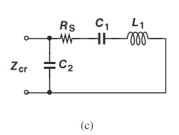
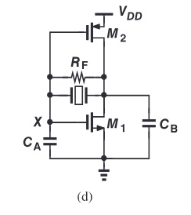

# 장말문제 13.59 — 크리스털 모델 값과 인버터 기반 크리스털 발진기 설계

## 원문
(a) A crystal with a parallel resonance frequency at $10\ \text{MHz}$ has $C_2 = 100\ \text{pF}$, $C_1 = 10\ \text{pF}$ [Fig. 13.30(c)]. Determine the value of $L_1$.

(b) Suppose the crystal series resistance is equal to $5\ \Omega$. Design the oscillator of Fig. 13.34(d) for a frequency of $10\ \text{MHz}$. Neglect the transistor capacitances and assume $C_A = C_B = 20\ \text{pF}$, $(W/L)_2 = 2(W/L)_1$, and $V_{DD} = 1.2\ \text{V}$.

## 조건
- (a) 크리스털 모델: Fig 13.30(c)
- (a) 병렬 공진 주파수 $10\ \text{MHz}$, $C_2 = 100\ \text{pF}$, $C_1 = 10\ \text{pF}$
- 식 (13.48): 병렬 공진 주파수 $\omega_2 = \dfrac{1}{\sqrt{L_1 \dfrac{C_1 C_2}{C_1 + C_2}}}$ ($R_S$ 무시) (본문 식, 원문에 없음)
- (b) 크리스털 직렬 저항 $R_S = 5\ \Omega$ (크리스털의 나머지 값은 (a)와 같다고 봄) (괄호 안은 원문에 없음)
- (b) 설계 대상: Fig 13.34(d)의 인버터 기반 크리스털 발진기, 발진 주파수 $10\ \text{MHz}$
- (b) 트랜지스터 커패시턴스 무시, $C_A = C_B = 20\ \text{pF}$, $(W/L)_2 = 2(W/L)_1$, $V_{DD} = 1.2\ \text{V}$
- 공통 가정: $\mu_n C_{ox} = 100\ \mu\text{A/V}^2$, $\mu_p C_{ox} = 50\ \mu\text{A/V}^2$, $\lambda_n = 0.1\ \text{V}^{-1}$, $\lambda_p = 0.2\ \text{V}^{-1}$, $V_{THN} = 0.3\ \text{V}$, $V_{THP} = -0.35\ \text{V}$ (원문의 Design Problems 머리말)
- 머리말의 "$\lambda_n = 0.5\ \lambda_p = 0.1\ \text{V}^{-1}$"은 쉼표 없이 인쇄됨. "$\mu_n C_{ox} = 2\mu_p C_{ox}$"와 같은 꼴로 $\lambda_n = 0.5\lambda_p = 0.1\ \text{V}^{-1}$로 읽음 (원문에 없음)
- 식 (13.58): 크리스털의 병렬 공진 주파수에서 발진하기 위한 조건 $L_1 C_1 \omega^2 - 1 \le g_m R_S \dfrac{C_1 C_2}{C_A C_B}$ (본문 식, 원문에 없음)
- Fig 13.34(d)에서 $M_1$과 $M_2$는 소신호에서 병렬이 되어 전체 트랜스컨덕턴스 $g_{m1} + g_{m2}$를 제공 (본문 설명, 원문에 없음)

## 구할 것
- (a) $L_1$의 값
- (b) Fig 13.34(d) 발진기 설계 (정할 값 예: $M_1$, $M_2$의 $W/L$, 바이어스 전류, $R_F$) (괄호 안은 원문에 없음)

## 상속·참조
- Design Problems 공통 가정 (원문 머리말을 그대로 옮김, 문제에 따로 적힌 값이 우선): In the following problems, unless otherwise stated, assume $\mu_n C_{ox} = 2\mu_p C_{ox} = 100\ \mu\text{A/V}^2$, $\lambda_n = 0.5\ \lambda_p = 0.1\ \text{V}^{-1}$, $V_{THN} = 0.3\ \text{V}$, and $V_{THP} = -0.35\ \text{V}$.
  - 해석: $\mu_n C_{ox} = 100\ \mu\text{A/V}^2$, $\mu_p C_{ox} = 50\ \mu\text{A/V}^2$. "$\lambda_n = 0.5\ \lambda_p = 0.1$"은 쉼표 없이 인쇄돼 있어 같은 머리말의 "$\mu_n C_{ox} = 2\mu_p C_{ox} = 100$"과 같은 꼴, 곧 $\lambda_n = 0.5\lambda_p = 0.1\ \text{V}^{-1}$로 읽어 $\lambda_n = 0.1\ \text{V}^{-1}$, $\lambda_p = 0.2\ \text{V}^{-1}$로 봄 ("$\lambda_n = 0.5$, $\lambda_p = 0.1$"로 읽을 수도 있음)
- 본문 13.6.1절 크리스털 모델 (Fig 13.30(c)): 직렬 가지 $R_S$, $C_1$, $L_1$에 $C_2$가 병렬. $R_S$를 무시하면 $Z_{cr}(j\omega) \approx \dfrac{1 - L_1 C_1 \omega^2}{j\omega(C_1 + C_2 - L_1 C_1 C_2 \omega^2)}$ (식 13.47), 병렬 공진 주파수는 식 (13.48)
- 본문 13.6.3절 (Fig 13.33, 식 13.58): 음의 저항 회로에 크리스털을 붙인 발진기는 식 (13.58)이 성립하면 크리스털의 병렬 공진 주파수에서 발진. 전형적인 설계에서 $C_A$, $C_B$는 $C_2$보다 10–20배 작게 고름
- 본문 Fig 13.34 설명: (b)는 피드백 저항 $R_F$로 '셀프-바이어스'를 만들고, $R_F$가 손실에 주는 영향을 무시하려면 매우 큰 값(수십 kΩ)을 씀. (c)는 $R_D$를 전류원으로 바꾸고, (d)는 그 전류원 게이트를 노드 $X$에 이어 증폭 소자로 바꿈. (d)에서 발진 전에 두 트랜지스터는 포화 영역에 바이어스되고, 소신호에서 $M_1$과 $M_2$가 병렬로 $g_{m1} + g_{m2}$를 제공하며, $M_1$과 $M_2$는 트립 지점에 바이어스된 CMOS 인버터로 볼 수 있음

## 회로 — Fig 13.30(c)
```spice
C2  out1  out2  {C_2}
RS  out1  n1    {R_S}
C1  n1    n2    {C_1}
L1  n2    out2  {L_1}
```
- 단자: out1, out2 = Z_cr 측정 단자 (개방 원, out1 위, out2 아래)
- 표시: 노드 라벨 없음 / 소자 라벨 R_S, C_1, L_1 (각 소자 위), C_2 (커패시터 오른쪽) / 부호 없음 / 화살표 없음 / 수치·면적 라벨 Z_cr (두 개방 원 사이 왼쪽)
- 배치: 위 개방 원에서 가로선이 오른쪽으로 접속점을 지나 R_S, C_1, L_1을 차례로 지나고 오른쪽 끝에서 아래로 꺾여 아래 가로선, 아래 가로선이 왼쪽 접속점을 지나 아래 개방 원 / C2는 두 접속점 사이 세로 / 접속점 (세 갈래 이상, 2곳): ① out1 = 왼쪽 개방 원 선 + 오른쪽 R_S + 아래 C2 (점) ② out2 = 왼쪽 개방 원 선 + 오른쪽 아래 가로선 + 위 C2 (점) / 접지 없음 / 교차: 없음



## 회로 — Fig 13.34(d)
```spice
M2   n1  X   VDD  pmos
M1   n1  X   0    nmos
RF   X   n1  {R_F}
XCR  X   n1  box "crystal"
CA   X   0   {C_A}
CB   n1  0   {C_B}
```
- 단자: VDD = 전원, 값 미지정 (T 전원 기호)
- 표시: 노드 라벨 V_DD (T 기호 오른쪽), X (게이트 쪽 세로선 접속점 왼쪽) / 소자 라벨 M2 (PMOS 오른쪽), M1 (NMOS 오른쪽), R_F (저항 위), C_A (커패시터 왼쪽), C_B (커패시터 오른쪽), 크리스털 (라벨 없음) / 부호 없음 / 화살표 없음 / 수치·면적 라벨 없음
- 배치: 오른쪽 세로줄 위→아래 V_DD T 기호, M2(PMOS, 소스 위, 게이트 왼쪽), R_F 오른쪽 접속점, 크리스털 오른쪽 접속점, M1(NMOS, 게이트 왼쪽, 소스 아래), 접지 접속점, 접지 / 두 트랜지스터 모두 바디 없는 3단자 기호 / 왼쪽 세로선: M2 게이트에서 왼쪽으로 나와 아래로 내려가며 R_F 왼쪽 접속점, 크리스털 왼쪽 접속점, X 접속점(오른쪽 가로선이 M1 게이트)을 지나 C_A, 아래 가로선 / R_F와 크리스털(가로로 누운 기호)은 두 세로선 사이에 위아래로 나란히 / 크리스털 오른쪽 접속점에서 가로선이 오른쪽으로 가서 아래로 꺾여 C_B, 아래 가로선 / 아래 가로선이 C_A 아래, M1 소스, C_B 아래를 잇고 가운데 접속점에서 접지 / 접속점 (세 갈래 이상, 6곳): ① 왼쪽 R_F 끝 (점) ② 왼쪽 크리스털 끝 (점) ③ X = 위 세로선 + 아래 C_A + 오른쪽 M1 게이트선 (점) ④ 오른쪽 R_F 끝 = 위 M2 드레인 + 왼쪽 R_F + 아래 세로선 (점) ⑤ 오른쪽 크리스털 끝 = 위 세로선 + 왼쪽 크리스털 + 아래 M1 드레인 + 오른쪽 C_B 가는 선 (점) ⑥ 아래 가로선의 M1 소스 = 왼쪽 C_A 아랫선 + 위 M1 소스 + 오른쪽 C_B 아랫선 + 아래 접지 (점) / 교차: 없음


