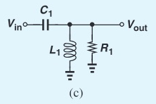

# 연습문제 15.4 — RLC 필터에서 인덕터와 커패시터를 맞바꾼 경우

## 조건
- Fig 15.12(c)의 $C_1$과 $L_1$의 위치를 교환한다.
- 교환 뒤 $L_1$이 입력과 출력 사이에 있고, $C_1$과 $R_1$은 각각 출력과 접지 사이에 놓인다. (원문에 없음)

## 구할 것
- 바뀐 회로의 극점과 영점을 복소평면에 그린다.

## 상속·참조
- 예제 15.4의 세 회로 중 Fig 15.12(c)만 사용한다. 원래 직렬 소자는 $C_1$, 접지로 향하는 병렬 가지는 $L_1$과 $R_1$이다. 위치를 교환한 뒤에도 출력은 병렬 부하 양단에서 측정한다.

## 회로 — Fig 15.12(c)
```spice
C1  Vin   Vout  {C_1}
L1  Vout  0     {L_1}
R1  Vout  0     {R_1}
```
- 단자: Vin = 입력 (개방 원) / Vout = 출력 (개방 원)
- 표시: 노드 라벨 V_in, V_out / 소자 라벨 C_1 (가로 커패시터 위), L_1 (인덕터 왼쪽), R_1 (저항 오른쪽) / 부호 없음 / 화살표 없음 / 수치·면적 라벨 없음
- 배치: 입력에서 오른쪽으로 C_1을 지나 출력까지 가로선이 이어진다. 그 선에서 왼쪽 L_1 가지(점), 오른쪽 R_1 가지(점)가 차례로 아래로 갈라져 각각 접지된다. 교차: 없음


> 참고: 교재 818쪽(PDF 8)의 Fig 15.12(c)와 넷리스트는 소자를 맞바꾸기 전의 원본 회로다.
