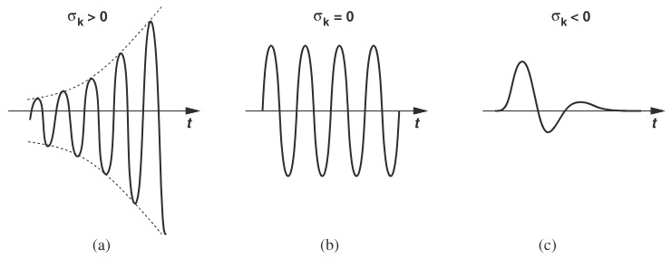

# 연습문제 15.5 — 진동 각주파수를 두 배로 바꾼 임펄스 응답

## 조건
- Fig 15.14(a)–(c)에서 $\omega_k$를 두 배로 바꾼다.
- 예제 15.5의 응답 성분은 $e^{\sigma_kt}e^{j\omega_kt}$이며, $\sigma_k$는 각각 양수, 0, 음수이다. (원문에 없음)

## 구할 것
- 세 경우의 시간 파형을 다시 그린다.

## 상속·참조
- 예제 15.5에서는 극점 실수부 $\sigma_k$가 진폭의 시간 변화를, 허수부 $\omega_k$가 진동 각주파수를 결정한다.
- Fig 15.14의 세 그래프는 모두 가로축이 시간 $t$이다. (a) $\sigma_k>0$에서는 점선 포락선 사이에서 진동의 진폭이 커지고, (b) $\sigma_k=0$에서는 일정한 진폭으로 진동한다. (c) $\sigma_k<0$에서는 진폭이 줄어들어 시간축에 가까워진다.

## 회로 — 없음 (임펄스 응답 파형 문제)
