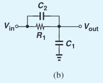

# 연습문제 15.7 — 영점과 극점이 있는 RC 회로에서 극점 주파수의 감도

## 조건
- Fig 15.12(b)에서 $R_1$의 변화에 따른 극점 주파수를 다룬다.
- 식 (15.4)의 전달 함수는 $H_b(s)=(R_1C_2s+1)/[R_1(C_1+C_2)s+1]$이다. (본문 식, 원문에 없음)
- 식 (15.11)의 감도 정의는 $S_C^P=(dP/P)/(dC/C)$이다. (본문 식, 원문에 없음)

## 구할 것
- $R_1$에 대한 극점 주파수의 감도를 구한다.

## 상속·참조
- 예제 15.7처럼 식 (15.11)의 상대 변화 비를 사용한다. Fig 15.12(b)의 극점 각주파수 크기는 식 (15.4)의 분모에서 $1/[R_1(C_1+C_2)]$이다.

## 회로 — Fig 15.12(b)
```spice
R1  Vin   Vout  {R_1}
C2  Vin   Vout  {C_2}
C1  Vout  0     {C_1}
```
- 단자: Vin = 입력 (개방 원) / Vout = 출력 (개방 원)
- 표시: 노드 라벨 V_in, V_out / 소자 라벨 R_1 (저항 아래), C_2 (위쪽 가로 커패시터 위), C_1 (오른쪽 세로 커패시터 옆) / 부호 없음 / 화살표 없음 / 수치·면적 라벨 없음
- 배치: 입력과 출력 사이의 가로 저항 양끝에서 위로 올라간 선을 C_2가 잇는다. 출력 쪽에서 아래로 C_1과 접지가 이어진다. 저항 왼쪽은 입력·저항·위쪽 선의 분기(점), 오른쪽은 저항·출력·위쪽 선·아래쪽 선의 분기(점)이다. 교차: 없음


> 참고: Fig 15.12(b)는 교재 818쪽(PDF 8)에 있다.
