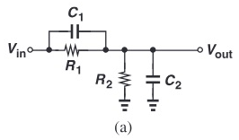

# 연습문제 15.8 — 극점과 영점 주파수가 지정된 수동 고역통과 필터 설계

## 조건
- 영점 주파수 $f_z=50\ \mathrm{MHz}$, 극점 주파수 $f_p=100\ \mathrm{MHz}$인 고역통과 필터를 설계한다.
- 각 커패시터의 값은 $10\ \mathrm{pF}$ 이하여야 한다.
- 예제 15.8의 두 병렬 RC 가지 분배기에서 $\omega_z=1/(R_1C_1)$, $\omega_p=1/[(C_1+C_2)(R_1\parallel R_2)]$이다. (원문에 없음)

## 구할 것
- 요구 조건을 만족하는 회로를 설계한다 (정할 값 예: $R_1,R_2,C_1,C_2$). (괄호 안은 원문에 없음)

## 상속·참조
- Fig 15.17(a)의 수동 회로에서 저주파 이득은 $R_2/(R_1+R_2)$, 고주파 이득은 $C_1/(C_1+C_2)$이다. $R_2C_2<R_1C_1$이면 영점이 극점보다 낮다.

## 회로 — Fig 15.17(a)
```spice
R1  Vin   Vout  {R_1}
C1  Vin   Vout  {C_1}
R2  Vout  0     {R_2}
C2  Vout  0     {C_2}
```
- 단자: Vin = 입력 (개방 원) / Vout = 출력 (개방 원)
- 표시: 노드 라벨 V_in, V_out / 소자 라벨 R_1, C_1, R_2, C_2 / 부호 없음 / 화살표 없음 / 수치·면적 라벨 없음
- 배치: 왼쪽 입력에서 오른쪽 출력으로 가는 가로선에 R_1이 있다. 양끝 분기(각각 점)에서 위쪽 C_1로 선을 올린다. R_1 오른쪽 가로선에서 왼쪽 R_2와 오른쪽 C_2가 각각 아래로 갈라져(각각 점) 따로 접지된다. 교차: 없음


