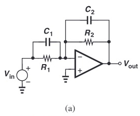

# 연습문제 15.9 — 통과대역 이득비와 극점·영점 주파수비

## 조건
- 통과대역 이득의 크기는 저지대역 이득 크기의 10배이다.
- 예제 15.9의 이상적 반전 RC 필터는 $H(s)=-\dfrac{R_2}{R_1}\dfrac{1+R_1C_1s}{1+R_2C_2s}$를 따른다. (원문에 없음)

## 구할 것
- 극점 주파수가 영점 주파수의 5배가 될 수 있는지 판단한다.

## 상속·참조
- Fig 15.18(a)는 입력 $R_1\parallel C_1$과 되먹임 $R_2\parallel C_2$를 갖는다. 이상적 연산증폭기 근사에서 저주파 및 고주파의 이득 크기는 각각 $R_2/R_1$, $C_1/C_2$이다.

## 회로 — Fig 15.18(a)
```spice
VIN  Vin  0     {V_in}
R1   Vin  n1    {R_1}
C1   Vin  n1    {C_1}
R2   n1   Vout  {R_2}
C2   n1   Vout  {C_2}
XA   0    n1    Vout  opamp
```
- 단자: Vout = 출력 (개방 원) / Vin = 접지 기준 입력 전압원의 양단 전압
- 표시: 노드 라벨 V_out / 소자 라벨 V_in, R_1, C_1, R_2, C_2, XA (라벨 없음) / 부호 전압원 오른쪽 위 +, 아래 −, 연산증폭기 왼쪽 위 −, 아래 + / 화살표 없음 / 수치·면적 라벨 없음
- 배치: 왼쪽 접지 전압원 위에서 가로 R_1을 거쳐 반전 입력으로 간다. R_1 양끝 분기(각각 점)에서 위쪽 C_1로 연결한다. 그 오른쪽 반전 입력선의 분기(점)에서 위로 올라가 R_2 왼쪽 끝(점)을 거쳐 C_2로 이어진다. R_2는 가운데, C_2는 그 위에서 가로로 되먹임된다. 오른쪽 공통선은 R_2 오른쪽 끝(점)과 연산증폭기 출력선(점)을 연결한다. 비반전 입력은 왼쪽 접지에 연결된다. 교차: 없음


