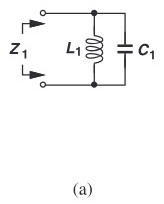

# 연습문제 15.13 — 병렬 LC 탱크가 원점에서 보이는 영점

## 조건
- 예제 15.13의 병렬 탱크에서 $L_1$과 $C_1$ 사이의 두 공통 단자에서 임피던스를 본다. (원문에 없음)

## 구할 것
- 원점에서 임피던스가 0이 되는 이유를 설명한다.

## 상속·참조
- Fig 15.25(a)에서 두 소자는 같은 두 단자에 걸려 있다. 원점은 $s=0$에 해당한다.

## 회로 — Fig 15.25(a)
```spice
L1  out1  out2  {L_1}
C1  out1  out2  {C_1}
```
- 단자: out1, out2 = 각각 위·아래 임피던스 측정 단자 (개방 원)
- 표시: 노드 라벨 없음 / 소자 라벨 L_1, C_1 / 부호 없음 / 화살표 "Z_1": 두 측정선 왼쪽에서 각 선 옆으로 오른쪽을 가리키는 한 쌍, 도선 옆 별도 화살표 (위쪽은 L자를 위아래 반전, 아래쪽은 L자) / 수치·면적 라벨 없음
- 배치: 왼쪽 위·아래의 개방 원에서 오른쪽으로 평행한 선이 뻗는다. L_1이 중간에 세로로 연결되며 위·아래 분기에 각각 점이 있다. C_1은 오른쪽 끝에서 두 선을 세로로 잇는다. 교차: 없음


> 참고: Fig 15.25(a)는 교재 829쪽(PDF 19)에 있다.
