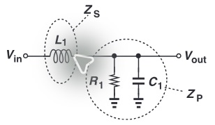

# 연습문제 15.14 — RLC 저역통과 필터의 피크 주파수와 LC 고유 주파수에서의 이득

## 조건
- 예제 15.14의 식 (15.47)은 $H(s)=V_{out}/V_{in}=R_1/(R_1C_1L_1s^2+L_1s+R_1)$이다. (원문에 없음)
- $Q>1/\sqrt2$에서 $\omega_a^2=1/(L_1C_1)-1/(2R_1^2C_1^2)$로 피크의 주파수를 정한다. (원문에 없음)

## 구할 것
- $\omega_a$와 $1/\sqrt{L_1C_1}$에서 각각의 이득을 비교한다.

## 상속·참조
- 예제 15.14의 수동 저역통과 회로를 사용한다. 식 (15.50)의 $\omega_a$에서는 식 (15.47)의 분모 크기가 최소이다.

## 회로 — Fig 15.29
```spice
L1  Vin   Vout  {L_1}
R1  Vout  0     {R_1}
C1  Vout  0     {C_1}
```
- 단자: Vin = 입력 (개방 원) / Vout = 출력 (개방 원)
- 표시: 노드 라벨 V_in, V_out / 소자 라벨 L_1, R_1, C_1, 점선 테두리의 임피던스 Z_S 및 Z_P / 부호 없음 / 화살표 없음 / 수치·면적 라벨 없음
- 배치: 입력에서 오른쪽으로 가로 L_1을 거쳐 출력에 닿는다. L_1 오른쪽 선에서 왼쪽 R_1과 오른쪽 C_1이 각각 아래로 갈라져(각각 점) 따로 접지된다. 점선 타원이 L_1을 Z_S로, 두 접지 가지를 Z_P로 묶는다. 교차: 없음


> 참고: Fig 15.29는 교재 832쪽(PDF 22)에 있다.
