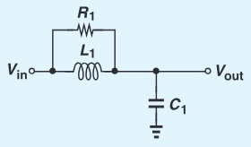

# 연습문제 15.15 — 병렬 RL 입력 회로에서 L과 C를 맞바꿀 때의 응답

## 조건
- Fig 15.30의 $L_1$과 $C_1$의 위치를 바꾼다.
- 교환 뒤 입력과 출력 사이에는 $R_1$과 $C_1$이 병렬이고 출력과 접지 사이에 $L_1$이 연결된다. (원문에 없음)

## 구할 것
- 교환 뒤의 주파수 응답 유형을 판별한다.

## 상속·참조
- 예제 15.15의 Fig 15.30에서 직렬 경로는 $R_1\parallel L_1$, 출력의 접지 가지는 $C_1$이다. 교환 대상은 저항을 제외한 두 소자이다.

## 회로 — Fig 15.30
```spice
R1  Vin   Vout  {R_1}
L1  Vin   Vout  {L_1}
C1  Vout  0     {C_1}
```
- 단자: Vin = 입력 (개방 원) / Vout = 출력 (개방 원)
- 표시: 노드 라벨 V_in, V_out / 소자 라벨 R_1, L_1, C_1 / 부호 없음 / 화살표 없음 / 수치·면적 라벨 없음
- 배치: 입력에서 출력으로 가는 가로선에 L_1이 있고 그 양끝 분기(각각 점)에서 위로 R_1이 병렬 연결된다. 그 오른쪽 출력선에서 C_1이 아래로 갈라져(점) 접지된다. 교차: 없음


> 참고: 그림과 넷리스트는 위치를 교환하기 전의 회로이다.
