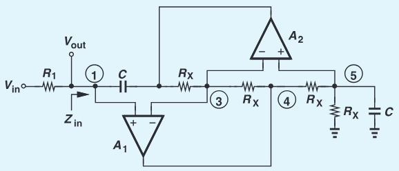

# 연습문제 15.23 — 대안 변환기 회로의 입력에서 노드 5까지 전달 함수

## 조건
- Fig 15.45의 입력과 변환기 노드 5를 사용한다.
- 예제 15.23에서 $Z_3=R_X$, $Z_5=R_X\parallel1/(Cs)$이다. (원문에 없음)

## 구할 것
- $V_{in}$에서 $V_5$까지의 전달 함수를 구한다.

## 상속·참조
- 예제 15.23의 노드 5에서 저항 $R_X$와 커패시터 $C$가 각각 접지된다. 이상적 연산증폭기의 두 입력 전압은 같다.

## 회로 — Fig 15.45
```spice
R1   Vin   Vout  {R_1}
CI   Vout  n1    {C}
RX2  n1    3     {R_X}
RX3  3     4     {R_X}
RX4  4     5     {R_X}
RX5  5     0     {R_X}
CP   5     0     {C}
XA1  Vout  3     4  opamp
XA2  5     3     n1  opamp
* Vout = 노드 1
```
- 단자: Vin = 입력 (개방 원) / Vout = 출력 (개방 원)
- 표시: 노드 라벨 V_in, V_out, 동그라미 속 1, 3, 4, 5 (A_2 출력의 접속점에는 2가 인쇄되지 않음) / 소자 라벨 R_1, C 두 곳, R_X 네 곳, A_1, A_2 / 부호 A_1의 위쪽 입력은 왼쪽 +, 오른쪽 −, A_2의 아래쪽 입력은 왼쪽 −, 오른쪽 + / 화살표 "Z_in": 노드 1에서 오른쪽으로 변환기를 바라보며 도선 옆 별도 화살표 (┌ 꺾임) / 수치·면적 라벨 없음
- 배치: 입력에서 R_1을 지나 V_out 원으로 선이 위로 갈라지고(점), 계속 오른쪽으로 노드 1의 접속점, C, R_X 세 개를 거쳐 노드 5에 닿는다. 5에서 네 번째 R_X가 접지된다. 아래쪽 A_1은 1·3에서 입력을 받고 4로 되돌아간다. 위쪽 A_2는 3·5에서 입력을 받고 2로 되돌아간다. 다섯 번호 위치 모두 접속점(점)이다. 5 오른쪽의 커패시터 C는 네 번째 R_X와 병렬로 접지된다. 교차: 없음


