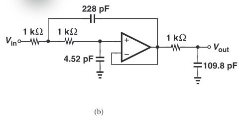

# 연습문제 15.25 — 228 pF 커패시터 오차에 따른 통과대역 끝 주파수 오차

## 조건
- Fig 15.50(b)에서 $228\ \mathrm{pF}$로 인쇄된 커패시터에 $10\%$ 오차가 생긴다.
- 예제 15.24–15.25에서 목표 $f_1$은 $1\ \mathrm{MHz}$이며, 통과대역 끝의 기준은 $0.45\ \mathrm{dB}$ 감쇠이다. (원문에 없음)
- Fig 15.50(b)의 첫 단 그림에는 $228\ \mathrm{pF}$와 $4.52\ \mathrm{pF}$가 인쇄되어 있다. 예제 풀이 본문은 $C_1=4C_2$, $C_2=54.9\ \mathrm{pF}$로 적어 그림과 다르다. 연습문제는 변화시킬 값을 $228\ \mathrm{pF}$로 명시한다. (원문에 없음)

## 구할 것
- $f_1$ 값의 오차를 구한다.

## 상속·참조
- 예제 15.25의 단위 이득 SK 단과 1차 RC 단의 직렬 연결이다. 첫 단 피드백 커패시터가 오차 대상이며, 뒤쪽 $1\ \mathrm{k}\Omega$ 및 $109.8\ \mathrm{pF}$ RC 단은 유지한다.

## 회로 — Fig 15.50(b)
```spice
R1  Vin  n1   1k
R2  n1   n2   1k
C1  n1   n3   228p
C2  n2   0    4.52p
XA  n2   n3   n3   opamp
R3  n3   Vout 1k
C3  Vout 0    109.8p
```
- 단자: Vin = 입력 (개방 원) / Vout = 출력 (개방 원)
- 표시: 노드 라벨 V_in, V_out / 소자 라벨 저항·커패시터·연산증폭기에 이름 없음 / 부호 각 증폭기 위 +, 아래 − / 화살표 없음 / 수치·면적 라벨 1 kΩ 세 가로 저항, 위 귀환 228 pF, 첫 단 접지 4.52 pF, 맨 오른쪽 접지 109.8 pF
- 배치: 첫 단은 왼쪽 입력에서 가로 저항 두 개를 지나 비반전 입력에 닿는다. 두 저항 중간(점)에서 위의 228 pF를 통해 증폭기 출력(점)에 귀환한다. 둘째 저항 오른쪽(점)에서 4.52 pF를 통해 접지된다. 반전 입력은 아래쪽 경로로 출력에 직접 연결한다. 첫 단 출력에서 세 번째 저항을 지나 최종 출력선 분기(점)에 이르고, 이 점 아래 109.8 pF는 접지된다. 교차: 없음


