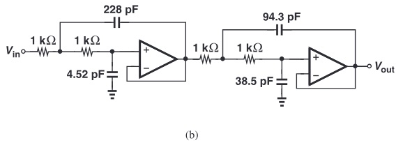

# 연습문제 15.28 — 모든 커패시터가 50 pF를 넘는 두 단 체비셰프 필터 설계

## 조건
- 모든 커패시터 값이 $50\ \mathrm{pF}$보다 커야 한다.
- 예제 15.28처럼 두 SK 단을 사용한다. 사양은 $5\ \mathrm{MHz}$ 통과대역의 리플은 $1\ \mathrm{dB}$, $10\ \mathrm{MHz}$에서 필요한 감쇠는 $30\ \mathrm{dB}$이며 $n=4$, $\epsilon=0.509$이다. (원문에 없음)
- 예제 15.28의 두 켤레 극점쌍은 $f_{n1}=4.965\ \mathrm{MHz}$, $Q_1=3.55$ 및 $f_{n2}=2.64\ \mathrm{MHz}$, $Q_2=0.783$이다. (원문에 없음)

## 구할 것
- 커패시터의 하한을 만족하도록 두 SK 단을 다시 설계한다.

## 상속·참조
- 예제 15.28의 두 단을 직렬로 유지한다. 각 단의 두 저항이 같은 선택에서 커패시터의 비는 첫 단 $C_1/C_2=50.4$, 둘째 단 $C_1/C_2=2.45$였다. 각 단의 고유 각주파수는 $1/\sqrt{R_1R_2C_1C_2}$이다.

## 회로 — Fig 15.53(b)
```spice
R1  Vin  n1   1k
R2  n1   n2   1k
C1  n1   n3   228p
C2  n2   0    4.52p
XA  n2   n3   n3   opamp
R3  n3   n4   1k
R4  n4   n5   1k
C3  n4   Vout 94.3p
C4  n5   0    38.5p
XB  n5   Vout Vout opamp
```
- 단자: Vin = 입력 (개방 원) / Vout = 출력 (개방 원)
- 표시: 노드 라벨 V_in, V_out / 소자 라벨 저항·커패시터·연산증폭기에 이름 없음 / 부호 각 증폭기 위 +, 아래 − / 화살표 없음 / 수치·면적 라벨 1 kΩ 네 가로 저항, 첫 단 귀환 228 pF와 접지 4.52 pF, 둘째 단 귀환 94.3 pF와 접지 38.5 pF
- 배치: 첫 단은 왼쪽 입력에서 가로 저항 두 개를 지나 비반전 입력에 닿는다. 두 저항 중간(점)에서 위의 228 pF를 통해 증폭기 출력(점)에 귀환한다. 둘째 저항 오른쪽(점)에서 4.52 pF를 통해 접지된다. 반전 입력은 아래쪽 경로로 출력에 직접 연결한다. 둘째 단에서도 두 가로 저항 중간(점)에서 위쪽 94.3 pF가 둘째 출력(점)에 이어진다. 비반전 입력선의 분기(점)에서 38.5 pF가 접지되고 반전 입력은 출력으로 되돌아간다. 둘째 출력 오른쪽 끝이 V_out이다. 교차: 없음


> 참고: Fig 15.53은 교재 861쪽(PDF 51)에 있다. 원본 그림과 넷리스트의 값은 변경 전 설계이다.
