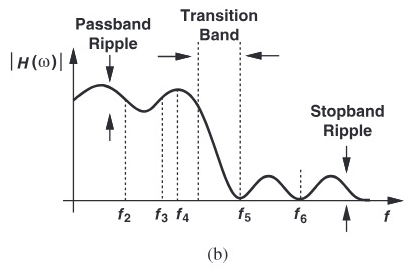
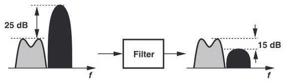

# 예제 15.1 — 인접 채널 간섭에 필요한 저지대역 감쇠

## 조건
- Fig 15.2(b)의 필터 입력에서 인접 채널의 간섭자 전력은 원하는 무선 신호보다 $25\ \mathrm{dB}$ 높다.
- 검출에 필요한 출력 신호 전력은 간섭자보다 $15\ \mathrm{dB}$ 이상 높아야 한다.

## 구할 것
- 필요한 저지대역 감쇠를 구한다.

## 상속·참조
- Fig 15.2(b)는 가로축이 $f$, 세로축이 $|H(\omega)|$인 저역통과 응답이다. 왼쪽 통과대역은 위아래로 흔들리고, 천이대역에서 급격히 낮아져 $f_5$에서 바닥에 닿는다. 이후 저지대역 리플이 나타나며 $f_6$에서 다시 바닥에 닿는다. 세로 점선에는 왼쪽부터 $f_2,f_3,f_4,f_5,f_6$가 표시되어 있다.

> 참고: Fig 15.2(b)는 교재 812쪽(PDF 2)에 있다.

## 회로 — 없음 (주파수 응답 그래프 문제)

## 답 (검증용)
- 저지대역에서 최소 $40\ \mathrm{dB}$의 감쇠가 필요하다.
- Fig 15.3의 두 스펙트럼은 가로축이 $f$이다. 왼쪽에서는 회색 신호의 오른편에 검은 간섭자가 $25\ \mathrm{dB}$ 더 높고, 가운데 Filter 블록을 지난 오른쪽에서는 신호가 간섭자보다 $15\ \mathrm{dB}$ 높다.

